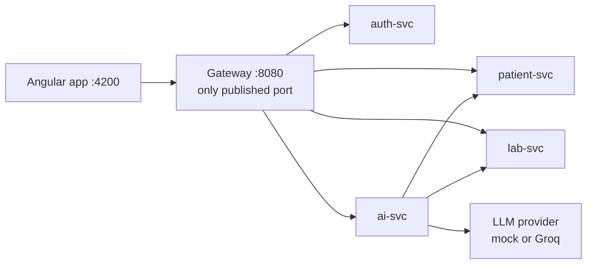

# NephroCare EMR (TyrionEMR)

A General Nephrology EMR built for the technical assignment in [reference/assignment.pdf](reference/assignment.pdf). A nephrologist
can manage patients, record outpatient encounters, enter laboratory results and watch kidney function over time (CKD
category, creatinine and eGFR trends, rapid-decline detection), and can ask for an AI clinical summary that is always
labelled as AI output and never written into the chart.

Four FastAPI services (auth, patient, lab, AI) sit behind a custom API gateway, and an Angular app talks only to the
gateway. All data is synthetic: the ten demo patients, their MRNs and the two demo clinicians are invented, and no real
person's data is in the repository, the fixtures or the screenshots.

## For reviewers

The six submission items of assignment section 5, and where each one is:

| Submission item | Where |
|---|---|
| 1. Complete source code in a Git repository | This repository. Layout: [Repository layout](#repository-layout) |
| 2. README with setup and execution instructions | This file: [Quick start](#quick-start) |
| 3. Database schema and synthetic patient data | [docs/DATABASE.md](docs/DATABASE.md): tables, relationships, the ten patients and what each demonstrates |
| 4. API documentation or endpoint descriptions | [docs/API.md](docs/API.md), with one OpenAPI file per service |
| 5. Architecture and AI integration | [docs/ARCHITECTURE.md](docs/ARCHITECTURE.md) |
| 6. Screenshots | [Screenshots](#screenshots) |

Every requirement in the assignment, with where to see it, the endpoint, the code and the test:
[docs/ASSIGNMENT-CHECKLIST.md](docs/ASSIGNMENT-CHECKLIST.md). How the repository is organised and how AI coding tools were
used: [docs/DEVELOPMENT.md](docs/DEVELOPMENT.md).

## Technology

| Area | Choice |
|---|---|
| Frontend | Angular 22, TypeScript, HTML, SCSS; standalone components and signals; Vitest and Playwright |
| Charts | Chart.js 4 for the laboratory trend charts |
| Backend | Python 3.12, FastAPI, SQLAlchemy (async), Alembic: four services and a custom gateway. The assignment allows any backend; Python was chosen for fast typed development, automatic OpenAPI and async I/O for the slow LLM calls (HLD ADR-013) |
| Database | PostgreSQL, one database and role per service |
| AI | A provider adapter with a deterministic mock (default, no key) and Groq (free tier, `openai/gpt-oss-20b`) |
| Runtime | Docker and Docker Compose |

## Architecture



The gateway verifies the access token, applies rate limits and routes `/api/<prefix>/**`. `/api/internal/**` is never routed.
Each service owns one PostgreSQL database. ai-svc reads patient and lab data over the private network and never writes it.
More: [docs/ARCHITECTURE.md](docs/ARCHITECTURE.md).

## Quick start

Prerequisites: Docker with Compose v2.20 or later (`include:` is used), GNU make and bash (Git Bash on Windows), and a
running Postgres container named `graphgpt-postgres` (the shared server; host port 5433). Python 3.12 is needed only to run
the backend test suites on the host. The frontend runs in Docker only: never run node, npm or ng on the host.

```bash
cp .env.example .env                  # then replace the change-me passwords; each service has its own .env.example
for s in auth-svc patient-svc lab-svc ai-svc; do cp $s/.env.example $s/.env; done   # fill in the DB passwords
make network                          # nephro-net, with graphgpt-postgres attached under the alias "postgres"
make init-dbs                         # prints the role and database commands, runs them only if you type "yes"
make keys                             # auth-svc JWT signing key (skipped when it already exists)
make migrate                          # auth-svc schema (the other three migrate when they start)
make up                               # builds and starts the five containers
make seed                             # demo clinicians, ten patients, lab catalog and results (idempotent)
make smoke                            # 19 end-to-end checks through the gateway
cd frontend && docker compose up -d   # dev server, first start runs npm ci
```

Open <http://localhost:4200> (use `localhost`, not an IP: the refresh cookie is Secure). Demo accounts, password
`Nephro#2026`:

| Email | Name |
|---|---|
| `dr.rao@nephrocare.demo` | Dr. Anita Rao |
| `dr.malhotra@nephrocare.demo` | Dr. Karan Malhotra |

Other targets: `make ps`, `make logs`, `make down`, `make test`, `make docs`, `make docs-check`.
`make init-dbs` changes the shared Postgres container (roles and databases); read the commands it prints first.

### A five-minute demo path

| To see | Do this |
|---|---|
| Patient listing and search | Sign in, open Patients, search `Kulkarni` or `PT-000101`; try the stage filter and the Needs attention filter |
| The dashboard worklist | Open Dashboard: needs-attention rows, eGFR categories, abnormal results, follow-ups, drafts |
| Demographics, history, comorbidities, medications and allergies | Open Ramesh Kulkarni (PT-000101) and visit the Overview, Conditions and Medications tabs |
| Kidney function monitoring | On PT-000101, Overview shows eGFR and creatinine charts with trend chips; PT-000106 (Lakshmi Iyer) shows the established-stage mismatch chip |
| Abnormal values | PT-000109 (Aditya Singh) has a critical potassium; the flag is text and an arrow, not colour alone |
| Laboratory entry in another unit | On PT-000101 choose Add lab report, set creatinine to µmol/L and watch the live conversion and flag |
| Encounters | On PT-000101 choose New encounter, save a draft, reopen it, then finalise it (it becomes read-only) |
| The AI summary | On any patient with data (for example PT-000104, Fatima Sheikh) open the AI summary tab and generate one; click a source chip; use the demo options to see the degraded and failed states |
| Missing information | PT-000108 (Priya Nair) has an almost empty chart; PT-000107 (Mohan Das) has had no labs for 230 days |

## AI provider

The default provider is the deterministic mock, so the stack needs no API key. With `APP_ENV=dev` the AI tab's demo options
send `X-Mock-Scenario` (the gateway forwards it only outside production). To use Groq, set `LLM_PROVIDER=groq` and
`LLM_API_KEY` (or `LLM_API_KEY_FILE`) in `ai-svc/.env`, then `docker compose up -d ai-svc`. How the AI pipeline works and what
it guards against: [docs/ARCHITECTURE.md](docs/ARCHITECTURE.md#ai-integration).

## Tests

| Suite | Command | Last recorded result |
|---|---|---|
| auth-svc | `make -C auth-svc test` | 284 passed |
| patient-svc | `make -C patient-svc test` | 230 passed |
| lab-svc | `make -C lab-svc test` | 328 passed |
| ai-svc | `make -C ai-svc test` | 388 passed, 1 skipped (the opt-in live Groq test) |
| gateway | `make -C gateway test` | 457 passed |
| All backend suites | `make test` | stops at the first failure |
| Running stack | `make smoke` | 19 of 19 checks |
| Frontend unit | `docker compose -f frontend/compose.yaml exec web npx ng test --watch=false` | 136 test cases in 26 spec files, run by folder |
| Frontend end to end | `docker compose -f frontend/compose.yaml --profile tools run --rm flow` | The flow, tooltip and screenshot specs |

The backend suites need each service's virtual environment (`make install`) and its test database, and run with
`REQUIRE_DB_TESTS=1` so a missing database fails instead of skipping. "Last recorded" are the counts of the most recent full
runs during development; run the commands to reproduce them. `make -C ai-svc capture-fixtures` records real upstream
responses for ai-svc's contract tests (the stack must be up and seeded).

## Screenshots

Taken from the running stack with the seeded data, in [docs/screenshots/](docs/screenshots/). Click one for the full size.
Screens 04, 07 and 09 were taken before the trend charts moved to Chart.js and show the earlier chart drawing.

| | | |
|---|---|---|
| <a href="docs/screenshots/01-sign-in.png"></a><br/>Sign in | <a href="docs/screenshots/02-dashboard.png"></a><br/>Dashboard | <a href="docs/screenshots/03-patient-list-filtered.png"></a><br/>Patient list with sparklines and a filter |
| <a href="docs/screenshots/04-overview-kidney-panel.png"></a><br/>Overview with the kidney panel | <a href="docs/screenshots/05-conditions-stage-mismatch.png"></a><br/>Conditions with the stage mismatch | <a href="docs/screenshots/06-encounter-form.png"></a><br/>Encounter form |
| <a href="docs/screenshots/07-labs-table-and-trends.png"></a><br/>Labs: flags and trends | <a href="docs/screenshots/08-add-lab-report-preview.png"></a><br/>Add lab report with the live preview | <a href="docs/screenshots/09-trend-charts.png"></a><br/>Trend charts |
| <a href="docs/screenshots/10-ai-summary-running.png"></a><br/>AI summary running | <a href="docs/screenshots/11-ai-summary-completed.png"></a><br/>AI summary completed | <a href="docs/screenshots/12-ai-summary-degraded.png"></a><br/>AI summary degraded (LLM unavailable) |
| <a href="docs/screenshots/13-ai-summary-failed.png"></a><br/>AI summary failed | <a href="docs/screenshots/14-ai-source-chip-opens-record.png"></a><br/>A source chip opening the cited record | <a href="docs/screenshots/15-chart-tooltip.png"></a><br/>A chart tooltip |

All AI screenshots used the mock provider. The end-to-end flow (sign in, dashboard, search, encounter draft and finalise,
µmol/L lab report, AI summary, source chip, sign out and back in) is `frontend/e2e/flow/flow.e2e.ts`.

## Repository layout

| Folder | Contents |
|---|---|
| `auth-svc/`, `patient-svc/`, `lab-svc/`, `ai-svc/` | One self-contained FastAPI service each: `app/`, `migrations/`, `tests/`, `docs/`, Dockerfile, README |
| `gateway/` | The custom API gateway |
| `frontend/` | The Angular app, its Docker setup and its end-to-end tests |
| `docs/` | The reviewer documents, the full design ([HLD.md](docs/HLD.md)) and the screenshots |
| `reference/` | The assignment PDF and the HTML prototype used as the visual reference |
| `scripts/docs/` | Documentation tooling: link checker and API index generator |
| `docker-compose.yml`, `Makefile`, `.env.example` | The whole stack, the common targets and the shared settings |

## Known limitations

- **Reference ranges** are common adult intervals taken from the prototype; no ranges file came with the assignment
  ([DATABASE.md](docs/DATABASE.md#reference-ranges)).
- **Rate limiting** is in memory in the gateway and **AI jobs** run in process: correct for one instance, not for replicas
  ([ARCHITECTURE.md](docs/ARCHITECTURE.md#trade-offs-and-what-would-change-at-scale)).
- **The gateway image** installs from `pyproject.toml` without hash locking, by decision ([gateway README](gateway/README.md#design-and-deviations), D1).
- **CI** exists for auth-svc only.
- **The patient list cannot sort by eGFR** by design (ADR-020).
- **Visual parity** with the reference HTML cannot be pixel-exact because the screens show seed data from the services
  ([frontend/docs/ui-inventory.md](frontend/docs/ui-inventory.md)).
- Each service README lists its own deviations from the design: [auth-svc](auth-svc/README.md#design-and-deviations),
  [patient-svc](patient-svc/README.md#design-and-deviations), [lab-svc](lab-svc/README.md#design-and-deviations),
  [ai-svc](ai-svc/README.md#design-and-deviations), [gateway](gateway/README.md#design-and-deviations).
