# NephroCare EMR (TyrionEMR)

A General Nephrology EMR. A nephrologist
can manage patients, record outpatient encounters, enter laboratory results and watch kidney function over time (CKD
category, creatinine and eGFR trends, rapid-decline detection), and can ask for an AI clinical summary that is always
labelled as AI output and never written into the chart.

Four FastAPI services (auth, patient, lab, AI) sit behind a custom API gateway, and an Angular app talks only to the
gateway. All data is synthetic: the ten demo patients, their MRNs and the two demo clinicians are invented, and no real
person's data is in the repository, the fixtures or the screenshots.

## Documentation

| Topic | Where |
|---|---|
| Run the system | [Quick start](#quick-start) below |
| Architecture and AI integration | [docs/ARCHITECTURE.md](docs/ARCHITECTURE.md) |
| API reference | [docs/API.md](docs/API.md), with one OpenAPI file per service |
| Database schema and synthetic data | [docs/DATABASE.md](docs/DATABASE.md) |
| Repository conventions and how to extend it | [docs/DEVELOPMENT.md](docs/DEVELOPMENT.md) |
| The full design | [docs/HLD.md](docs/HLD.md) and `<service>/docs/<service>-HLD-LLD.md` |
| Screenshots | [Screenshots](#screenshots) below |

## Technology

| Area | Choice |
|---|---|
| Frontend | Angular 22, TypeScript, HTML, SCSS; standalone components and signals; Vitest and Playwright |
| Charts | Chart.js 4 for the laboratory trend charts |
| Backend | Python 3.12, FastAPI, SQLAlchemy (async), Alembic: four services and a custom gateway. Python was chosen for fast typed development, automatic OpenAPI and async I/O for the slow LLM calls (HLD ADR-013) |
| Database | PostgreSQL, one database and role per service |
| AI | A provider adapter with a deterministic mock (default, no key) and Groq (free tier, `openai/gpt-oss-20b`) |
| Runtime | Docker and Docker Compose |

## Architecture

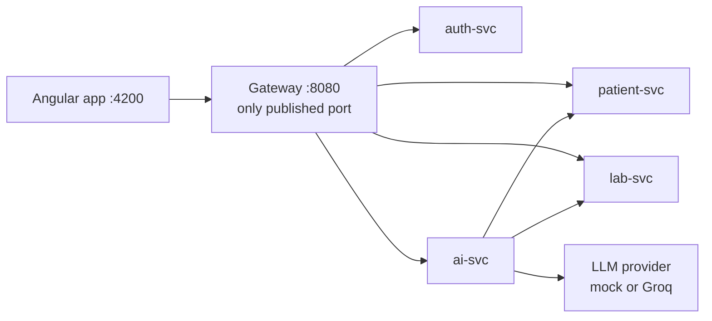

The gateway verifies the access token, applies rate limits and routes `/api/<prefix>/**`. `/api/internal/**` is never routed.
Each service owns one PostgreSQL database. ai-svc reads patient and lab data over the private network and never writes it.
More: [docs/ARCHITECTURE.md](docs/ARCHITECTURE.md).

## Quick start

This takes about 20 to 30 minutes the first time, mostly waiting for Docker to download and build. You type commands in a
terminal; you do not need to know Python or Angular. Copy each block exactly and run the blocks in order.

### Step 1: install three tools

| Tool | Why | Check it works |
|---|---|---|
| [Docker Desktop](https://www.docker.com/products/docker-desktop/) (start it and wait until it says it is running) | Runs everything | `docker --version` and `docker compose version` |
| `make` | Runs the short commands used below | `make --version` |
| A bash terminal | The commands are written for bash. On Windows install [Git for Windows](https://git-scm.com/download/win) and open **Git Bash**. On macOS or Linux use the normal terminal | |

On Windows, if `make --version` says "command not found", install it once with `winget install GnuWin32.Make` (or
`choco install make`) and open a new Git Bash window.

Do not install Node or Angular: the website runs inside Docker.

**Windows: use Git Bash for every command in this guide, not PowerShell or Command Prompt.** The commands are bash, and PowerShell
rejects them (for example the `for ... do` line in step 3). To open Git Bash from PowerShell, run
`& "C:\Program Files\Git\bin\bash.exe" -l`, or search for "Git Bash" in the Start menu. Then `cd` into the folder, for example
`cd /c/Users/you/Desktop/TyrionEMR`.

### Step 2: get the code and open a terminal in it

```bash
git clone https://github.com/shubh-soubhagya/TyrionEMR.git
cd TyrionEMR
```

Every command below is run from this `TyrionEMR` folder unless it says otherwise.

### Step 3: create the settings files

Pick one password for the databases. Use only letters and digits (no spaces or symbols), for example `NephroDb2026`. The
first block creates the settings files; the second puts your password in all of them.

```bash
cp .env.example .env
for s in auth-svc patient-svc lab-svc ai-svc; do cp $s/.env.example $s/.env; done
```

```bash
sed -i 's/change-me/NephroDb2026/g' .env auth-svc/.env patient-svc/.env lab-svc/.env ai-svc/.env
```

(On macOS use `sed -i '' ...` instead of `sed -i ...`.) Replace `NephroDb2026` with your own password if you like; the same
word is used in every file, which is what the setup needs. Skip this step if the `.env` files already exist.

### Step 4: start the database

All the services store their data in one PostgreSQL database server, which runs as a Docker container. Skip this step if you
already have a container named `graphgpt-postgres`. The name must be exactly that.

```bash
docker run -d --name graphgpt-postgres -e POSTGRES_PASSWORD=NephroAdmin2026 -p 5433:5432 -v nephro-pgdata:/var/lib/postgresql/data postgres:17
```

Wait about 10 seconds, then run this. When it says `accepting connections` the database is ready (if not, wait and run it again):

```bash
docker exec graphgpt-postgres pg_isready
```

What the command means: `--name` names the container, `POSTGRES_PASSWORD` is the password of the database administrator (this
is not the one from step 3), `-p 5433:5432` makes the database reachable on port 5433 of your computer, and `-v` keeps the
data safe if the container is removed. If the container stops later (for example after a restart), start it with
`docker start graphgpt-postgres`.

### Step 5: create the databases

```bash
make network
make init-dbs
```

`make init-dbs` shows the commands it will run and asks `Type yes to continue`. Read them, type `yes` and press Enter. It
creates four empty databases and their logins on the database container.

### Step 6: build and start the application

```bash
make keys
make migrate
make up
```

The first `make up` builds five Docker images, so it takes several minutes. Later runs reuse the images and start in seconds;
after you change code, run `make rebuild` instead. `make up` waits until all five containers are healthy, shows each image
with its health, and prints the API addresses, so you do not need to check anything else. Then load the demo data and run
the built-in checks:

```bash
make seed
make smoke
```

`make smoke` should end with `19 passed, 0 failed`. At any time, `make ps` waits for and shows the health of the containers.

### Step 7: start the website

```bash
make web
```

The first start downloads the website's packages and compiles the app, which can take 5 to 10 minutes. The command waits
until the page answers and then prints the address and the login. (`make start` does steps 6 and 7 together, without the
seed.)

### Step 8: open it

Go to <http://localhost:4200> in your browser. Type `localhost`; do not use an IP address, or sign-in will fail. Sign in with:

| Email | Password |
|---|---|
| `dr.rao@nephrocare.demo` | `Nephro#2026` |

(`dr.malhotra@nephrocare.demo` also works, with the same password.) The demo data is ten invented patients. For things to
try, see [the demo path below](#a-five-minute-demo-path).

### If something goes wrong

| What you see | What to do |
|---|---|
| `make: command not found` | Install `make` (step 1) and open a new terminal |
| `Cannot connect to the Docker daemon` | Start Docker Desktop and wait until it is running |
| `make ps` shows a service that is not `healthy` | Wait a minute and run `make ps` again; then `make logs` shows why |
| `password authentication failed` in a log | The password in a `.env` file does not match the one used in step 5. Fix it, then run `make down` and `make up` |
| The page does not load | In the `frontend` folder run `docker compose logs web` and wait for the build to finish |
| Sign-in fails | Check that `make seed` ran and that the address is `http://localhost:4200` |

### Stopping and starting again

```bash
make down                          # in the TyrionEMR folder: stops the five application containers and the website
docker stop graphgpt-postgres      # stops the database; your data is kept
```

Next time: `docker start graphgpt-postgres`, then `make start`. You do not need
steps 3 to 5, `make keys`, `make migrate` or `make seed` again. Other commands: `make logs` shows the backend logs, `make down` stops the backend and the website, `make test` runs the backend tests (needs Python 3.12).

### A five-minute demo path

| To see | Do this |
|---|---|
| Patient listing and search | Sign in, open Patients, search `Kulkarni` or `PT-000101`; try the stage filter and the Needs attention filter |
| The dashboard worklist | Open Dashboard: needs-attention rows, eGFR categories, abnormal results, follow-ups, drafts |
| Demographics, history, comorbidities, medications and allergies | Open Ramesh Kulkarni (PT-000101) and visit the Overview, Conditions and Medications tabs |
| Kidney function monitoring | On PT-000101, Overview shows eGFR and creatinine charts with trend chips; PT-000106 (Lakshmi Iyer) shows the established-stage mismatch chip |
| Abnormal values | PT-000109 (Aditya Singh) has a critical potassium; the flag is text and an arrow, not colour alone |
| Laboratory entry in another unit | On PT-000101 choose Add lab report, set creatinine to µmol/L and watch the live conversion and flag |
| Encounters | On PT-000101 choose New encounter, save a draft, reopen it, then finalise it (it becomes read-only) |
| The AI summary | On any patient with data (for example PT-000104, Fatima Sheikh) open the AI summary tab and generate one; click a source chip; use the demo options to see the degraded and failed states |
| Missing information | PT-000108 (Priya Nair) has an almost empty chart; PT-000107 (Mohan Das) has had no labs for 230 days |

## AI provider

The default provider is the deterministic mock, so the stack needs no API key. With `APP_ENV=dev` the AI tab's demo options
send `X-Mock-Scenario` (the gateway forwards it only outside production). To use Groq, set `LLM_PROVIDER=groq` and
`LLM_API_KEY` (or `LLM_API_KEY_FILE`) in `ai-svc/.env`, then `docker compose up -d ai-svc`. How the AI pipeline works and what
it guards against: [docs/ARCHITECTURE.md](docs/ARCHITECTURE.md#ai-integration).

## Tests

| Suite | Command | Last recorded result |
|---|---|---|
| auth-svc | `make -C auth-svc test` | 284 passed |
| patient-svc | `make -C patient-svc test` | 230 passed |
| lab-svc | `make -C lab-svc test` | 328 passed |
| ai-svc | `make -C ai-svc test` | 388 passed, 1 skipped (the opt-in live Groq test) |
| gateway | `make -C gateway test` | 457 passed |
| All backend suites | `make test` | stops at the first failure |
| Running stack | `make smoke` | 19 of 19 checks |
| Frontend unit | `docker compose -f frontend/compose.yaml exec web npx ng test --watch=false` | 136 test cases in 26 spec files, run by folder |
| Frontend end to end | `docker compose -f frontend/compose.yaml --profile tools run --rm flow` | The flow, tooltip and screenshot specs |

The backend suites need each service's virtual environment (`make install`) and its test database, and run with
`REQUIRE_DB_TESTS=1` so a missing database fails instead of skipping. "Last recorded" are the counts of the most recent full
runs during development; run the commands to reproduce them. `make -C ai-svc capture-fixtures` records real upstream
responses for ai-svc's contract tests (the stack must be up and seeded).

## Screenshots

Taken from the running stack with the seeded data, in [docs/screenshots/](docs/screenshots/). Click one for the full size.
Screens 04, 07 and 09 were taken before the trend charts moved to Chart.js and show the earlier chart drawing.

| | | |
|---|---|---|
| <a href="docs/screenshots/01-sign-in.png">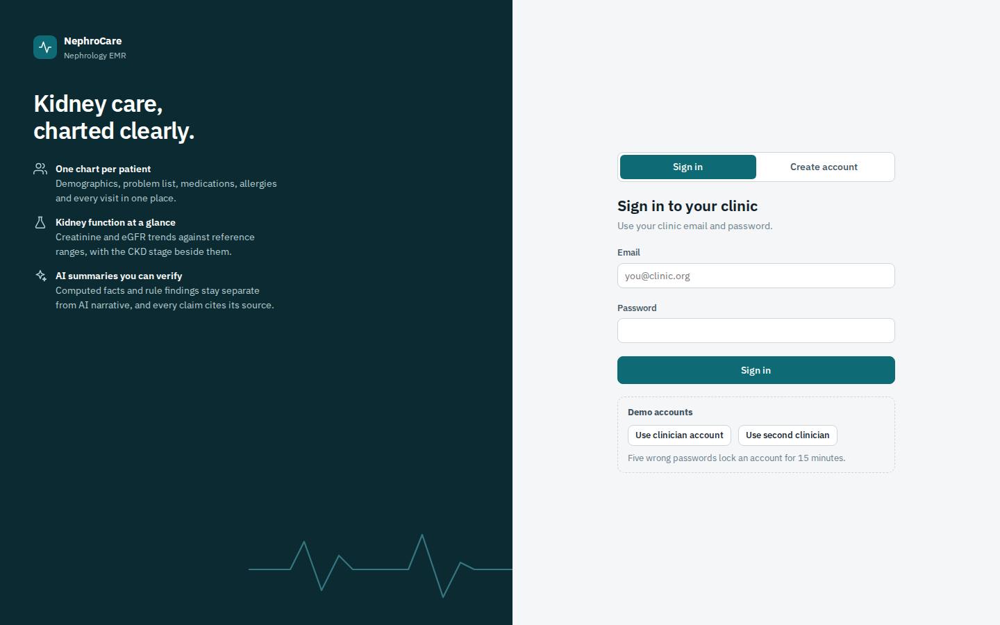</a><br/>Sign in | <a href="docs/screenshots/02-dashboard.png">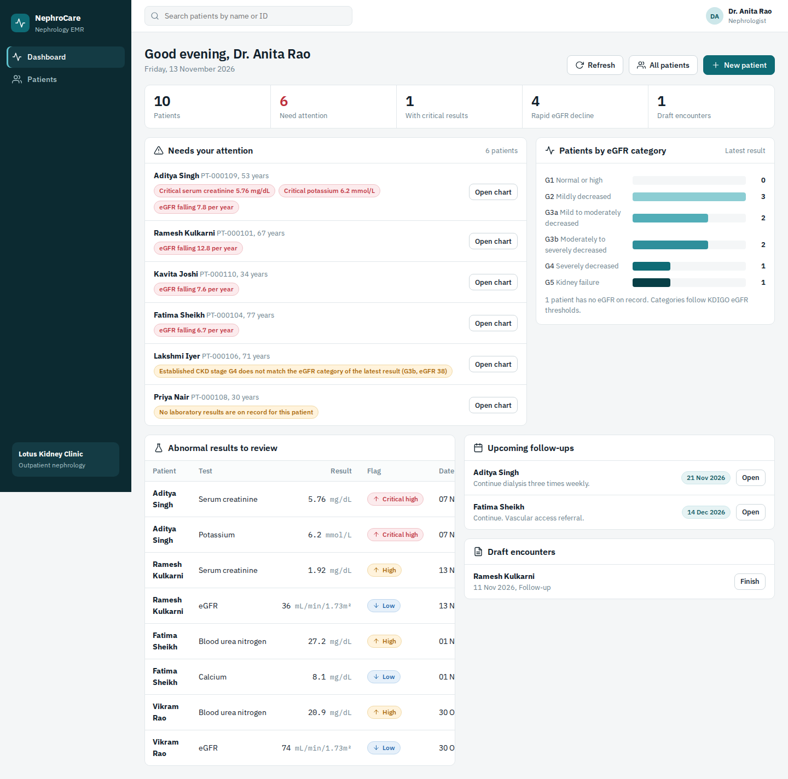</a><br/>Dashboard | <a href="docs/screenshots/03-patient-list-filtered.png">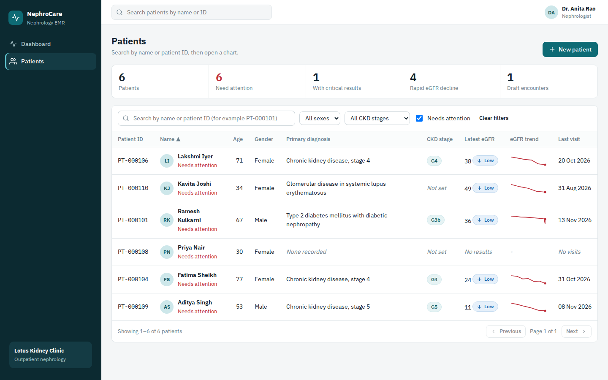</a><br/>Patient list with sparklines and a filter |
| <a href="docs/screenshots/04-overview-kidney-panel.png">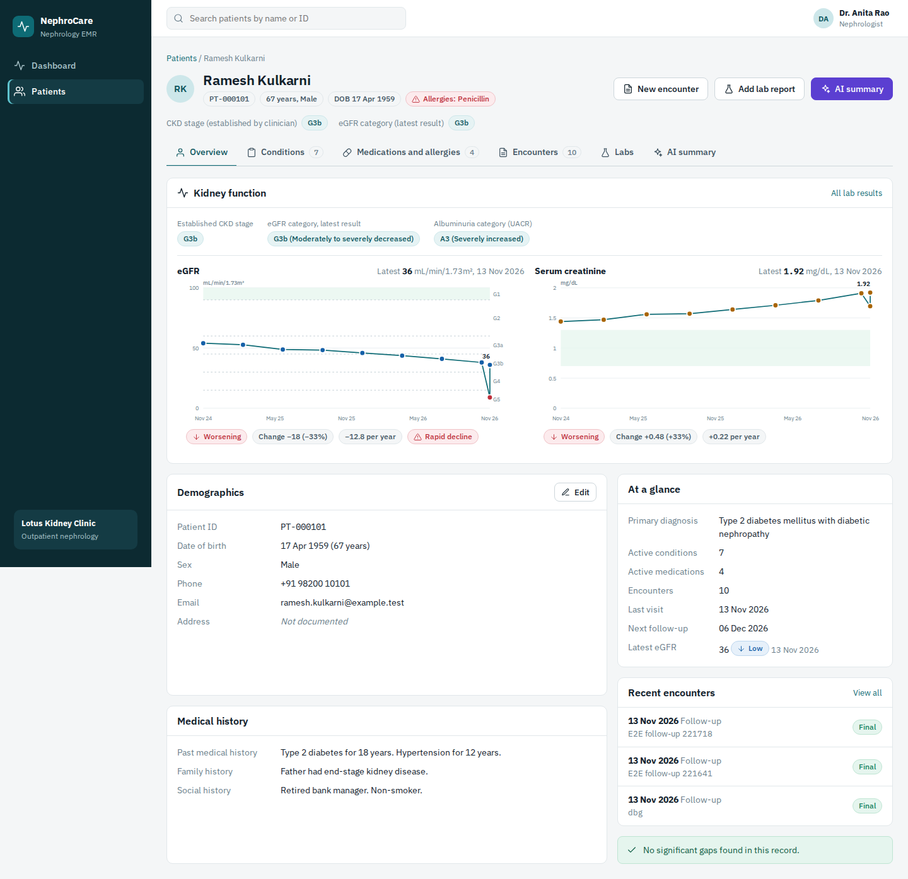</a><br/>Overview with the kidney panel | <a href="docs/screenshots/05-conditions-stage-mismatch.png">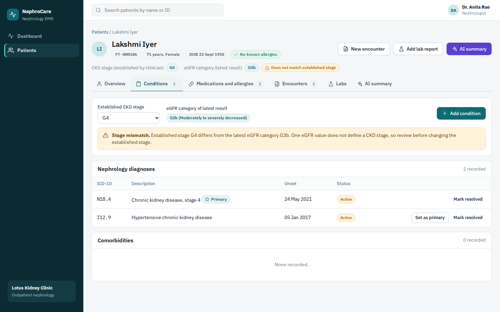</a><br/>Conditions with the stage mismatch | <a href="docs/screenshots/06-encounter-form.png">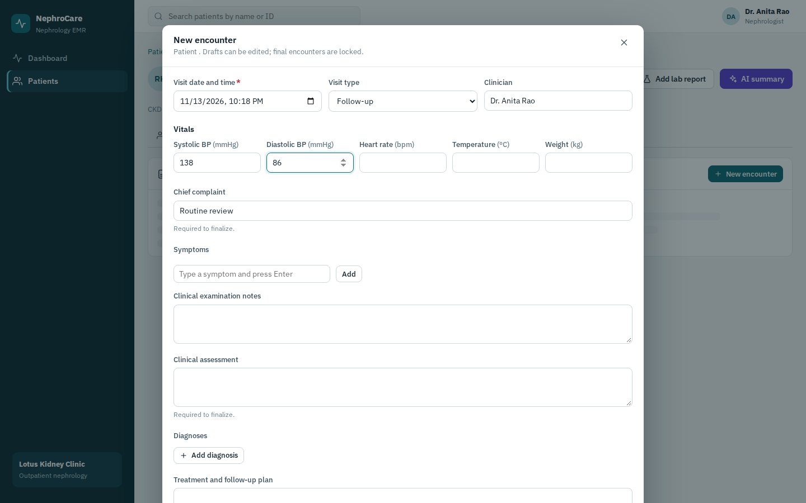</a><br/>Encounter form |
| <a href="docs/screenshots/07-labs-table-and-trends.png">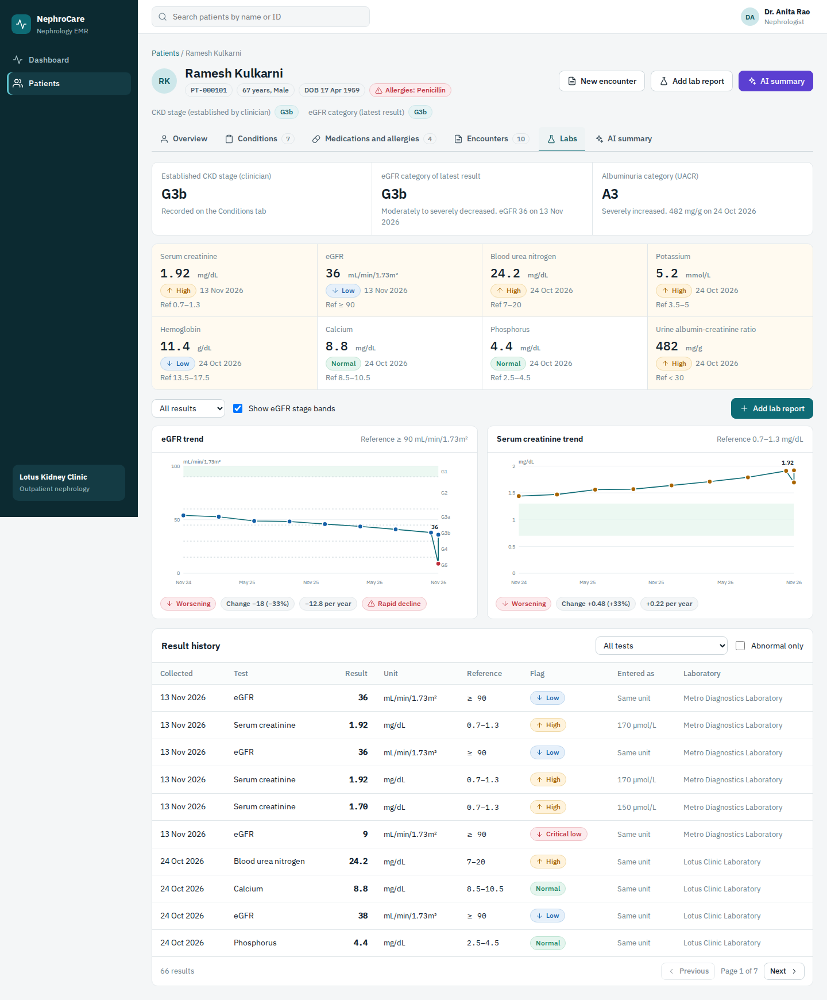</a><br/>Labs: flags and trends | <a href="docs/screenshots/08-add-lab-report-preview.png">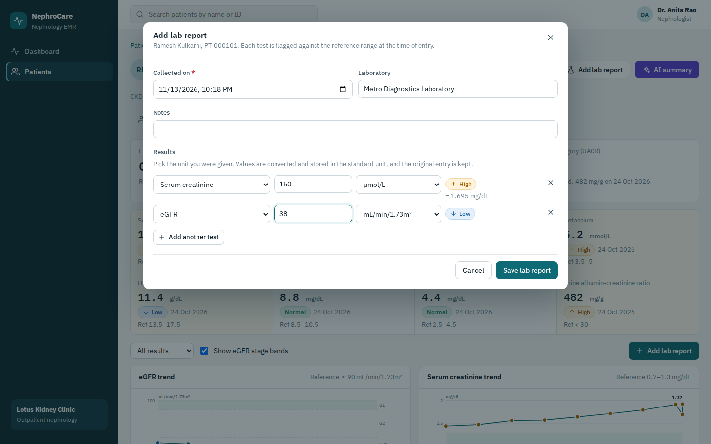</a><br/>Add lab report with the live preview | <a href="docs/screenshots/09-trend-charts.png">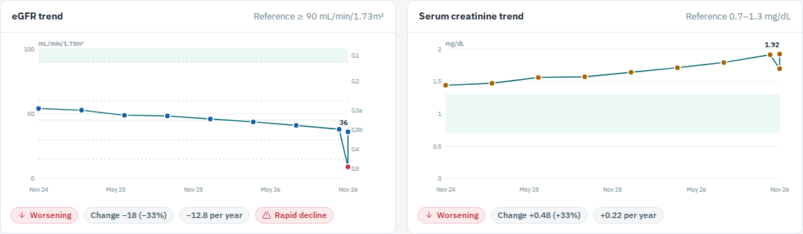</a><br/>Trend charts |
| <a href="docs/screenshots/10-ai-summary-running.png">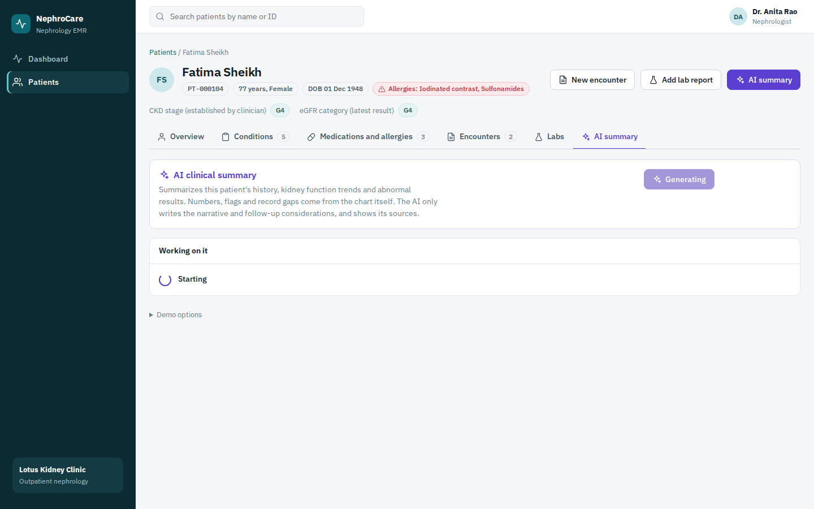</a><br/>AI summary running | <a href="docs/screenshots/11-ai-summary-completed.png">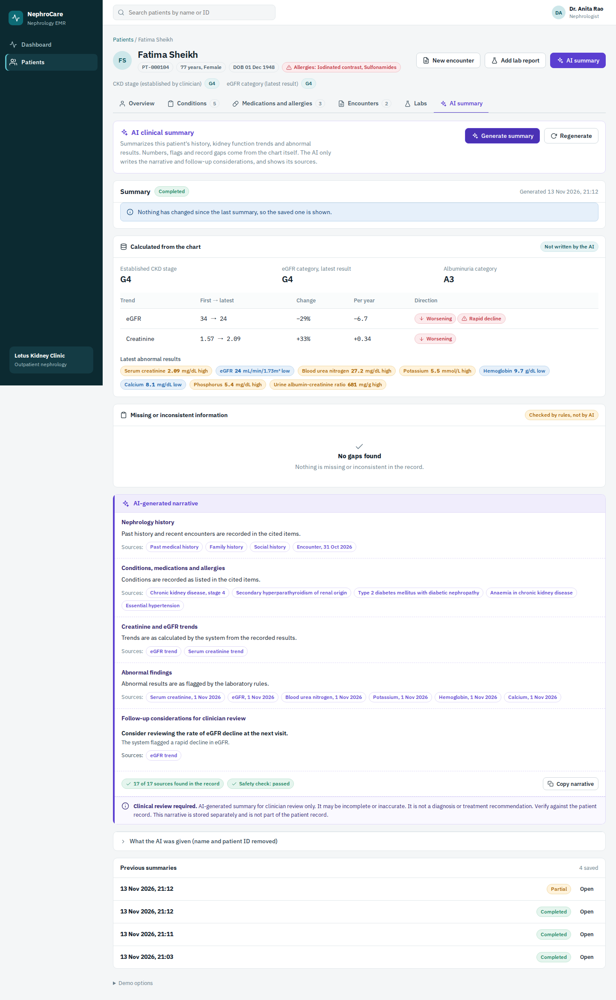</a><br/>AI summary completed | <a href="docs/screenshots/12-ai-summary-degraded.png">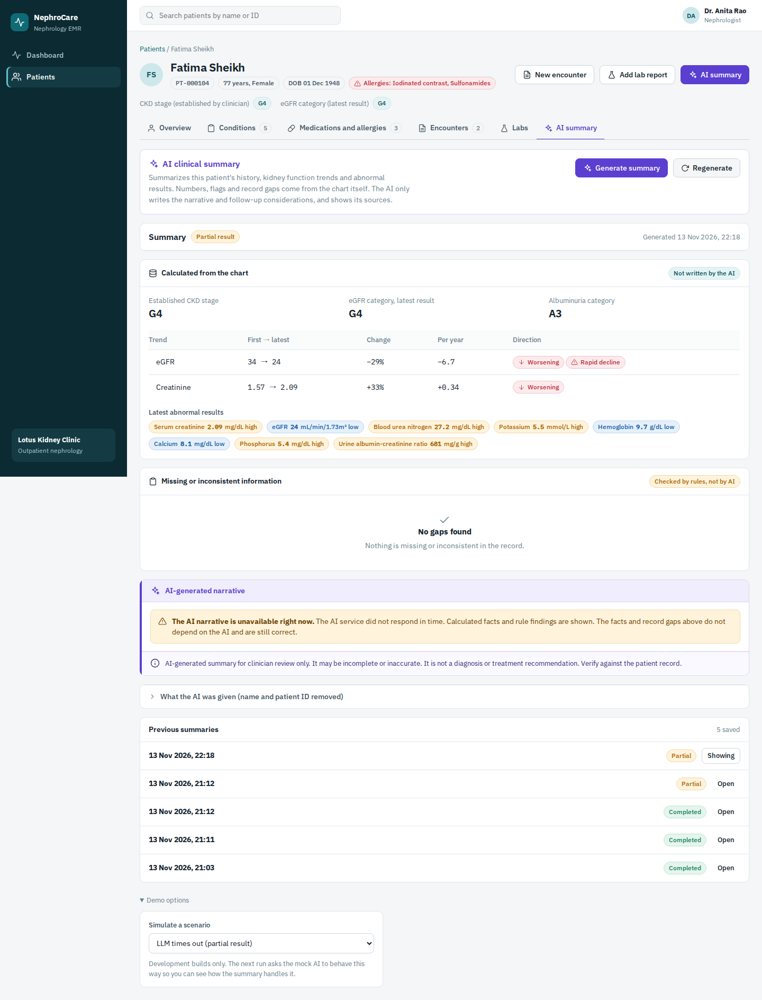</a><br/>AI summary degraded (LLM unavailable) |
| <a href="docs/screenshots/13-ai-summary-failed.png">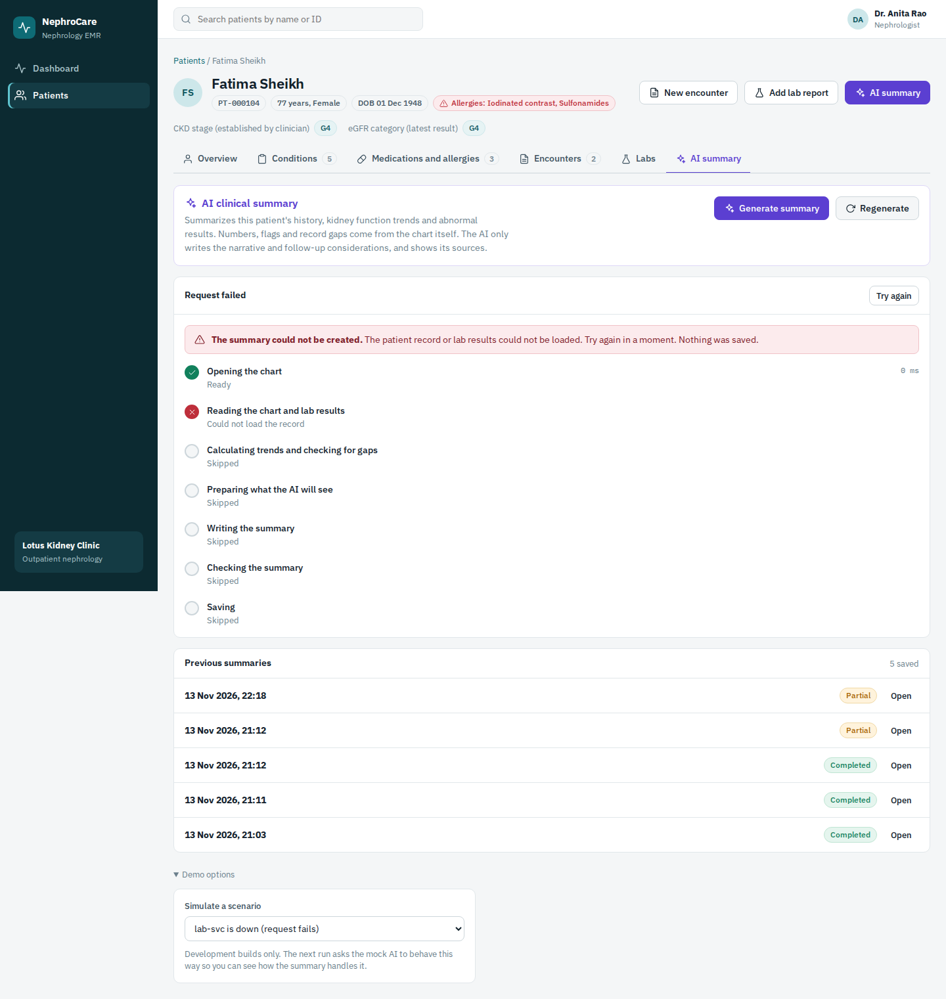</a><br/>AI summary failed | <a href="docs/screenshots/14-ai-source-chip-opens-record.png">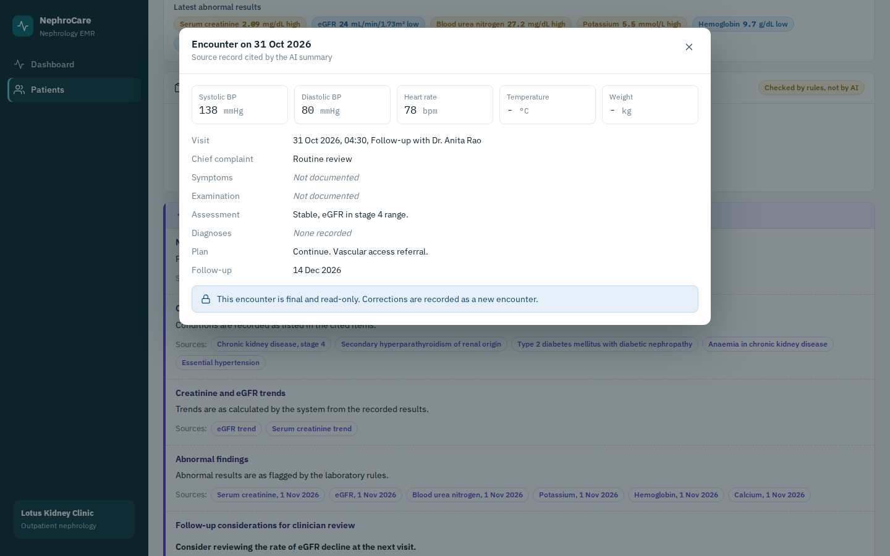</a><br/>A source chip opening the cited record | <a href="docs/screenshots/15-chart-tooltip.png">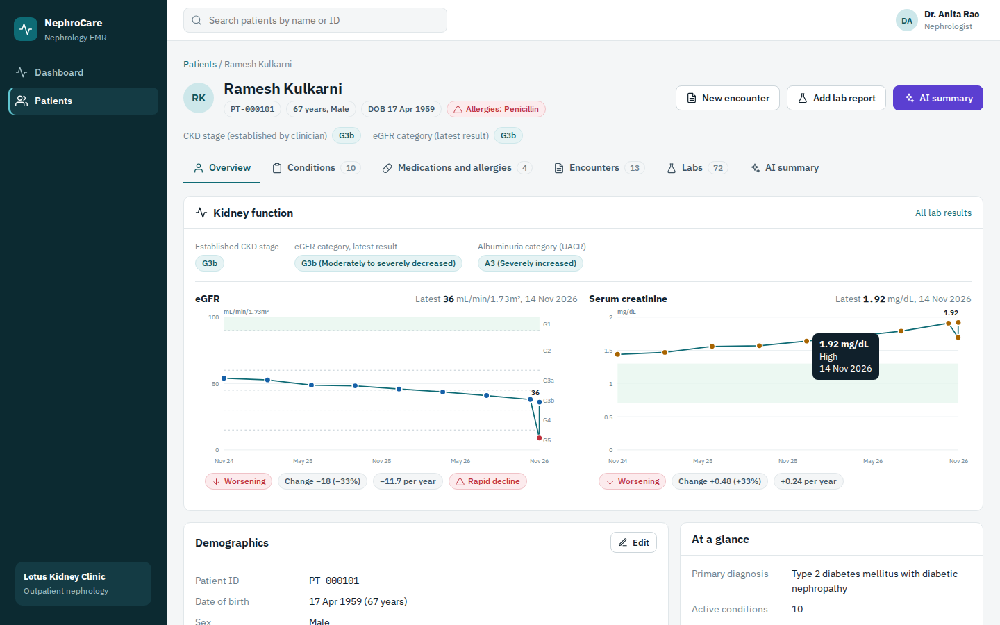</a><br/>A chart tooltip |

All AI screenshots used the mock provider. The end-to-end flow (sign in, dashboard, search, encounter draft and finalise,
µmol/L lab report, AI summary, source chip, sign out and back in) is `frontend/e2e/flow/flow.e2e.ts`.

## Repository layout

| Folder | Contents |
|---|---|
| `auth-svc/`, `patient-svc/`, `lab-svc/`, `ai-svc/` | One self-contained FastAPI service each: `app/`, `migrations/`, `tests/`, `docs/`, Dockerfile, README |
| `gateway/` | The custom API gateway |
| `frontend/` | The Angular app, its Docker setup and its end-to-end tests |
| `docs/` | Architecture, API, database and development documents, the full design ([HLD.md](docs/HLD.md)) and the screenshots |
| `reference/` | The HTML prototype used as the visual reference, and the original brief |
| `scripts/docs/` | Documentation tooling: link checker and API index generator |
| `docker-compose.yml`, `Makefile`, `.env.example` | The whole stack, the common targets and the shared settings |

## Known limitations

- **Reference ranges** are common adult intervals taken from the prototype; no ranges file was provided
  ([DATABASE.md](docs/DATABASE.md#reference-ranges)).
- **Rate limiting** is in memory in the gateway and **AI jobs** run in process: correct for one instance, not for replicas
  ([ARCHITECTURE.md](docs/ARCHITECTURE.md#trade-offs-and-what-would-change-at-scale)).
- **Images install from `pyproject.toml`** without hash locking, by decision (all services; [gateway README](gateway/README.md#design-and-deviations), D1).
- **CI** exists for auth-svc only.
- **The patient list cannot sort by eGFR** by design (ADR-020).
- **Visual parity** with the reference HTML cannot be pixel-exact because the screens show seed data from the services
  ([frontend/docs/ui-inventory.md](frontend/docs/ui-inventory.md)).
- Each service README lists its own deviations from the design: [auth-svc](auth-svc/README.md#design-and-deviations),
  [patient-svc](patient-svc/README.md#design-and-deviations), [lab-svc](lab-svc/README.md#design-and-deviations),
  [ai-svc](ai-svc/README.md#design-and-deviations), [gateway](gateway/README.md#design-and-deviations).
