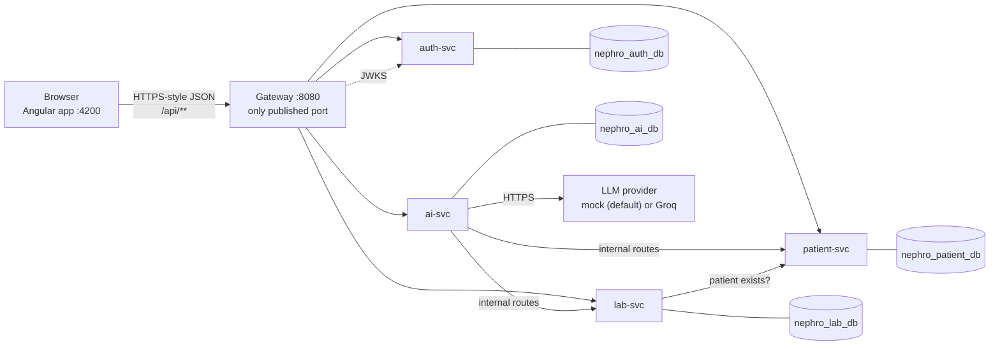
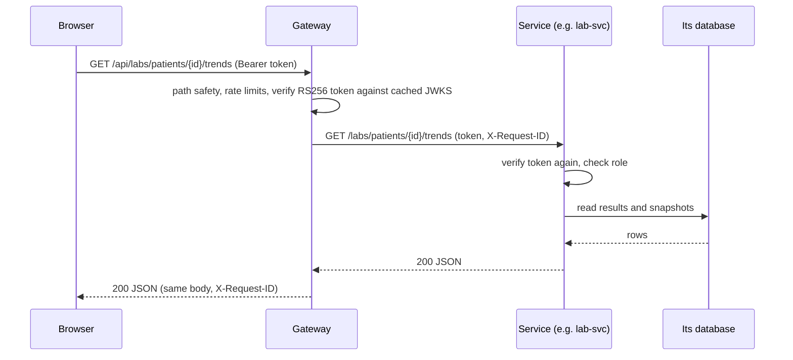

# Architecture and AI integration

A brief tour for a reviewer, about ten minutes. It explains the shape of the system and links to the files that implement
each claim. The full design is in [HLD.md](HLD.md) and in each service's `docs/<service>-HLD-LLD.md`. Where the build
differs from the design, the service README has a deviations table.

Contents:

- [System at a glance](#system-at-a-glance)
- [Why four services](#why-four-services)
- [Request flow](#request-flow)
- [Security in brief](#security-in-brief)
- [Clinical rules](#clinical-rules)
- [AI integration](#ai-integration)
- [Frontend architecture](#frontend-architecture)
- [Testing strategy](#testing-strategy)
- [Trade-offs and what would change at scale](#trade-offs-and-what-would-change-at-scale)

## System at a glance



| Component | Owns |
|---|---|
| Angular frontend | The user interface. Talks only to the gateway. Never calls an LLM |
| Gateway | The single entry point: CORS, token verification, rate limits, body and URL limits, routing by path prefix, request ids. It has no business logic and no database. [gateway/README.md](../gateway/README.md) |
| auth-svc | Clinician accounts, password hashing, token issue and rotation, the signing keys. [auth-svc/README.md](../auth-svc/README.md) |
| patient-svc | Patients, demographics, conditions, medications, allergies and encounters, with the encounter lifecycle. [patient-svc/README.md](../patient-svc/README.md) |
| lab-svc | The test catalog and reference ranges, lab reports and results, CKD classification, trends, abnormal flags. [lab-svc/README.md](../lab-svc/README.md) |
| ai-svc | The AI clinical summary, and the deterministic insights (gap findings, the attention worklist, dashboard numbers). [ai-svc/README.md](../ai-svc/README.md) |
| PostgreSQL | One server, four databases, four roles. [DATABASE.md](DATABASE.md) |

## Why four services

The boundaries follow data ownership and failure domains (HLD §3.3):

- **auth-svc** holds credentials and keys. It should be small, hard to break and independently deployable.
- **patient-svc** keeps patients and encounters together (ADR-002). A finalised encounter updates the problem list in the same
  transaction, which would need a distributed transaction if the two lived apart.
- **lab-svc** owns an append-only data set with its own rules and its own growth pattern.
- **ai-svc** depends on a slow, rate-limited third party and must fail without taking charting down. It stores AI output in
  its own database so that output can never be mistaken for a source record.

Insights (the worklist, the dashboard, gap findings) live in ai-svc because it is the one service that already reads both
patient and lab data. They never call the LLM (ADR-016): an import test fails the build if they do, so they keep working
when the LLM or the AI database is down.

## Request flow

A normal read passes through the gateway, which verifies the token and routes by prefix. The service verifies the token
again, so a service is safe even if the gateway is bypassed on the private network.



Composed screens make several independent calls in parallel from the browser; no service calls another to build a screen
except ai-svc:

| Screen | Calls (in parallel) |
|---|---|
| Patient list | `GET /patients` (one page), then `GET /labs/summary?patient_ids=` for that page's eGFR and sparkline, and `GET /insights/worklist` for the attention filter |
| Dashboard | `GET /insights/dashboard`, plus the draft-encounters list and the upcoming-follow-ups list, both `GET /encounters` with different query parameters |
| Patient chart | `GET /patients/{id}`, `GET /labs/patients/{id}/latest`, then tab data on demand |

## Security in brief

- Tokens are RS256, 15 minutes. Services and the gateway verify them locally against the public keys that auth-svc
  publishes; no call to auth-svc per request. Each consumer caches the keys and refetches on an unknown `kid`.
- The access token lives in browser memory. The refresh token is an opaque value in an HttpOnly, Secure, SameSite=Strict
  cookie scoped to `/api/auth`. It rotates on every use, and replaying an old one revokes the whole family.
- The gateway is the only published port. `/api/internal/**` is never routed. Unsafe paths (encoded dots or slashes) are
  refused, not normalised.
- Each service has its own database role and cannot connect to another service's database.
- Logs carry request ids, never request or response bodies, tokens, cookies, names or lab values.
- The AI context is minimised before it leaves the service (see below).

Details: [auth-svc README](../auth-svc/README.md#token-and-cookie-model), [gateway README](../gateway/README.md).

## Clinical rules

Rules are computed in code, never by the LLM. Each row links to the implementation and a test that covers it.

| Rule | Behaviour | Code | Test |
|---|---|---|---|
| eGFR category (KDIGO 2012) | G1 90 and above, G2 60, G3a 45, G3b 30, G4 15, G5 below 15; boundaries are lower-inclusive (60 is G2). Applied to the stored value | [lab-svc/app/domain/ckd.py](../lab-svc/app/domain/ckd.py) | [test_domain.py](../lab-svc/tests/unit/test_domain.py), [lab_cases.json](../lab-svc/tests/vectors/lab_cases.json) |
| Albuminuria category | A1 below 30 mg/g, A2 30 to 300, A3 above 300 | same file | same tests |
| Abnormal flag | `critical_low`, `low`, `normal`, `high`, `critical_high`, or `unknown` when no range applies. Critical limits are checked first and are exclusive. The range used is snapshotted on the result | [lab-svc/app/domain/flagging.py](../lab-svc/app/domain/flagging.py) | [test_domain.py](../lab-svc/tests/unit/test_domain.py), [test_reports.py](../lab-svc/tests/api/test_reports.py) |
| Unit conversion | Exact decimal factors from the catalog; the browser preview uses the same factors and the shared test vectors | [lab-svc/app/domain/units.py](../lab-svc/app/domain/units.py), [frontend lab-preview](../frontend/src/app/core/clinical/lab-preview.ts) | [lab_cases.json](../lab-svc/tests/vectors/lab_cases.json), [lab-preview.spec.ts](../frontend/src/app/core/clinical/lab-preview.spec.ts) |
| Trend | Least-squares slope per year over the window. Fewer than 3 points gives `insufficient_data`. eGFR within 2 per year is `stable`; creatinine within 0.1 mg/dL per year | [lab-svc/app/domain/trends.py](../lab-svc/app/domain/trends.py) | [test_domain.py](../lab-svc/tests/unit/test_domain.py), [test_reads.py](../lab-svc/tests/api/test_reads.py) |
| Rapid decline | eGFR slope at or below -5 per year | same file | same tests |
| Gap findings | Sixteen rules over the chart and labs, for example no labs, no recent labs, stage mismatch, eGFR and creatinine disagree, medication past its end date, implausible vitals. Each finding has a severity and evidence references | [ai-svc/app/insights/rules/gaps.py](../ai-svc/app/insights/rules/gaps.py) | [test_rules.py](../ai-svc/tests/unit/test_rules.py) |
| Attention | A patient needs attention when a latest result is critical, eGFR shows rapid decline, or any finding has high severity | [ai-svc/app/insights/rules/attention.py](../ai-svc/app/insights/rules/attention.py) | [test_attention_dashboard.py](../ai-svc/tests/unit/test_attention_dashboard.py) |
| Reference ranges | One data file; see [DATABASE.md](DATABASE.md#reference-ranges) | [lab-svc/app/domain/catalog_data.py](../lab-svc/app/domain/catalog_data.py) | [test_catalog.py](../lab-svc/tests/api/test_catalog.py) |

Established stage and eGFR category are separate: the established stage is what the clinician recorded in patient-svc; the
eGFR category is computed from the latest result in lab-svc. When they differ the chart shows a mismatch chip and the gap
engine reports it.

## AI integration

The assignment asks for an AI assistant that summarises a patient, through a backend service, with prepared context,
safe handling of missing data and failures, clear labelling and a clinical disclaimer. This is how the code does each part.
The design is [ai-svc/docs/ai-svc-HLD-LLD.md](../ai-svc/docs/ai-svc-HLD-LLD.md).

**Deterministic first.** Numbers, flags, trends and gap findings are computed by the rules above and are never produced by
the LLM. The LLM writes only four narrative sections and a short list of follow-up considerations. The response has three
separately labelled panels: calculated facts, rule-based findings, and the AI narrative.

### The six required outputs

| Assignment output | Produced by | Where |
|---|---|---|
| 1. Summarise nephrology history | LLM (`history_summary`), from the minimised chart | [orchestrator.py](../ai-svc/app/orchestrator/orchestrator.py), [output_schema.py](../ai-svc/app/validation/output_schema.py) |
| 2. Summarise conditions and comorbidities | LLM (`comorbidity_summary`) | same |
| 3. Creatinine and eGFR trends | Code computes the numbers (`facts.trends`); LLM writes `trend_commentary` and may only cite computed values | [facts.py](../ai-svc/app/orchestrator/facts.py), [numbers.py](../ai-svc/app/validation/numbers.py) |
| 4. Abnormal laboratory findings | Code lists them (`facts.abnormal_results`, flags from lab-svc); LLM writes `abnormal_commentary` | same |
| 5. Missing or inconsistent information | Code (`gaps.findings` from the rule engine); the LLM lists what it found undocumented in `not_documented` | [gaps.py](../ai-svc/app/insights/rules/gaps.py) |
| 6. Follow-up considerations for review | LLM (`follow_up_considerations`, at most six), screened by the safety lint | [safety.py](../ai-svc/app/validation/safety.py) |

### Pipeline

```mermaid
sequenceDiagram
    participant B as Browser
    participant G as Gateway
    participant A as ai-svc
    participant P as patient-svc and lab-svc
    participant L as LLM provider
    participant D as ai database
    B->>G: POST /api/ai/patients/{id}/summary
    G->>A: forward (per-user rate limit)
    A->>D: insert job (status running); one running job per patient and user
    A-->>B: 202 Accepted, summary_id, progress steps
    Note over A: background job
    A->>P: 1 open chart, 2 gather chart, labs, trends
    A->>A: 3 rules: facts and gap findings; 4 prepare: minimise, build packet, hash
    A->>D: cache lookup by context hash
    alt cache hit
        A->>D: store pointer to the original
    else miss
        A->>L: 5 write (prompt + packet, optional read-only tool calls)
        L-->>A: JSON narrative
        A->>A: 6 check: schema, citations, numbers, safety; one repair attempt
        A->>D: 7 save validated output, or degraded or failed
    end
    loop poll about every second
        B->>G: GET /api/ai/summaries/{summary_id}
        G->>A: forward
        A-->>B: status, progress, and the document when finished
    end
```

### Context preparation

[`app/context/`](../ai-svc/app/context) builds a packet from an allow-list of fields, so nothing is sent unless it is listed.

- Name, MRN, phone, email and address are never included. Free text is scrubbed of email addresses, MRN patterns and phone-like
  sequences, truncated to 1500 characters, and the whole packet is trimmed to a size budget in a fixed order
  ([minimize.py](../ai-svc/app/context/minimize.py)). The scrub cannot remove names that appear inside free text; this is
  acceptable for synthetic data only and is stated in the design.
- Every record gets a stable reference id (`enc:1`, `cond:2`, `lab:EGFR:2026-11-02`, `trend:EGFR`) from one builder
  ([refs.py](../ai-svc/app/context/refs.py)). The model cites these ids; the service resolves them to real records.
- The packet, prompt version, schema version, rules version, provider, model and tool setting are hashed
  ([hashing.py](../ai-svc/app/context/hashing.py)). The patient id is part of the key. A completed summary with the same hash
  is served from cache without calling the LLM; `?force=true` skips the cache.

### Tool calling

The model may call six read-only tools: `get_conditions`, `get_recent_encounters`, `get_medications_and_allergies`,
`get_lab_history`, `get_lab_trend` and `get_gap_report` ([definitions.py](../ai-svc/app/tools/definitions.py)). The
patient id is not a tool argument: the registry binds it from the job, so a prompt injection cannot read another patient.
Arguments are validated with `extra="forbid"`, results are whitelisted, scrubbed and capped at 50 rows, and a job may make at
most 8 calls over 4 iterations ([registry.py](../ai-svc/app/tools/registry.py)). Every call is logged to `llm_tool_calls`.
Tools are optional; the packet already carries the core chart.

### Validation of the LLM output

LLM output is treated as untrusted input ([pipeline.py](../ai-svc/app/validation/pipeline.py)):

1. **Parse** the JSON (code fences and trailing text tolerated).
2. **Schema**: the fixed `SummaryOutput` model, no extra keys, length limits ([output_schema.py](../ai-svc/app/validation/output_schema.py)).
3. **Citations**: every cited id must exist in the reference index; unknown ids are stripped ([refs.py](../ai-svc/app/validation/refs.py)).
4. **Numeric grounding**: numbers in the text must come from the computed facts; ungrounded numbers become warnings
   ([numbers.py](../ai-svc/app/validation/numbers.py)).
5. **Safety lint** ([safety.py](../ai-svc/app/validation/safety.py)): blocks prescribing language (start, stop or titrate a
   drug), doses in follow-up items, "new diagnosis" language and admission or dialysis instructions; warns on causal
   certainty ("caused by", "definitely").
6. **One repair attempt**: if the check fails, the model gets the reasons and one more try. After that the unsafe text is
   removed or the summary is degraded. Nothing unvalidated is stored.

### Missing information

Absent data is never filled in. The packet marks what is missing, the schema has a `not_documented` list, sections without
data must say "Not documented.", and the gap engine reports missing items independently of the LLM.

### Failure handling

[`llm/resilience.py`](../ai-svc/app/llm/resilience.py) wraps every provider with a deadline (30 s), retries, 429 handling, a
circuit breaker (opens after 5 consecutive failures, 60 s cooldown) and a concurrency limit (4).

| Failure | What happens | What the user sees |
|---|---|---|
| LLM timeout, rate limit, provider down, breaker open, busy | Summary saved as `degraded` with facts and gaps | Calculated facts and rule findings, a notice that the AI narrative is unavailable, and a retry button |
| LLM output invalid twice, or unsafe twice | Saved as `degraded` with `LLM_INVALID_OUTPUT` | Same as above |
| patient-svc or lab-svc down or slow | Job `failed` with `UPSTREAM_UNAVAILABLE` or `UPSTREAM_TIMEOUT` | "The summary could not be created", with retry |
| Job stuck or the process restarts | A reaper marks it `failed` (`JOB_TIMEOUT` or `JOB_ABORTED`) | Same as above |
| Daily quota used (50 per user) | `429 AI_QUOTA_EXCEEDED` before any job starts | A message with the reset time |

Insights keep working in every row above because they never call the LLM.

### Provenance and disclaimer

- The AI panel is visually distinct and labelled "AI-generated", with the provider, model and generation time.
- The disclaimer text is injected by the server ([schemas/summary.py](../ai-svc/app/schemas/summary.py)), not by the model:
  "AI-generated summary for clinician review only. It may be incomplete or inaccurate. It is not a diagnosis or treatment
  recommendation. Verify against the patient record."
- AI output is stored only in `ai_summaries`. No code path writes it into patient-svc or lab-svc, and the UI has no control
  to copy it into a clinical field.

### Providers

| Provider | Selected by | Notes |
|---|---|---|
| Mock (default) | `LLM_PROVIDER=mock` | Deterministic, no network, no key. With `APP_ENV=dev` the header `X-Mock-Scenario` picks a scenario (success, tool round trip, invalid output, unsafe output, timeout, rate limit, upstream down); the AI tab's demo options send it. The gateway forwards the header only outside production |
| Groq | `LLM_PROVIDER=groq` and `LLM_API_KEY` (or `LLM_API_KEY_FILE`) | Free tier, model `openai/gpt-oss-20b`, plain `httpx`, no vendor SDK. The key is never logged |

To switch, set the variables in `ai-svc/.env` and run `docker compose up -d ai-svc`. Prompts are Markdown files under
[`ai-svc/app/prompts/v1/`](../ai-svc/app/prompts/v1).

## Frontend architecture

Angular 22, standalone components only, OnPush everywhere, signals for state, typed reactive forms, built-in control flow.
The rules are in [CLAUDE.md](../CLAUDE.md); the full tour is [frontend/README.md](../frontend/README.md).

| Layer | What it holds |
|---|---|
| `core/api` | Endpoint paths, DTOs that mirror the wire shapes, mappers to view models, the `Remote<T>` state type (idle, loading, ok, empty, error), error messages |
| `core/auth`, `core/http` | The auth service (in-memory token, silent refresh), the auth, refresh and error interceptors, route guards |
| `core/data` | One data-access service per feature (`PatientsApi`, `LabsApi`, `AiApi` and so on). Components never use `HttpClient` |
| `core/clinical` | Pure functions with tests: decimal arithmetic and the live lab preview, display helpers |
| `shared/ui` | Reusable presentational components: button, text field, select, date field, data table, pagination, modal, toast, badge, lab flag, CKD stage badge, KPI strip, tabs, tooltip, empty, error and skeleton states, line chart and sparkline |
| `features/*` | Container pages that inject services and own state: auth, dashboard, patients (list, chart shell, tabs), encounters, labs, AI summary |

Charts: the two lab trend charts use Chart.js; the list sparkline is a small inline SVG
([decision](../frontend/docs/decisions.md#charting-library)).

## Testing strategy

| Suite | What it covers | Command |
|---|---|---|
| auth-svc | Password and token rules, lockout, refresh rotation and races, cookie attributes, schema and role grants | `make -C auth-svc test` |
| patient-svc | Validation, encounter lifecycle and immutability, optimistic locking, problem-list linkage, search and sort, seed scenarios, migrations | `make -C patient-svc test` |
| lab-svc | Units and flags (shared vectors), CKD and trends, append-only data, corrections, read model rebuild, seed | `make -C lab-svc test` |
| ai-svc | Gap and attention rules, context building and redaction, validation pipeline, resilience, tools, API, contract fixtures captured from the live services | `make -C ai-svc test` |
| gateway | Path safety, routing, header handling, rate limits, CORS, auth gate, upstream failure mapping | `make -C gateway test` |
| frontend unit | Mappers, API services with a fake HTTP backend, auth and interceptors, forms, the live lab preview against the shared vectors, shell and tab components | `ng test` in the `web` container |
| smoke | 19 checks through the gateway against the running stack | `make smoke` |
| end to end | One browser flow of the assignment, plus tooltip and screenshot specs (Playwright) | `docker compose --profile tools run --rm flow` in `frontend/` |

Last recorded counts per suite are in the root [README](../README.md#tests).

## Trade-offs and what would change at scale

- **Gateway rate limit is in memory.** It is correct for one gateway instance. With replicas it needs a shared store such as Redis.
- **AI jobs run in process.** A `202` with polling is simple and survives a refresh, but a restart loses running jobs (a reaper
  fails them). At scale this becomes a queue with workers and server-sent events.
- **Insights read in bulk on demand.** The worklist and dashboard page through patients and labs and cache the result for
  30 seconds. A larger clinic would keep a materialised worklist updated by change events.
- **One Postgres server.** Four databases and roles isolate data logically, but one server is one failure domain. Production
  would use separate or managed instances with backups and read replicas.
- **No sort by latest eGFR in the patient list** (ADR-020). It would need a projection of the latest eGFR inside patient-svc.
- **Open signup is a flag.** It suits a demo; production needs invitations or federated sign-in and email verification.
- **The LLM is a free-tier or mock provider.** Real patient data would need a provider with a data-processing agreement or a
  local model behind the same adapter.
- **Name scrubbing in free text is best effort.** Acceptable for synthetic data only.
