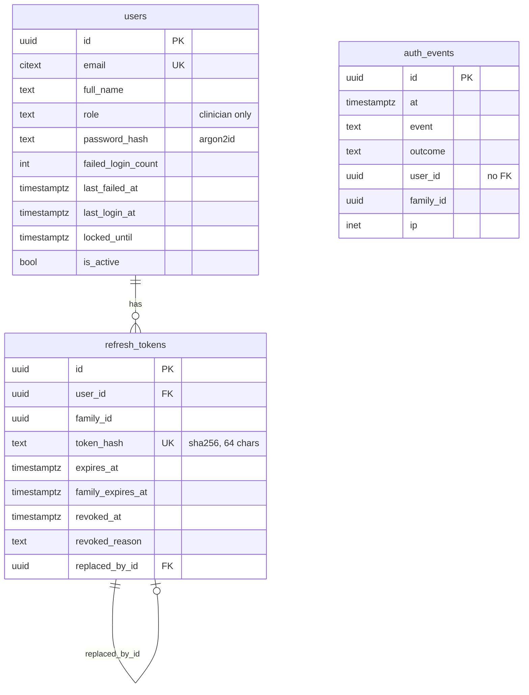
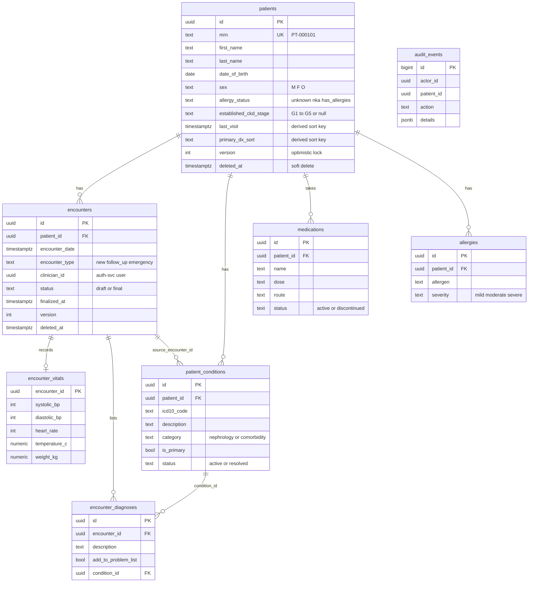
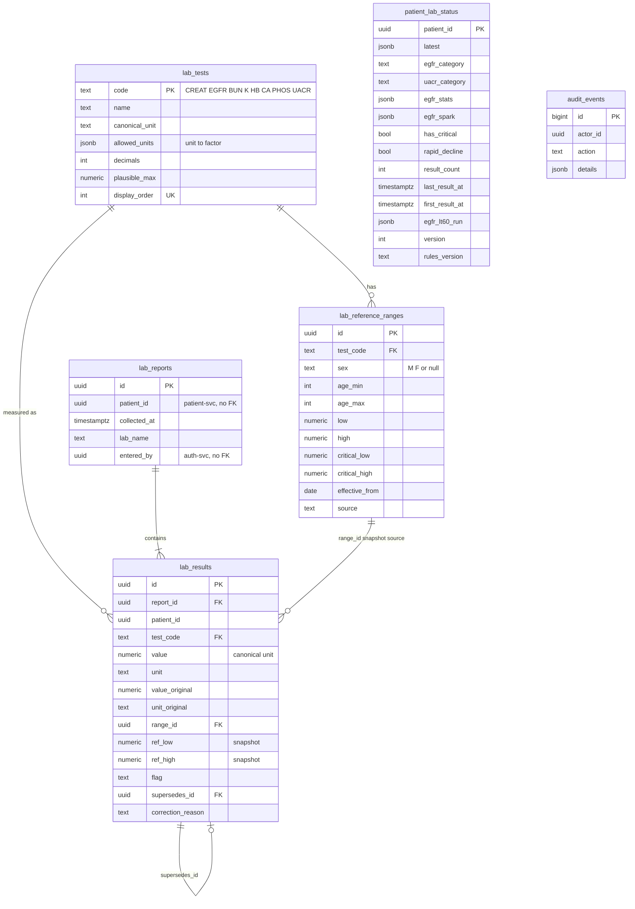
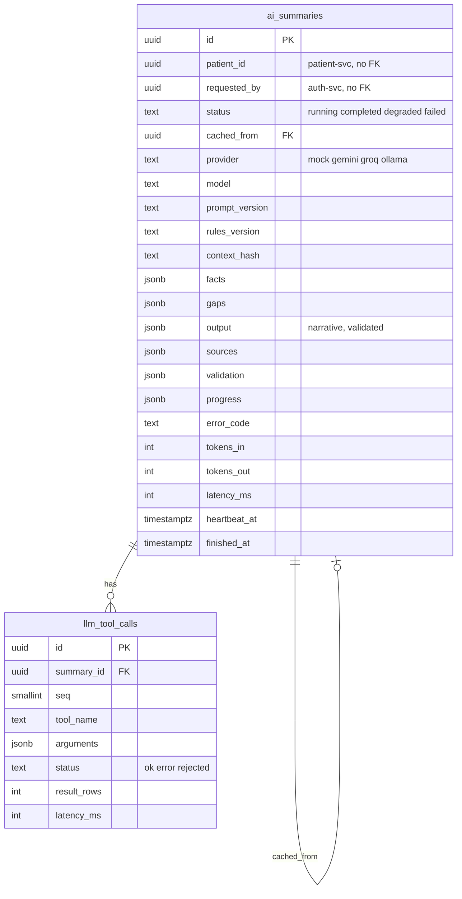

# Database schema and synthetic data

Each service owns one PostgreSQL database. The source of truth for every schema is the service's `migrations/` folder
(Alembic). This page describes the result so that the migrations do not have to be read. It was written from the
migration files and the SQLAlchemy models, not from a running database.

`make schema-dump` writes a schema-only `pg_dump` of each database to `docs/db/<service>.sql` (a readable snapshot of the
migrations; the files are not committed).

Contents:

- [Isolation model](#isolation-model)
- [auth-svc](#auth-svc)
- [patient-svc](#patient-svc)
- [lab-svc](#lab-svc)
- [ai-svc](#ai-svc)
- [Cross-service references](#cross-service-references)
- [Synthetic data](#synthetic-data)
- [Reseed a development database](#reseed-a-development-database)
- [Reference ranges](#reference-ranges)

## Isolation model

One Postgres server (the existing `graphgpt-postgres` container, host port 5433) holds four databases, one per service,
each with its own login role. `CONNECT` is revoked from `PUBLIC`, so a service cannot open another service's database.
Services share data only through their APIs. A column that points at another service's record is a plain UUID with no
foreign key. The full reasoning is in [HLD.md](HLD.md) §5.

| Service | Database | Runtime role | Migration role |
|---|---|---|---|
| auth-svc | `nephro_auth_db` | `auth_app` | `auth_migrator` |
| patient-svc | `nephro_patient_db` | `patient_svc` | `patient_svc` |
| lab-svc | `nephro_lab_db` | `lab_svc` | `lab_svc` |
| ai-svc | `nephro_ai_db` | `ai_svc` | `ai_svc` |

Each database has a `_test` twin used by the test suites. Common rules in all four: timestamps are `timestamptz`, ids are
`uuid` (`gen_random_uuid()`), and statement, lock and idle-in-transaction timeouts are set on every connection.

## auth-svc



| Table | Purpose and constraints that matter |
|---|---|
| `users` | One row per clinician. `role` is checked to be `clinician`; `password_hash` must start with `$argon2id$`; email length 3 to 254 |
| `refresh_tokens` | One row per issued refresh token. The token itself is never stored, only its SHA-256 hash (unique). `expires_at <= family_expires_at`. `revoked_at` and `revoked_reason` are set together; reasons are `rotated`, `logout`, `reuse_detected`, `user_inactive`, `password_changed`. Deleting a user deletes their tokens |
| `auth_events` | Append-only audit trail of sign-in outcomes (event, outcome, user and family ids, request id, IP, user agent) with no emails or tokens. The runtime role has `SELECT` and `INSERT` only; old rows go through `purge_auth_events(days)` with a 30-day floor |

Migrations: `0001` initial schema, `0002` `users.last_failed_at`, `0003` `password_changed` revoke reason, `0004`
`auth_events`, `0005` append-only `auth_events` and the purge function.

## patient-svc



| Table | Purpose and constraints that matter |
|---|---|
| `patients` | Demographics, history, allergy status and the established CKD stage. `mrn` comes from the sequence `patient_mrn_seq` and is checked against `^PT-[0-9]{6,}$`. `search_name` is a generated lower-case column behind a trigram index. `version` drives optimistic locking. `last_visit` and `primary_dx_sort` are derived sort keys kept in the same transaction as the change (migration 0004); they never change `version` |
| `encounters` | An outpatient visit. `status` is `draft` or `final`. A final encounter needs a chief complaint, assessment and plan, has `finalized_at`, and is immutable: the trigger `encounters_guard` rejects any update or delete of a final row. Only drafts can be soft-deleted (`encounters_delete_draft`) |
| `encounter_vitals` | At most one row per encounter, at least one value, plausible ranges (systolic 50 to 300, temperature 30 to 45 and so on), systolic above diastolic. Frozen once the encounter is final |
| `encounter_diagnoses` | Diagnoses typed in the encounter form. `add_to_problem_list` asks finalisation to link or create a condition; `condition_id` records the result. Frozen once the encounter is final |
| `patient_conditions` | The problem list. A partial unique index allows one active, non-deleted primary condition per patient. A primary condition must be active; a resolved one needs `resolved_date` |
| `medications` | Current and past medications. A discontinued medication needs an `end_date` |
| `allergies` | One row per allergen per patient (unique on the lower-cased name while not deleted) |
| `audit_events` | Append-only (`audit_append_only` trigger). Records who did what to which patient, with field names only, never values |

Deletion: `patients`, `patient_conditions`, `medications` and `allergies` cannot be hard-deleted (`no_hard_delete`
triggers); every delete is a `deleted_at` stamp. All foreign keys point inside this database.

Migrations: `0001` baseline, `0002` `encounter_diagnoses.category`, `0003` nullable `clinician_name` and a clock-aware
`updated_at` trigger, `0004` the two sort columns and their indexes.

## lab-svc



| Table | Purpose and constraints that matter |
|---|---|
| `lab_tests` | The catalog of the eight tests: canonical unit, accepted units with exact conversion factors (strings, so decimals stay exact), display decimals and a plausibility limit |
| `lab_reference_ranges` | Ranges by test, optional sex and age band, and `effective_from`. A new range row with a later date replaces an old one without losing history. `low <= high` and critical limits outside the normal range are checked |
| `lab_reports` | One submission of results for a patient: collection time (not in the future), lab name, who entered it |
| `lab_results` | One value. Append-only: triggers reject `UPDATE` and `DELETE` on `lab_results` and `lab_reports`. Each row stores the converted `value`, the `value_original` and `unit_original` as entered, and a snapshot of the range used (`ref_low`, `ref_high`, `crit_low`, `crit_high`) with the `flag`, so a later change of ranges never rewrites history. A correction is a new row with `supersedes_id`; a unique index allows at most one correction per result |
| `patient_lab_status` | A read model with one row per patient, rebuilt in the same transaction as every report or correction. It holds the latest value per test, the eGFR and UACR categories, trend statistics, the sparkline points, the critical and rapid-decline flags, `result_count` (current results only), and the length of the trailing run of eGFR below 60. `rules_version` records which rule set computed it; `make check-status` compares it with a rebuild from the results |
| `audit_events` | Append-only audit trail, same shape as patient-svc |

Migrations: `0001` baseline (tables, append-only triggers), `0002` audit, `0003` alignment with the design (column
renames, constraints, defaults), `0004` `first_result_at` and `egfr_lt60_run` on the read model.

## ai-svc



| Table | Purpose and constraints that matter |
|---|---|
| `ai_summaries` | One row per summary job. Only validated output is stored in `output`. Check constraints fix the shape of each status: `completed` has output, facts, gaps, sources, validation and a context hash (or is a cache hit pointing at an original); `degraded` has facts and gaps but no output and an error code; `failed` has an error code and no output. A partial unique index allows one running job per patient and clinician. A trigger makes a finished row immutable and forbids deletes |
| `llm_tool_calls` | Append-only log of the read-only tool calls the model made for one summary: tool name, bounded arguments, status, row and byte counts. `(summary_id, seq)` is unique |

Error codes allowed in `ai_summaries.error_code`: `UPSTREAM_UNAVAILABLE`, `UPSTREAM_TIMEOUT`, `PATIENT_NOT_FOUND`,
`LLM_TIMEOUT`, `LLM_UNAVAILABLE`, `LLM_RATE_LIMITED`, `LLM_CIRCUIT_OPEN`, `LLM_BUSY`, `LLM_INVALID_OUTPUT`, `JOB_TIMEOUT`,
`JOB_ABORTED`, `INTERNAL_ERROR`. AI text never reaches patient-svc: the summary lives only in this table.

Migration: `0001` initial schema.

## Cross-service references

No foreign key crosses a database. These columns hold another service's UUID.

| Column | Points at | Service holding the column |
|---|---|---|
| `lab_reports.patient_id`, `lab_results.patient_id`, `patient_lab_status.patient_id` | `patients.id` | lab-svc to patient-svc |
| `ai_summaries.patient_id` | `patients.id` | ai-svc to patient-svc |
| `encounters.clinician_id`, `finalized_by`, `created_by`, `updated_by` (patient-svc), `lab_reports.entered_by`, `lab_results.entered_by` (lab-svc), `ai_summaries.requested_by` (ai-svc), `audit_events.actor_id` (patient-svc, lab-svc) | `users.id` | to auth-svc |

lab-svc checks that a patient exists by calling patient-svc (`/internal/patients/{id}/basic`) when a report is created.
Nothing checks the reverse direction, so deleting a patient in patient-svc (a soft delete) leaves lab rows in place.

## Synthetic data

All data is invented. No real person, MRN or record is in the repository.

How it is generated:

- **Deterministic ids.** Seeded patients and clinicians get UUIDv5 ids from one namespace
  (`9b3f6a52-7c1e-4d0b-9a58-2f4e8c1d7a10`): `uuid5(ns, "patient:" + MRN)` and `uuid5(ns, "user:" + email)`. The three seeding
  services use the same function, so lab-svc and auth-svc reference patient-svc ids without calling it.
- **Dates relative to the seed day.** Visits, follow-ups and lab dates are offsets in days from the day the seed runs,
  so "last visit 6 days ago" and "no labs for 230 days" stay true on any date.
- **Consistent clinical values.** lab-svc computes each creatinine from the target eGFR with the CKD-EPI 2021 equation
  for the patient's age and sex, so creatinine and eGFR always agree (except where a scenario says otherwise). A fixed
  random seed per patient makes every run produce the same digits.
- **Through the real write path.** The seeds call the same services the API uses, so flags, range snapshots, the read model and
  audit rows are what a clinician entering the same data would produce.

Demo clinicians (password in the root [README](../README.md#quick-start)): Dr. Anita Rao (`dr.rao@nephrocare.demo`) and
Dr. Karan Malhotra (`dr.malhotra@nephrocare.demo`).

The ten patients. "Stage" is the established CKD stage recorded in patient-svc; the eGFR column is the first and latest
seeded eGFR from lab-svc's profile table (`lab-svc/app/cli/seed_labs.py`). Scenarios were read from the seed files and
profiles; they were not re-checked in the running app for this page.

| MRN | Patient | Stage | Reports (eGFR first to latest) | Scenario it demonstrates |
|---|---|---|---|---|
| PT-000101 | Ramesh Kulkarni, M, born 1959 | G3b | 8 (54 to 38) | Rapid decline with heavy albuminuria (A3); one creatinine entered in µmol/L; four encounters, one a draft; penicillin allergy |
| PT-000102 | Sunita Verma, F, born 1971 | G3a | 7 (58 to 55) | A stable baseline; no known allergies |
| PT-000103 | Arjun Mehta, M, born 1985 | G2 | 6 (82 to 78) | Mostly normal results; allergy status unknown |
| PT-000104 | Fatima Sheikh, F, born 1948 | G4 | 7 (34 to 24) | Advanced disease with a rapid decline; sulfonamide (severe) and contrast allergies |
| PT-000105 | Vikram Rao, M, born 1990 | none | 4 (30 to 74) | Recovery after acute kidney injury (improving trend); no established stage |
| PT-000106 | Lakshmi Iyer, F, born 1955 | G4 | 6 (44 to 38) | Stage mismatch: the recorded stage is G4 but the latest eGFR is in G3b, so the mismatch chip shows |
| PT-000107 | Mohan Das, M, born 1962 | G2 | 5 (76 to 72) | No labs for 230 days (a missing-labs gap); the last reported eGFR disagrees with the one derived from creatinine (an inconsistency finding) |
| PT-000108 | Priya Nair, F, born 1996 | none | none | An almost empty chart: no labs, encounters, conditions, medications or allergies, and unknown allergy status |
| PT-000109 | Aditya Singh, M, born 1973 | G5 | 6 (19 to 11) | Critical potassium (6.2) and creatinine; latex allergy |
| PT-000110 | Kavita Joshi, F, born 1992 | none | 5 (59 to 49) | Lupus nephritis with low eGFR and no established stage; a medication (hydroxychloroquine) with an end date |

## Reseed a development database

Seeds are idempotent: a second run skips what exists. Run them from each service folder with its `.env` loaded (the root
`make seed` runs the three that have a seed; ai-svc has none).

```bash
make -C auth-svc seed       # the two demo clinicians
make -C patient-svc seed    # ten patients with conditions, medications, allergies and encounters
make -C lab-svc seed        # the test catalog and ranges, then the lab reports
```

Resetting wipes a database, so each reset needs an explicit opt-in and refuses to run in production:
`make -C patient-svc seed-reset` and `make -C lab-svc seed-reset` (which sets `SEED_ALLOW_RESET=true`). Reset the
development database of one service only after reading what its seed does; the other services' rows keep pointing at the
same deterministic ids, so a reseed restores the links.

## Reference ranges

| Question | Answer |
|---|---|
| Where do the values live? | `lab-svc/app/domain/catalog_data.py`, loaded into `lab_tests` and `lab_reference_ranges` by `make -C lab-svc seed` (`seed_catalog`). It is the single source; the Angular app reads them from `GET /api/labs/tests` and defines none of its own |
| Which tests are sex-specific? | Creatinine and hemoglobin have separate male and female rows. The others have one row for all patients. The table also supports age bands |
| How is a range chosen? | By test, then a sex-specific row over an any-sex row, then an age-banded row over an open one, then the latest `effective_from` on or before the collection date. No match gives the flag `unknown`, never `normal` |
| What is stored on a result? | A snapshot of the range used (`ref_low`, `ref_high`, `crit_low`, `crit_high`), so flags never change retroactively |
| Where do the values come from? | No reference-ranges file was provided. The values are common adult reference intervals taken from the reference UI prototype (`reference/emr-ui.html`), marked in the `source` column as a placeholder |
| Classification | eGFR categories G1 to G5 and albuminuria categories A1 to A3 follow KDIGO 2012, with lower-inclusive boundaries (90, 60, 45, 30, 15; UACR 30 and 300) |
| How would a supplied file be used? | Replace the values in `catalog_data.py` with a later `effective_from`. Old results keep their snapshots; new results use the new rows |
