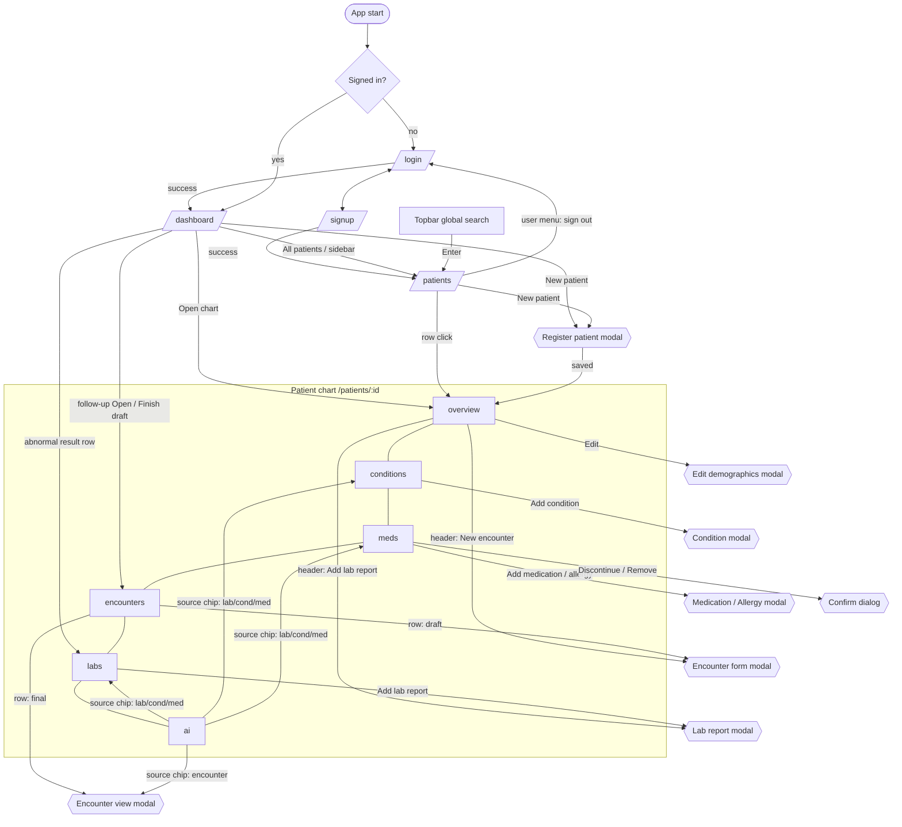

# UI inventory and build specification

Sources: `reference/emr-ui.html` (1315 lines, cited as `html:LINE`), `reference/assignment.pdf`, `docs/HLD.md` (v2, cited as `HLD §N`), `CLAUDE.md`.
Marker **⚑** = something I had to invent or decide because no source specifies it. Marker **❓** = needs the owner's decision.

## 0. What the reference HTML actually is

A single-file prototype ("NephroCare EMR - Prototype") with a simulated gateway and four simulated services, all in one inline `<script>` (html:303-1312). Hash routing (`#/…`). Style: calm clinical teal on cool grey, dark teal sidebar, IBM Plex Sans and Mono, 8–10 px radii, flat panels with 1 px borders, almost no shadows except on overlays. A violet palette is reserved for AI content so it cannot be mistaken for record content.

Rendered screens: **Dashboard**, **Patient list**, **Patient detail** (tabs Overview, Conditions, Medications and allergies, Encounters, Labs, AI summary), and modals (register/edit patient, add condition, add medication, add allergy, encounter form, encounter view, add lab report, confirm).

Code present but **unreachable** (dead or hidden):

- Sign-in and sign-up markup (`viewAuth`, html:713-725) and their forms. Startup auto-signs in a clinician and redirects `#/login|signup|system|architecture` to the dashboard (html:1309-1310).
- Admin role, `/system` route, "Use admin account" demo button.
- CSS for an architecture/journey view (`.flow-svg`, `.node`, `.edge`, `.jr`, `.jstep`, `.decision`, html:260-275) and a network drawer (`.net`, `renderNet`). No markup is rendered for them.
- Mobile nav (`.mnav` is `display:flex` at ≤900 px, html:280) but no element has that class. Mobile has **no navigation at all**.
- `#umenu` dropdown (`.menu`, `.user-menu`): `toggle-user-menu` is wired but the user button is a static `div`. Logout exists as an action (html:700) with no button.
- `.switch` toggle CSS is unused. `.svc-pill` / `.pills` unused.

Decision: build only what is reachable or required (auth screens come from `viewAuth` + HLD §15.4). Do not build admin, architecture, network drawer or service pills.

## 1. External dependencies

| Item         | What the HTML loads                                                                                                                                                                                        | Angular plan                                                                                                                                                                                                                                                                                                                                                                                                                                                                                                                                                  |
| ------------ | ---------------------------------------------------------------------------------------------------------------------------------------------------------------------------------------------------------- | ------------------------------------------------------------------------------------------------------------------------------------------------------------------------------------------------------------------------------------------------------------------------------------------------------------------------------------------------------------------------------------------------------------------------------------------------------------------------------------------------------------------------------------------------------------- |
| Fonts        | Google Fonts CSS2: IBM Plex Sans 400/500/600/700 and IBM Plex Mono 400/500, `display=swap`, with `preconnect` to fonts.googleapis.com and fonts.gstatic.com (html:8-10)                                    | Self-host via npm `@fontsource/ibm-plex-sans` (400, 500, 600, 700) and `@fontsource/ibm-plex-mono` (400, 500), latin subset, imported in `styles.scss`. Reason: no third-party request, works offline and in the clinic network, no layout shift, same glyphs. Alternative rejected: CDN link (privacy, offline, CSP).                                                                                                                                                                                                                                        |
| Icons        | None external. 40 hand-written Feather-style inline SVG paths in an `ICONS` map (html:329-368), 24×24 viewBox, `fill:none`, `stroke:currentColor`, `stroke-width:1.8`, round caps and joins, default 18 px | `emr-icon` component with a typed `IconName` union and a `const` path registry copied verbatim. No icon library. Names: search plus x check users user activity alert file logout sliders server db calendar edit trash right left down clock shield lock spark flask pill clip git play pause refresh terminal info up dn copy star eye key. Unused in reachable views: sliders, server, db (used in AI panel header), git, play, pause, terminal, eye, key, clock, shield (used in 403 error state), lock (used in final encounter alert). Keep all; cheap. |
| Charts       | None. Hand-built SVG `lineChart` (html:983-1004) and `spark` (html:1259-1266)                                                                                                                              | Chart.js 4 + `ng2-charts` + `chartjs-adapter-date-fns` + `date-fns` + `chartjs-plugin-annotation`, lazy-loaded (HLD ADR-014; assignment §2 requires a charting library). Sparkline: tiny inline SVG component, not Chart.js.                                                                                                                                                                                                                                                                                                                                  |
| Favicon      | Inline SVG data-URI, teal `#0e6b75` rounded square with a white pulse line (html:7)                                                                                                                        | Copy verbatim into `public/favicon.svg` and `index.html`.                                                                                                                                                                                                                                                                                                                                                                                                                                                                                                     |
| JS libraries | None                                                                                                                                                                                                       | n/a                                                                                                                                                                                                                                                                                                                                                                                                                                                                                                                                                           |
| Locale       | `toLocaleDateString('en-GB', …)`                                                                                                                                                                           | Angular `DatePipe` with `en-GB` locale registered. Formats below.                                                                                                                                                                                                                                                                                                                                                                                                                                                                                             |

Date formats (verbatim behaviour): date = `dd MMM yyyy` (e.g. 21 Oct 2026); date-time = `dd MMM yyyy, HH:mm`; time = `HH:mm:ss`; empty = `-`; chart x-axis ticks = `MMM yy`.

## 2. Design tokens (verbatim)

No dark theme exists in the HTML, so none is created. Single `prefers-reduced-motion` rule exists (html:281) and must be kept.

### 2.1 Colors

Declared custom properties (html:12-21), with proposed semantic names. Keep the HTML's short names as the underlying variable names (`--teal`, etc.) **and** add the semantic alias, so diffs against the HTML stay trivial. ⚑ aliases are mine.

| HTML var     | Value                                                                        | Semantic token ⚑         | Use                                      |
| ------------ | ---------------------------------------------------------------------------- | ------------------------ | ---------------------------------------- |
| `--bg`       | `#f4f6f7`                                                                    | `--color-surface-page`   | page background, input wells, hover fill |
| `--surface`  | `#fff`                                                                       | `--color-surface-raised` | panels, topbar, modals                   |
| `--line`     | `#e1e7ea`                                                                    | `--color-border-default` | panel/table borders                      |
| `--line-2`   | `#cdd6db`                                                                    | `--color-border-strong`  | input/button borders, tab rule           |
| `--ink`      | `#10202b`                                                                    | `--color-text-primary`   | body text                                |
| `--ink-2`    | `#3d5260`                                                                    | `--color-text-secondary` | labels, secondary text                   |
| `--ink-3`    | `#6b7f8c`                                                                    | `--color-text-muted`     | captions, "Not documented"               |
| `--teal`     | `#0e6b75`                                                                    | `--color-primary-600`    | primary, links, focus                    |
| `--teal-700` | `#0a555d`                                                                    | `--color-primary-700`    | primary hover, active tab text           |
| `--teal-50`  | `#e6f3f4`                                                                    | `--color-primary-50`     | focus halo, chip bg                      |
| `--teal-100` | `#cde7ea`                                                                    | `--color-primary-100`    | avatar bg, chip border                   |
| `--nav`      | `#0c2a31`                                                                    | `--color-nav-bg`         | sidebar                                  |
| `--nav-2`    | `#143b44`                                                                    | `--color-nav-bg-active`  | nav hover/active, clinic card            |
| `--nav-ink`  | `#a9c4ca`                                                                    | `--color-nav-text`       | nav text                                 |
| `--ai`       | `#5b3fd1`                                                                    | `--color-ai-600`         | AI accent                                |
| `--ai-50`    | `#f0edfc`                                                                    | `--color-ai-50`          | AI banner/chip bg                        |
| `--ai-100`   | `#ded7f8`                                                                    | `--color-ai-100`         | AI borders                               |
| `--ok`       | `#12805c`                                                                    | `--color-success-600`    |                                          |
| `--ok-50`    | `#e5f5ee`                                                                    | `--color-success-50`     |                                          |
| `--warn`     | `#a86400`                                                                    | `--color-warning-600`    |                                          |
| `--warn-50`  | `#fff3dc`                                                                    | `--color-warning-50`     |                                          |
| `--bad`      | `#be2f3b`                                                                    | `--color-danger-600`     |                                          |
| `--bad-50`   | `#fcebed`                                                                    | `--color-danger-50`      |                                          |
| `--info`     | `#1560a8`                                                                    | `--color-info-600`       |                                          |
| `--info-50`  | `#e6f0fa`                                                                    | `--color-info-50`        |                                          |
| `--font`     | `"IBM Plex Sans",system-ui,-apple-system,"Segoe UI",Roboto,Arial,sans-serif` | `--font-sans`            |                                          |
| `--mono`     | `"IBM Plex Mono",ui-monospace,SFMono-Regular,Menlo,Consolas,monospace`       | `--font-mono`            |                                          |

Hard-coded colors found in CSS/JS (not declared as variables). Each needs a token (CLAUDE.md §3 forbids literals in component SCSS). Used-once values are marked **one-off**; recommended to still tokenise so components stay literal-free, but group them as "derived".

| Value                                                            | Where                                                                          | Proposed token ⚑                                                |
| ---------------------------------------------------------------- | ------------------------------------------------------------------------------ | --------------------------------------------------------------- |
| `#e5b9be`                                                        | `.btn.danger` border                                                           | `--color-danger-border-strong`                                  |
| `#bfe5d3`                                                        | chip.ok, alert.ok border                                                       | `--color-success-border`                                        |
| `#f0d9a6`                                                        | chip.warn, alert.warn border                                                   | `--color-warning-border`                                        |
| `#f0c2c7`                                                        | chip.danger, alert.danger border                                               | `--color-danger-border`                                         |
| `#bcd6ee`                                                        | chip.info, alert.info border                                                   | `--color-info-border`                                           |
| `#6e4400`                                                        | alert.warn text                                                                | `--color-warning-text`                                          |
| `#80202a`                                                        | alert.danger text                                                              | `--color-danger-text`                                           |
| `#0f4478`                                                        | alert.info text                                                                | `--color-info-text`                                             |
| `#0c5c42`                                                        | alert.ok text                                                                  | `--color-success-text`                                          |
| `#4a31b5`                                                        | `.btn.ai:hover`                                                                | `--color-ai-700`                                                |
| `#5fc4cf`                                                        | nav active inset bar; auth trace stroke; `inset 3px 0 0`                       | `--color-nav-accent`                                            |
| `#8fb0b7`                                                        | `.sim-note` text (unused)                                                      | skip (dead code)                                                |
| `#1c4953`                                                        | `.sim-note` border (unused)                                                    | skip                                                            |
| `#fafcfc`                                                        | `th`, `.sect-label` bg                                                         | `--color-surface-subtle`                                        |
| `#f8fbfb`                                                        | `tr.click:hover td`                                                            | `--color-row-hover`                                             |
| `#eef3f4`                                                        | `.tab:hover` bg                                                                | `--color-tab-hover`                                             |
| `#fffaf0` / `#fff5f6`                                            | `.lt.abn` / `.lt.crit` bg                                                      | `--color-lab-abnormal-bg` / `--color-lab-critical-bg`           |
| `#e6ecef`                                                        | chart grid line                                                                | `--color-chart-grid`                                            |
| `#e5f5ee` @ .75 opacity                                          | chart reference band (same hex as `--ok-50`)                                   | reuse `--color-success-50`                                      |
| `#b8c6cd`                                                        | eGFR stage line (dashed)                                                       | `--color-chart-stage-line`                                      |
| `#6b7f8c`                                                        | stage label text                                                               | reuse `--color-text-muted`                                      |
| `#9fb0b8`                                                        | chart crosshair                                                                | `--color-chart-crosshair`                                       |
| `#10202b`                                                        | tooltip bg, toast bg, last-point label                                         | reuse `--color-text-primary` as `--color-tooltip-bg`            |
| `#2f2268`                                                        | `.ai-sec h3`                                                                   | `--color-ai-900`                                                |
| `#faf9ff`                                                        | `.disclaimer` bg                                                               | `--color-ai-disclaimer-bg`                                      |
| `#3a2f78`                                                        | `.disclaimer` text                                                             | `--color-ai-disclaimer-text`                                    |
| `#eee9fb`                                                        | `.fu` row divider                                                              | `--color-ai-divider`                                            |
| `#0f1d24`, `#d6e6ea`                                             | `pre.code` bg / text                                                           | `--color-code-bg` / `--color-code-text`                         |
| `#d3e4e8`                                                        | `.auth-art` text                                                               | `--color-nav-text-strong`                                       |
| `#b6ced3`                                                        | `.auth-art li` text                                                            | `--color-nav-text-soft`                                         |
| `#b6c5cc`                                                        | architecture node stroke (dead)                                                | skip                                                            |
| `#e8f2f3`, `#f4f7f8`, `#f5f2fd`, `#b8aaec`, `#a5b4bc`, `#8f7ae0` | architecture view (dead)                                                       | skip                                                            |
| `#eef2f4`, `#f7f9fa`                                             | skeleton gradient                                                              | `--color-skeleton-1` / `--color-skeleton-2`                     |
| `#fff` literal                                                   | many surfaces/text-on-color                                                    | `--color-surface-raised` / `--color-on-primary`                 |
| `#ff8e98`, `#6ee0b2`, `#8fd3ff`                                  | toast icon colors (err/ok/info)                                                | `--color-toast-icon-error/-success/-info`                       |
| `#bfe3e6 #8ccdd3 #52aeb8 #2f8f9b #0e6b75 #083f46`                | `STAGE_COL` G1…G5 bars (html:1276)                                             | `--color-stage-g1` … `--color-stage-g5` (G4 equals primary-600) |
| `#6b7f89`                                                        | sparkline neutral stroke (note: differs by one digit from `--ink-3` `#6b7f8c`) | use `--color-text-muted`; ⚑ treat as typo, flag in §7           |
| `#12805c #1560a8 #a86400 #be2f3b #6b7f8c`                        | `flagColor` for chart points (html:373)                                        | reuse success/info/warning/danger/muted tokens                  |
| `rgba(12,42,49,.15)`                                             | user menu shadow                                                               | `--shadow-menu`                                                 |
| `rgba(10,28,34,.5)`                                              | modal backdrop                                                                 | `--color-backdrop`                                              |
| `rgba(10,28,34,.35)`                                             | modal shadow                                                                   | `--shadow-modal`                                                |
| `rgba(0,0,0,.25)`                                                | toast shadow                                                                   | `--shadow-toast`                                                |
| `rgba(12,42,49,.12)`                                             | net drawer shadow (dead)                                                       | skip                                                            |

Chart colors: series line `--teal`; normal band `#e5f5ee` @ .75; point fill = flag color above; sparkline stroke worsening `#be2f3b`, improving `#12805c`, stable `#6b7f89`.

### 2.2 Typography

Base: `font-family: var(--font); font-size:14px; line-height:1.5; -webkit-font-smoothing:antialiased`. Inputs inherit family, `font-size:14px`, color `--ink`.

| Element / class                                                                      | Size                           | Weight            | Line-height | Letter-spacing | Notes                                                       |
| ------------------------------------------------------------------------------------ | ------------------------------ | ----------------- | ----------- | -------------- | ----------------------------------------------------------- |
| h1                                                                                   | 22px                           | 600               | 1.25        | -.01em         | `.greet` 24px / -.01em; `.auth-art h1` 34px / 1.15 / -.02em |
| h2                                                                                   | 16px                           | 600               | 1.25        |                | `.auth-card h2` 22px                                        |
| h3                                                                                   | 14px                           | 600               | 1.25        |                |                                                             |
| body, td                                                                             | 14px                           | 400               | 1.5         |                |                                                             |
| `.small`                                                                             | 12.5px                         |                   |             |                |                                                             |
| th, `.fld-l`(13px), `.ckd-cell .t`, `.lt .t`, `.kpi .l`                              | 12.5 / 13 / 12.5 / 12.5 / 12.5 | 500 for th, fld-l |             |                |                                                             |
| `.btn`                                                                               | 13.5px                         | 500               |             |                | `.btn.sm` 13px                                              |
| `.chip`                                                                              | 12px                           | 500               |             |                | `.tab .ct` 11.5px                                           |
| `.hint`, `.err`, `.svc-pill`, `.sim-note`, `.brand small`, `.avatar`, `.vit-tile .t` | 12px                           |                   |             |                | avatar 600                                                  |
| `.kpi .n`                                                                            | 26px                           | 600               | 1.1         | -.02em         |                                                             |
| `.ckd-cell .v`                                                                       | 24px                           | 600               |             | -.02em         |                                                             |
| `.lt .v`                                                                             | 21px, mono                     | 500               |             |                | `small` inside 12px, sans                                   |
| `.vit-tile .v`                                                                       | 17px mono                      |                   |             |                |                                                             |
| `.brand b`                                                                           | 15px                           |                   |             | -.005em        |                                                             |
| `.user-btn .who b`                                                                   | 13px                           |                   | 1.2         |                |                                                             |
| `.menu button/a`                                                                     | 13.5px                         |                   |             |                |                                                             |
| `.empty b`                                                                           | 15px                           |                   |             |                |                                                             |
| chart axis text                                                                      | 11px                           |                   |             |                | `.stage-t` 10.5px                                           |
| chart last-point label                                                               | 12px                           | 600               |             |                | inline style                                                |
| `pre.code`                                                                           | 12px mono                      |                   | 1.55        |                |                                                             |
| `.hbar`                                                                              | 13px                           |                   |             |                | `.ct` 600                                                   |
| `.ai-sec p`                                                                          | 14px                           |                   | 1.6         |                | max-width 78ch                                              |
| `.disclaimer`                                                                        | 13px                           |                   |             |                |                                                             |
| `.toast`                                                                             | 13.5px                         |                   |             |                |                                                             |
| `.mono`                                                                              | mono + `tabular-nums`          |                   |             |                | IDs, numbers                                                |
| `.nd`                                                                                | `--ink-3`, italic              |                   |             |                | "Not documented"                                            |
| `.pw-rules`                                                                          | 12px                           |                   |             |                |                                                             |
| `.auth-card h2` + intro                                                              | 22px / default                 |                   |             |                |                                                             |

Weights actually needed: Sans 400, 500, 600, 700 (700 from bare `<b>`/`<strong>` UA default); Mono 400, 500.

### 2.3 Spacing, radii, borders, shadows, layers, motion

Spacing is **not a scale** in the HTML; values are ad hoc px. Observed set: 2, 3, 4, 5, 6, 7, 8, 9, 10, 11, 12, 13, 14, 16, 18, 20, 22, 24, 26, 30, 32, 36, 40, 48. ⚑ Proposal: do not invent a 4-pt scale (it would alter pixel values). Define a spacing token per _observed value that is used 2+ times_ (`--space-2 … --space-24` named by px) and keep one-offs as component-local custom properties. Key layout values: sidebar 240px; topbar padding `10px 24px`; view padding 24px, max-width 1360px; grid gap 16px; panel-h padding `13px 16px`; panel-b 16px; table th `9px 14px`, td `11px 14px`; modal-h `16px 20px`, modal-b `18px 20px 20px`; button height 36 (sm 30), input min-height 36 (sm 32), icon-btn 30; avatar 32 (lg 44).

Radii: 4 (focus ring, hbar track), 6 (menu items, icon-btn, tab top, nav), 8 (buttons, inputs, nav-item, alerts, toast, vit-tile, tooltip), 9 (brand logo; ai-banner/disclaimer inner), 10 (panels, kpis, menu, auth cards, demo box), 12 (modal), 999 (chips, pills, switch, seg radius 8), 50% (avatar, dots).

Borders: 1px solid everywhere (`--line` default, `--line-2` inputs/buttons); AI panel `border-left:4px solid var(--ai)`; active tab `2px` bottom; nav active `inset 3px 0 0`; sort of dashed `1px dashed` for `.ai-sec` dividers and `.demo-box`; step dot 2px.

Shadows: menu `0 10px 30px rgba(12,42,49,.15)`; modal `0 24px 70px rgba(10,28,34,.35)`; toast `0 8px 24px rgba(0,0,0,.25)`; focus halo on inputs `0 0 0 3px var(--teal-50)`; nav active `inset 3px 0 0 #5fc4cf`.

Focus: global `:focus-visible{outline:2px solid var(--teal);outline-offset:2px;border-radius:4px}`; inputs additionally `outline:none; border-color: var(--teal); box-shadow: 0 0 0 3px var(--teal-50)`.

z-index: topbar 20, menu 40, net 60 (dead), backdrop 100, tooltip 200, toasts 300.

Transitions/animation: switch `.15s` (unused); tooltip opacity `.08s`; toast in `.18s ease-out` (translateY 8px→0, opacity); `pulse .7s infinite alternate`; AI step spinner `spin .8s linear infinite`; skeleton `sk 1.1s infinite` (background-position -200%); `prefers-reduced-motion: reduce` kills all animation and transition.

### 2.4 Breakpoints (only two in the HTML)

| Max width | Changes                                                                                                                                                                                              |
| --------- | ---------------------------------------------------------------------------------------------------------------------------------------------------------------------------------------------------- |
| ≤1100px   | `.g4`, `.kpis` → 2 columns; `.g-main`, `.g3` → 1 column; `.latest-grid` → 2 columns (border fix-ups for `.lt`).                                                                                      |
| ≤900px    | `.shell` → 1 column; `.sidebar` hidden; `.mnav` shown (no element exists); `.g2` → 1 column; `.auth` → 1 column and `.auth-art` hidden; `.ckd-grid` → 1 column; `.vit` → 2 columns; `.pills` hidden. |

The phase prompts check 1440, 1024, 768, 375. Those are _test widths_, not breakpoints. Behaviour: 1440 (wide, max-width 1360 content), 1024 (≤1100 rules), 768 and 375 (≤900 rules). ⚑ There is nothing specific below 900. Below ~560 px several rigid grids will cramp (`.dl` 150px label, `.hbar` 150px, `.dx-row` 110px+1fr, `.lab-row` 5 columns, `.kpis` 2 cols, `.f-row` auto-fit 150px is fine). Phase 12 must add ⚑ small-screen rules built only from existing patterns (stack `.dl`, `.dx-row`, `.lab-row`; single-column kpis ≤480).

Single-use values to decide: `.sim-note`, `.svc-pill`, `.net` (dead, drop); `.trace` opacity .5 and 420px width (auth art, one-off, keep local); `.auth-art` padding 48px (one-off).

## 3. Screen and view map

### 3.1 Navigation flow

### 3.2 Screens

| Screen                           | Purpose                                                                                                                                                                     | Layout regions                                                                                                                                                                                                                                | Data shown                                                                                                                                                             | Entry / exit                                                     |
| -------------------------------- | --------------------------------------------------------------------------------------------------------------------------------------------------------------------------- | --------------------------------------------------------------------------------------------------------------------------------------------------------------------------------------------------------------------------------------------- | ---------------------------------------------------------------------------------------------------------------------------------------------------------------------- | ---------------------------------------------------------------- |
| **Shell** (all signed-in routes) | Frame                                                                                                                                                                       | Left sidebar 240px (brand, nav, clinic card); right column: sticky topbar (global search, user chip) over `main.view`                                                                                                                         | Nav: Dashboard, Patients; clinic card "Lotus Kidney Clinic / Outpatient nephrology"; user avatar, name, "Nephrologist"                                                 | Always                                                           |
| **Sign in** (`viewAuth`)         | Authenticate                                                                                                                                                                | 2-column: dark brand art (h1 "Kidney care, charted clearly.", 3 value bullets, ECG trace SVG) + form card with Sign in / Create account segmented link                                                                                        | email, password, error alert, demo accounts box                                                                                                                        | `/login` → dashboard                                             |
| **Sign up**                      | Create clinician                                                                                                                                                            | same                                                                                                                                                                                                                                          | full name, email, password (+ live rule hints), confirm                                                                                                                | `/signup` → patients                                             |
| **Dashboard**                    | Daily worklist                                                                                                                                                              | Greeting + date, 2 actions; KPI strip (5); `g-main`: Needs attention list + eGFR category bars; `g2`: Abnormal results table + (Upcoming follow-ups, Draft encounters)                                                                        | KPIs: patients, need attention, critical results, rapid eGFR decline, draft encounters                                                                                 | Home; row clicks to chart/labs/encounters                        |
| **Patient list**                 | Find a patient                                                                                                                                                              | Page header + "New patient"; KPI strip; panel with toolbar (search, sex, CKD stage, Needs-attention checkbox, Clear filters), table, pager                                                                                                    | Patient ID (mono), Name + avatar + phone or red "Needs attention", Age, Gender, Primary diagnosis, CKD stage chip, Latest eGFR + flag chip, eGFR sparkline, Last visit | Row → `/patients/:id/overview`                                   |
| **Patient shell**                | Hub                                                                                                                                                                         | Breadcrumb; header (avatar, name, chips: ID, age/sex, DOB, allergy chip; actions: New encounter, Add lab report, AI summary); stage strip (established vs eGFR category, mismatch chip); tab bar with count pills; tab body                   |                                                                                                                                                                        |                                                                  |
| **Overview**                     | Summary                                                                                                                                                                     | Kidney function panel (CKD strip + eGFR chart w/ stage bands + creatinine chart + trend chips); `g-main`: [Demographics, Medical history] and [At a glance, Recent encounters (3), gap alert]                                                 |                                                                                                                                                                        | Edit → modal                                                     |
| **Conditions**                   | Problem list                                                                                                                                                                | Established-stage select + eGFR category + mismatch alert + Add condition; two tables (Nephrology diagnoses, Comorbidities)                                                                                                                   | ICD-10, description (+Primary chip), onset, status chip, actions                                                                                                       |                                                                  |
| **Medications and allergies**    |                                                                                                                                                                             | `g-main`: medications table (+ "Show discontinued", Add) and allergies panel (status alert, list with severity chip, remove)                                                                                                                  |                                                                                                                                                                        |                                                                  |
| **Encounters**                   | History                                                                                                                                                                     | Panel with table (Date, Type, Clinician, Chief complaint, Assessment (90 chars), BP / HR, Status chip)                                                                                                                                        |                                                                                                                                                                        | Row → view modal (final) or edit modal (draft)                   |
| **Labs**                         | Kidney function                                                                                                                                                             | CKD grid (3 cells), mismatch alert, latest-results grid (8 tiles, 4 cols), controls (range select, stage bands checkbox, Add lab report), two chart panels, Result history panel (test filter, abnormal-only, table, pager)                   |                                                                                                                                                                        |                                                                  |
| **AI summary**                   |                                                                                                                                                                             | Intro panel with Generate/Regenerate; progress stepper panel; Summary header; Calculated panel; Missing/inconsistent panel; AI-generated narrative panel with disclaimer; "What the AI was given" fold; Previous summaries; Demo options fold |                                                                                                                                                                        |                                                                  |
| **Modals**                       | Register/Edit patient (lg), Add condition, Add medication, Add allergy, Encounter form (lg), Encounter view (lg, read-only), Add lab report (lg), Confirm (sm)              | Backdrop, dialog, header with title/sub and close, body                                                                                                                                                                                       |                                                                                                                                                                        | Escape or backdrop click closes (no focus trap, no focus return) |
| **Empty / error / skeleton**     | `.empty` block (icon, bold title, text, optional action); `errorState` (403 Access denied, 404 Not found, else Something went wrong, with code and Back link); `.skel` bars |                                                                                                                                                                                                                                               |                                                                                                                                                                        |                                                                  |
| **Toasts**                       | Bottom-right stack, `aria-live=polite` container                                                                                                                            | ok / err / info                                                                                                                                                                                                                               |                                                                                                                                                                        | 3.4 s (5.2 s for errors)                                         |

Not in the HTML: 404 route page, session-expired screen, mobile nav, user menu with sign-out, 401/refresh handling. See §5 and §7.

## 4. Component inventory

Selector prefix `emr-`. Presentational unless marked (container). Inputs/outputs are proposals ⚑ derived from the HTML's behaviour.

| Component                                    | Where                                                          | Inputs                                                                                         | Outputs                  | Variants / states                                                                                                   | Notes                                                                                             |
| -------------------------------------------- | -------------------------------------------------------------- | ---------------------------------------------------------------------------------------------- | ------------------------ | ------------------------------------------------------------------------------------------------------------------- | ------------------------------------------------------------------------------------------------- |
| `emr-icon`                                   | everywhere                                                     | `name: IconName`, `size=18`                                                                    |                          |                                                                                                                     | `aria-hidden`, stroke 1.8                                                                         |
| `button[emr-button]`, `a[emr-button]`        | everywhere                                                     | `variant`: default, primary, ai, danger, ghost; `size`: md(36), sm(30); `loading`; `fullWidth` | native click             | hover, disabled (.5 opacity, not-allowed), loading (`pointer-events:none`, .8 opacity)                              | Auth submit is full width, height 40 (one-off)                                                    |
| `emr-icon-button`                            | modal close, remove rows, allergy remove                       | `icon`, `label` (required aria-label)                                                          | click                    | 30×30, hover bg `--bg`                                                                                              |                                                                                                   |
| `emr-text-field`                             | all forms                                                      | label, required, hint, error, `type`, prefix/suffix                                            | CVA                      | focus halo, invalid red border, readonly                                                                            | Label wraps control (`<label class="fld">`); error line 12px red                                  |
| `emr-select`, `emr-textarea`                 | forms, toolbars                                                | as above; select `size=sm` for toolbars                                                        | CVA                      | textarea min-height 70, resize vertical                                                                             | `.inp.sm` min-height 32, auto width                                                               |
| `emr-date-field`                             | DOB, onset, follow-up (date); visit/collected (datetime-local) | `kind: date                                                                                    | datetime`, `max`         | CVA                                                                                                                 |                                                                                                   | Native inputs |
| `emr-checkbox`                               | filters, "Add to problem list", "Primary"                      | label                                                                                          | CVA                      | 16px box                                                                                                            | `.chk`                                                                                            |
| `emr-switch`                                 | not used                                                       |                                                                                                |                          |                                                                                                                     | Skip (dead CSS)                                                                                   |
| `emr-search-input`                           | topbar (`.gsearch`), list toolbar (`.search`)                  | placeholder, value, `debounceMs`                                                               | `search`                 | focus-within border teal                                                                                            | Topbar submits on Enter (form); list is debounced 260ms in HTML. ❓ HLD/prompt say 300ms; use 300 |
| `emr-panel` (card)                           | everywhere                                                     | `flush` body, `accent` (ai)                                                                    |                          | slots: header (`panel-h`), body, footer                                                                             | overflow-x auto                                                                                   |
| `emr-kpi-strip`                              | dashboard, list                                                | `items: {value,label,hot}[]`                                                                   |                          | 5 columns → 2 at ≤1100                                                                                              | `hot` = red number                                                                                |
| `emr-ckd-grid` / `emr-stat-cell`             | Labs                                                           | `label`, `value`, `caption`                                                                    |                          | 3 columns → 1 at ≤900                                                                                               |                                                                                                   |
| `emr-latest-lab-tile`                        | Labs                                                           | `result?`, `testCode`, `sex`                                                                   |                          | normal / abn bg / crit bg / no result                                                                               | 4 cols → 2 at ≤1100                                                                               |
| `emr-data-table<T>`                          | list, conditions, meds, encounters, labs, dashboard            | columns, rows, `sortable`, `rowClickable`, loading, empty, error                               | `rowClick`, `sortChange` | hover row, `.num` right align, sticky none                                                                          | Header bg `#fafcfc`; ⚑ rows need `tabindex`/Enter (HTML lacks it)                                 |
| `emr-pagination`                             | list, labs                                                     | page, pages, total, label                                                                      | `pageChange`             | disabled prev/next                                                                                                  | "Showing a–b of N patients" / "N results", "Page x of y"                                          |
| `emr-badge` (chip)                           | everywhere                                                     | `tone`: neutral, ok, warn, danger, info, teal, ai; `icon?`                                     |                          | `.chip.ref` interactive variant (see source chip); chip with × button                                               |                                                                                                   |
| `emr-lab-flag`                               | tables, tiles, dashboard, AI                                   | `flag`                                                                                         |                          | Normal (ok), Low (info, ↓), High (warn, ↑), Critical low (danger, ↓), Critical high (danger, ↑), No range (neutral) | Text + icon: already not color-only                                                               |
| `emr-ckd-stage-badge`                        | list, headers                                                  | `stage?`                                                                                       |                          | teal chip or italic "Not set"                                                                                       |                                                                                                   |
| `emr-tabs`                                   | patient shell                                                  | `tabs: {key,label,icon,count?,tone?}[]`                                                        |                          | active teal underline; AI tab uses violet                                                                           | Router-driven `<a>`; ⚑ add `aria-current`                                                         |
| `emr-modal`                                  | all dialogs                                                    | `title`, `sub`, `size`: md 560 / lg 860 / sm 420                                               | `closed`                 | backdrop 50%                                                                                                        | ⚑ Must add focus trap + restore (HTML lacks)                                                      |
| `emr-confirm-dialog` (service)               | discontinue med, remove allergy, delete draft, finalize        | title, message, ok label, danger                                                               | promise/observable       |                                                                                                                     |                                                                                                   |
| `emr-toast` service + container              | global                                                         |                                                                                                |                          | ok/err/info                                                                                                         | polite live region                                                                                |
| `emr-alert`                                  | forms, mismatch, gaps                                          | `tone`: ok, warn, danger, info; icon                                                           |                          |                                                                                                                     |                                                                                                   |
| `emr-avatar`                                 | list rows, header, topbar                                      | `name`, `size`: md 32 / lg 44                                                                  |                          | initials, max 2                                                                                                     |                                                                                                   |
| `emr-empty-state`                            | many                                                           | title, text, icon?, action slot                                                                |                          |                                                                                                                     |                                                                                                   |
| `emr-error-state`                            | many                                                           | status, message, code?, back link                                                              | `retry` ⚑                | 403 / 404 / generic                                                                                                 | HTML has no retry button; add                                                                     |
| `emr-skeleton`                               | loading                                                        | lines widths                                                                                   |                          | shimmer 1.1s                                                                                                        |                                                                                                   |
| `emr-page-header`                            | list, dashboard                                                | title, subtitle, actions slot                                                                  |                          |                                                                                                                     |                                                                                                   |
| `emr-breadcrumbs`                            | patient shell                                                  |                                                                                                |                          |                                                                                                                     | "Patients / Name"                                                                                 |
| `emr-sidebar`, `emr-topbar`, `emr-user-menu` | shell                                                          |                                                                                                |                          |                                                                                                                     | ⚑ mobile drawer + sign-out menu to be designed                                                    |
| `emr-definition-list` (`.dl`)                | overview, encounter view                                       | `rows`                                                                                         |                          | 150px label grid                                                                                                    | values via `emr-value`                                                                            |
| `emr-not-documented` / `emr-value-with-unit` | everywhere                                                     | `value`, `unit?`, `emptyText`                                                                  |                          | "Not documented", "None recorded", "Not set", "No results", "No visits"                                             | The HTML uses several empty phrasings, keep them per context                                      |
| `emr-list-item`                              | meds, allergies, encounters, dashboard                         |                                                                                                |                          |                                                                                                                     |                                                                                                   |
| `emr-vitals-tiles`                           | encounter view                                                 | `vitals`                                                                                       |                          | 5 → 2 cols at ≤900                                                                                                  |                                                                                                   |
| `emr-vitals-fields`                          | encounter form                                                 |                                                                                                |                          |                                                                                                                     | 5 inputs with units                                                                               |
| `emr-chip-input`                             | symptoms                                                       | `suggestions`                                                                                  | `valuesChange`           | Enter adds, × removes, datalist suggestions                                                                         | ⚑ add Backspace remove (prompt)                                                                   |
| `emr-diagnosis-rows`                         | encounter form                                                 |                                                                                                |                          | row: ICD, description, "Add to problem list", remove                                                                |                                                                                                   |
| `emr-lab-row-form`                           | lab modal                                                      | `sex`, tests catalog                                                                           |                          | test select, value, unit select, live flag preview, remove                                                          |                                                                                                   |
| `emr-sparkline`                              | list                                                           | `points`, `direction`                                                                          |                          | worsening red / improving green / stable grey                                                                       | 86×26 SVG                                                                                         |
| `emr-lab-trend-chart`                        | overview, labs                                                 | `points`, `test`, `unit`, `low`, `high`, `showStages`                                          |                          | eGFR with G-bands and labels; creatinine with ref band; tooltip; last-point label                                   | Chart.js                                                                                          |
| `emr-trend-stats`                            | under charts                                                   | `stats`                                                                                        |                          | direction chip, change, per year, rapid decline                                                                     |                                                                                                   |
| `emr-stage-bars`                             | dashboard                                                      | `distribution`                                                                                 |                          | 6 bars with `STAGE_COL`                                                                                             |                                                                                                   |
| `emr-attention-list`                         | dashboard                                                      | `rows`                                                                                         |                          | reason chips                                                                                                        |                                                                                                   |
| `emr-progress-stepper`                       | AI                                                             | `steps`                                                                                        |                          | pending, active (spinner), done (green), warn, failed (red), skipped                                                |                                                                                                   |
| `emr-ai-panel`                               | AI                                                             |                                                                                                |                          | violet banner, left 4px rule                                                                                        |                                                                                                   |
| `emr-source-chip`                            | AI                                                             | `ref`, `label`                                                                                 | `open`                   | `.chip.ref`                                                                                                         | `role=link tabindex=0` already; ⚑ needs key handler                                               |
| `emr-disclaimer`                             | AI                                                             | text                                                                                           |                          |                                                                                                                     |                                                                                                   |
| `emr-code-block`                             | AI fold                                                        | json                                                                                           |                          | dark mono block max-height 340                                                                                      | `
`                                                                                       |
| `emr-tooltip` directive                      | charts, bars                                                   |                                                                                                |                          |                                                                                                                     | mouse-only in HTML; ⚑ add focus                                                                   |

## 5. Interaction inventory

| Behaviour (html:line)                                                                         | Trigger                                        | Effect                                                                                                                                                                          | Angular approach                                                           |
| --------------------------------------------------------------------------------------------- | ---------------------------------------------- | ------------------------------------------------------------------------------------------------------------------------------------------------------------------------------- | -------------------------------------------------------------------------- |
| Hash router + render (704-710)                                                                | `hashchange`                                   | Re-render view; unknown → dashboard                                                                                                                                             | `provideRouter` with lazy routes, `**` ⚑ not-found page                    |
| Stale-response guard `ui.tok`                                                                 | any navigation during fetch                    | Ignore late responses                                                                                                                                                           | `switchMap` / `toSignal`; route-scoped resource                            |
| Event delegation (`data-act`, 676-690)                                                        | click                                          | Dispatch action                                                                                                                                                                 | Normal `(click)` outputs                                                   |
| Modal open/close (633-638)                                                                    | actions, Esc, backdrop click                   | Open overlay, focus first field, Esc closes                                                                                                                                     | `<dialog>` based `emr-modal`, focus trap, restore focus ⚑                  |
| Confirm dialog (640)                                                                          | destructive actions                            | Promise<boolean>                                                                                                                                                                | `ConfirmService` returning observable                                      |
| Toasts (631)                                                                                  | after actions                                  | 3.4 s ok/info, 5.2 s error                                                                                                                                                      | `ToastService` signal queue                                                |
| Global search (701)                                                                           | topbar submit                                  | navigate `/patients?q=`                                                                                                                                                         | Router `navigate` with queryParams                                         |
| List search (792)                                                                             | input                                          | 260ms debounce, page=1, reload                                                                                                                                                  | URL query params as state (HLD 15.2), `debounceTime(300)`+`switchMap`      |
| List filters/sort/page (793-798)                                                              | change                                         | reload table only                                                                                                                                                               | queryParams `sex, stage, attention, sort, dir, page`                       |
| KPI + table in parallel (774-777)                                                             | list load                                      | KPI skeleton then values                                                                                                                                                        | per-panel signals                                                          |
| Row open (799)                                                                                | click                                          | navigate to chart                                                                                                                                                               | `routerLink`/click + Enter ⚑                                               |
| Patient create/edit (816-833)                                                                 | submit                                         | Validate (first, last, dob ≤ today and age ≤120, email, phone `^[+0-9 ()-]{7,20}$`), POST/PATCH with `version`, 409 → message                                                   | Typed form, `ApiError` mapping                                             |
| Established CKD stage select (882)                                                            | change                                         | PATCH patient                                                                                                                                                                   | Output → API, toast                                                        |
| Add condition (885-889), set primary, toggle resolved (890-891)                               | forms/buttons                                  | One primary at a time                                                                                                                                                           | API calls, refresh                                                         |
| Show discontinued (902), add/stop med (903-908), add/remove allergy (909-914), mark NKA (915) |                                                | Allergy status transitions: add → `has`; remove last → `unknown`; confirm NKA                                                                                                   | Server-driven; reload                                                      |
| Encounter form (935-979)                                                                      | submit with `data-mode` draft/final            | Validate dates, vitals ranges, BP rule, follow-up ≥ visit, dx description; final requires CC, assessment, plan + confirm; final locks; "Add to problem list" creates conditions | Typed form + FormArray; two submit buttons                                 |
| Symptom chips (949-950)                                                                       | Enter / Add / ×                                | add unique (case-insens.), remove                                                                                                                                               | `emr-chip-input`                                                           |
| Diagnosis rows (951-952)                                                                      | add / remove                                   |                                                                                                                                                                                 | FormArray                                                                  |
| Delete draft (953)                                                                            | confirm                                        | soft delete                                                                                                                                                                     |                                                                            |
| Labs controls (1029-1033)                                                                     | range, bands, test filter, abnormal-only, page | Re-render                                                                                                                                                                       | Query params or signals; ⚑ range/test/abnormal as URL params (not in HTML) |
| Lab modal row preview (1043-1050)                                                             | input/unit/test change                         | Live flag chip + converted value                                                                                                                                                | Computed from test catalog (HLD ADR-019)                                   |
| Lab submit (1051-1067)                                                                        | submit                                         | Validate date (required, not future, not before DOB), ≥1 value, non-negative, ≤ max, no duplicate test; POST report; toast "N results… M abnormal"                              | Typed form, batch POST                                                     |
| Chart hover tooltip (688-690)                                                                 | mouseover `[data-tip]`                         | Fixed tooltip following cursor                                                                                                                                                  | Chart.js tooltip; tooltip directive for bars/sparkline                     |
| AI run (1143-1191)                                                                            | Generate / Regenerate                          | 7-step simulated pipeline, quota 429, cache hit message, degraded path                                                                                                          | Real: POST 202, poll every 1 s (HLD 15.2), progress from server            |
| AI copy (1249)                                                                                | click                                          | copies narrative + disclaimer                                                                                                                                                   | `Clipboard` API with fallback toast                                        |
| Open source ref (1250-1256)                                                                   | click                                          | lab → Labs tab; cond → Conditions; med → Meds; enc → encounter modal                                                                                                            | Router + dialog; use server `sources` map (HLD §10.9)                      |
| Demo options sim select (1245)                                                                | change                                         | simulate failures                                                                                                                                                               | Mock-mode only dev control ⚑ (HLD 15.4)                                    |
| Sparkline/hbar tooltips                                                                       | hover                                          | text                                                                                                                                                                            | tooltip directive                                                          |
| Animations                                                                                    | n/a                                            | pulse, spin, skeleton, toast-in                                                                                                                                                 | CSS; keep reduced-motion rule                                              |
| Session                                                                                       | start                                          | auto sign-in clinician; `forceLogout`                                                                                                                                           | Real auth: HLD 15.2 (memory token, refresh cookie, single-flight refresh)  |

## 6. Requirement coverage matrix

| Requirement                                           | Covered by HTML? | Where                                                           | Plan                                                                                                                                                                        |
| ----------------------------------------------------- | ---------------- | --------------------------------------------------------------- | --------------------------------------------------------------------------------------------------------------------------------------------------------------------------- |
| §2 Angular, TS, HTML/CSS                              | n/a              |                                                                 | Angular 22 standalone                                                                                                                                                       |
| §2 Charting library                                   | Partial          | Hand-made SVG (html:983)                                        | Chart.js + ng2-charts + annotation (HLD ADR-014). Match the SVG look: grid `#e6ecef`, teal line 2px, white-stroked points r=5, band, G-stage dashed lines + labels at right |
| 3A Patient listing: ID, name, age, gender, primary dx | Yes              | list table (786)                                                | Superset: also CKD stage, eGFR, sparkline, last visit                                                                                                                       |
| 3A Search by name or patient ID                       | Yes              | toolbar (769, 756)                                              | Server-side `q`, URL-synced                                                                                                                                                 |
| 3A Demographics and medical history                   | Yes              | Overview (866-867)                                              |                                                                                                                                                                             |
| 3A Comorbidities and established diagnoses            | Yes              | Conditions tab (874-880)                                        |                                                                                                                                                                             |
| 3A Current medications and allergies                  | Yes              | Meds tab (894-901); allergy chip in header                      |                                                                                                                                                                             |
| 3A Previous encounters                                | Yes              | Encounters tab + Overview recent 3                              |                                                                                                                                                                             |
| 3B Create encounter                                   | Yes              | modal (935)                                                     |                                                                                                                                                                             |
| 3B Visit date and details                             | Yes              | datetime + type + clinician                                     |                                                                                                                                                                             |
| 3B Vitals BP, HR, temp, weight                        | Yes              | 5 inputs, ranges (918)                                          | SpO2 absent: do not add ❓                                                                                                                                                  |
| 3B Chief complaint, symptoms, exam                    | Yes              |                                                                 |                                                                                                                                                                             |
| 3B Assessment and diagnoses                           | Yes              |                                                                 |                                                                                                                                                                             |
| 3B Treatment / follow-up plan                         | Yes              | plan + follow-up date                                           |                                                                                                                                                                             |
| 3B Save and retrieve                                  | Yes              | draft/final, list                                               |                                                                                                                                                                             |
| 3C Eight parameters                                   | Yes              | `LAB_TESTS` (378)                                               |                                                                                                                                                                             |
| 3C Add results with dates and units                   | Yes              | lab modal with unit dropdown + conversion                       |                                                                                                                                                                             |
| 3C View history                                       | Yes              | Result history (1023)                                           |                                                                                                                                                                             |
| 3C Visualise creatinine and eGFR                      | Yes (SVG)        | two charts                                                      | Chart.js                                                                                                                                                                    |
| 3C Highlight abnormal using supplied ranges           | Partial          | flag chips, tinted tiles; ranges are placeholders               | Ranges from API (`/labs/tests`); show "Using default ranges" notice only if fallback ⚑                                                                                      |
| 3C CKD stage or classify eGFR                         | Yes              | CKD grid, strip, mismatch alert                                 | Show both; never reconcile                                                                                                                                                  |
| 3D Summarise nephrology history                       | Yes              | narrative history                                               |                                                                                                                                                                             |
| 3D Summarise conditions and comorbidities             | Yes              | narrative                                                       |                                                                                                                                                                             |
| 3D Trends in creatinine and eGFR                      | Yes              | computed table + narrative                                      |                                                                                                                                                                             |
| 3D Highlight abnormal findings                        | Yes              | chips + narrative                                               |                                                                                                                                                                             |
| 3D Identify missing or inconsistent info              | Yes              | rules panel (labelled "not AI")                                 | ❓ Assignment lists it as an AI task; HLD does it by rules and says so. Keep, label honestly                                                                                |
| 3D Follow-up considerations                           | Yes              | narrative list                                                  |                                                                                                                                                                             |
| 3D LLM via backend                                    | n/a              | HTML simulates                                                  | Mock interceptor in dev, gateway in prod                                                                                                                                    |
| 3D Prepare context before LLM                         | Yes              | "What the AI was given" fold                                    | Backend does it; frontend only displays                                                                                                                                     |
| 3D Missing info without fabricating                   | Yes              | "Not documented in the record" chips                            |                                                                                                                                                                             |
| 3D Error handling for invalid LLM / API failure       | Partial          | 4 simulated modes; error panel with "Try again" (1204)          | Add: network/5xx, 429 text, malformed response, timeout (polling max), insufficient-data. ⚑ Cancel and print are not in the HTML or HLD                                     |
| 3D Distinguish AI from record                         | Yes              | violet panel, "AI-generated narrative", three provenance labels |                                                                                                                                                                             |
| 3D Disclaimer                                         | Yes              | `.disclaimer`                                                   | Wording conflict, see §7                                                                                                                                                    |
| 3D Must not diagnose or prescribe                     | Yes              | server lint + wording                                           | UI never shows "save to record"                                                                                                                                             |
| §4 Reusable components                                | n/a              |                                                                 | §4 above                                                                                                                                                                    |
| §4 Error handling and input validation                | Partial          | per-field errors, summary alert "Fix N fields to continue"      | Add ICD-10 format ⚑, unsaved-changes guard ⚑                                                                                                                                |
| §4 Basic testing                                      | n/a              |                                                                 | Phase 13                                                                                                                                                                    |
| §4 Setup instructions                                 | n/a              |                                                                 | README                                                                                                                                                                      |
| Auth screens (HLD, not assignment)                    | Partial          | `viewAuth` unreachable                                          | Build from that markup                                                                                                                                                      |
| Mobile navigation                                     | No               | `.mnav` has no element                                          | ⚑ Hamburger button in topbar opens the sidebar as a slide-over using the same nav items, `nav-bg` colors, Escape closes, focus trap                                         |
| Sign out                                              | No               | action exists, no button                                        | ⚑ User chip becomes a button opening `.menu` (styles exist): name+role header, "Sign out"                                                                                   |
| 404 page, session expired                             | No               |                                                                 | ⚑ `emr-empty-state` with Back link; expired → login with info alert                                                                                                         |
| Table → cards on mobile                               | No               | tables scroll horizontally inside `.panel`                      | Keep horizontal scroll (what the HTML does) rather than inventing cards ❓                                                                                                  |

## 7. Conflicts and issues

### 7.1 Phase-prompt assumptions that the HTML and HLD contradict

(Resolution = follow the HTML for look and the HLD for contract; the prompts were written before reading either.)

| Prompt says                                                                                                                                                    | HTML / HLD says                                                                                                                                                                 | Resolution                                                                                                                                                |
| -------------------------------------------------------------------------------------------------------------------------------------------------------------- | ------------------------------------------------------------------------------------------------------------------------------------------------------------------------------- | --------------------------------------------------------------------------------------------------------------------------------------------------------- |
| Patient code `NEP-0001`                                                                                                                                        | `PT-000101` (mono chip), UUID `id`                                                                                                                                              | Use `PT-`                                                                                                                                                 |
| Gender `male/female/other/unknown`                                                                                                                             | `M                                                                                                                                                                              | F                                                                                                                                                         | O`  | Use `M | F   | O`  |
| Lab codes `CREATININE, POTASSIUM, HEMOGLOBIN…`                                                                                                                 | `CREAT, EGFR, BUN, K, HB, CA, PHOS, UACR`                                                                                                                                       | Use HTML/HLD codes                                                                                                                                        |
| Flags `critical-low`                                                                                                                                           | `critical_low`, `critical_high`, `unknown`                                                                                                                                      | Underscore                                                                                                                                                |
| Tabs `/overview /encounters /labs /ai-summary`                                                                                                                 | `overview, conditions, meds, encounters, labs, ai`                                                                                                                              | HTML names                                                                                                                                                |
| Password ≥ 8                                                                                                                                                   | ≥ 10, letter + digit, not common (html:620; HLD §7.1)                                                                                                                           | 10                                                                                                                                                        |
| Token mirrored in `sessionStorage`                                                                                                                             | Memory only, httpOnly refresh cookie `nephro_rt`, single-flight refresh (HLD §15.2; confirmed in `auth-svc/`)                                                                   | **Decided (decisions.md D3):** in-memory access token + silent refresh. No Web Storage.                                                                   |
| 401 → clear session, redirect                                                                                                                                  | Refresh once and retry; only if refresh fails go to login                                                                                                                       | HLD                                                                                                                                                       |
| Trend: 2+ points, ±5%                                                                                                                                          | ≥3 points else "Insufficient data (needs 3+ results)"; OLS slope per year; eGFR ±2/yr, creatinine ±0.1/yr; rapid decline ≤ −5/yr (html:402-414)                                 | HTML/HLD; trend stats come from API                                                                                                                       |
| Chart empty state if < 2 points                                                                                                                                | 0 points → "No X results in this period"; 1–2 points still draw                                                                                                                 | HTML                                                                                                                                                      |
| Vitals limits BP 60–260/30–160, HR 30–220, T 34–42, Wt 2–300, SpO2                                                                                             | sys 50–300, dia 20–200, HR 20–300, T 30–45, Wt 1–500, **no SpO2** (html:918)                                                                                                    | **Decided (D1):** the prompt limits block typos; out-of-normal but plausible values give a soft warning, not an error. SpO2 omitted (not in HTML or HLD). |
| Lab plausibility creatinine 0.1–25, eGFR 1–200, BUN 1–250, K 1.5–9, Hb 3–25, Ca 4–16, Phos 0.5–15, UACR 0–10000                                                | max only: 30, 200, 300, 12, 25, 20, 20, 20000; min 0                                                                                                                            | **Decided by analogy (D1):** prompt limits block typos; abnormal-but-plausible values are saved and flagged. ⚑ extension, not explicitly confirmed.       |
| Follow-up date "must be after" visit                                                                                                                           | "cannot be before the visit" (html:959)                                                                                                                                         | HTML (same day allowed)                                                                                                                                   |
| Encounter diagnoses with ICD format and one "primary" toggle                                                                                                   | "Add to problem list" checkbox per row; primary is set on the Conditions tab                                                                                                    | HTML. ICD-10 format check ⚑ is extra                                                                                                                      |
| Encounter types new / follow-up / review                                                                                                                       | `new, follow_up, emergency`                                                                                                                                                     | HTML                                                                                                                                                      |
| Encounter as route or modal                                                                                                                                    | Modal                                                                                                                                                                           | Modal                                                                                                                                                     |
| Encounter save only                                                                                                                                            | Draft **and** Finalize (final is read-only, finalize confirmation)                                                                                                              | HTML/HLD                                                                                                                                                  |
| Phase 4 trend.ts, CKD-EPI hint "calculated eGFR"                                                                                                               | Not in HTML. HTML computes eGFR only for seed data/gap rule                                                                                                                     | ⚑ Drop the hint unless you want it; classification and trends come from the API                                                                           |
| AI summary: synchronous POST, 6 bullet sections, cancel, print, timeout                                                                                        | POST 202 + polling; sections are paragraphs plus follow-up list; no cancel or print                                                                                             | HLD contract. Bullets ❓: HTML renders paragraphs, assignment says nothing. Recommend paragraphs as in HTML                                               |
| Disclaimer wording (CLAUDE.md §7) "…It may be incomplete or inaccurate. It is not a diagnosis or treatment recommendation. Verify against the patient record." | HTML: "AI-generated content for clinician review only. It is not a diagnosis or a treatment recommendation. Verify everything against the source record."; HLD: server-injected | **Decided (D2):** CLAUDE.md wording, one constant, HTML styling kept. Backend should return the same text.                                                |
| Missing phases                                                                                                                                                 | Dashboard, Conditions tab, Meds and allergies tab, patient register/edit, encounter draft/finalize, global search, KPI strips                                                   | Not covered by Phases 5-11 as written. Need adding (see §8)                                                                                               |
| Phase 6: table to cards on mobile "follow the HTML"                                                                                                            | HTML scrolls the table                                                                                                                                                          | Scroll                                                                                                                                                    |

### 7.2 HTML vs assignment

| Issue                                                                                | Resolution                                                                                         |
| ------------------------------------------------------------------------------------ | -------------------------------------------------------------------------------------------------- |
| eGFR range `≥ 90` makes every G2 result "Low" (html:380, HLD §6.2 notes it)          | Keep flagging as specified; always show the G-category beside it. ❓ Confirm the "supplied" ranges |
| UACR 30 is flagged normal (`high` only when > 30) but categorised A2 (html:391, 398) | Internal inconsistency; follow server and note it                                                  |
| Potassium critical: HTML `> 6.0` (6.0 not critical); prompt says ≥ 6.0               | HTML/HLD rule `value > critical_high`                                                              |
| List: the HTML makes eGFR sortable; HLD ADR-020 says deliberately not                | Not sortable                                                                                       |
| Admin account, `/system` route                                                       | Removed (ADR-018)                                                                                  |
| List KPI strip uses `/patients/stats` (html:774) which HLD does not define           | ❓ Compute from `/insights/dashboard` or add endpoint                                              |
| Search debounce 260 ms (HTML) vs 300 ms (HLD/prompt)                                 | 300                                                                                                |
| Sparkline stable color `#6b7f89` vs `--ink-3` `#6b7f8c`                              | Treat as typo, use token                                                                           |
| Disclaimer / "Not documented" phrasing: several variants                             | Keep per context                                                                                   |
| Prototype demo options on AI tab                                                     | Mock mode only                                                                                     |

### 7.3 Accessibility issues in the HTML (do not silently "fix" look; note and fix behaviour)

1. Clickable `<tr class="click">` and `data-act` rows are not focusable or keyboard-operable. Add `tabindex=0`, Enter/Space (or a real link in the first cell).
2. `th.sortable` is click-only, no `aria-sort`, no button.
3. Modal has `role=dialog aria-modal` and focuses the first field, but no focus trap, no focus restore, backdrop click closes without warning (data loss on forms).
4. Chart points and sparkline expose info only on mouse hover (`data-tip`). Keyboard/touch cannot read values. Charts have `role=img` + label, but no data-table alternative. Add focusable points and a "View as table".
5. Source chips have `role=link tabindex=0` but no Enter/Space handler.
6. Contrast: `--ink-3` `#6b7f8c` on `#fff` computes to about 4.2:1 (below 4.5:1) for 12-12.5px text (captions, "Not documented", table header). On `--bg #f4f6f7` it is lower. Chip text pairs (warning `#a86400` on `#fff3dc`, success on `#e5f5ee`) are borderline; verify with a tool in Phase 12. Per CLAUDE.md §8, record here and do not change the token silently ❓.
7. Lab-form live preview `.lab-prev` is not a live region.
8. User menu and mobile nav missing (keyboard and small-screen users cannot sign out or navigate).
9. Tabs are plain links without `aria-current="page"`; tab counts are not announced meaningfully.
10. Required fields mark `*` with no `aria-required`; errors are spans without `aria-describedby`. Not `aria-invalid`.
11. Focus ring is good (`:focus-visible` teal 2px).
12. `prefers-reduced-motion` handled.

### 7.4 Ambiguities and their resolution

Resolved on 2026-11-12, recorded in `decisions.md`:

1. Vitals and lab plausibility limits: **D1** (prompt limits block typos; abnormal-but-plausible is a soft warning; SpO2 omitted).
2. Canonical disclaimer wording: **D2** (CLAUDE.md wording, HTML styling).
3. Token storage: **D3** (in-memory access token + silent refresh; `auth-svc` issues an httpOnly refresh cookie).
4. Phase 2 additions (mobile drawer, user menu, skip link, `menu` icon, narrow name hiding, placeholder user): **D4**, approved.

Still open:

5. Client-side calculated-eGFR hint: not in the HTML or HLD. Default: skip.
6. Mobile tables: default is the HTML's horizontal scroll.
7. `/patients/stats` for the list KPIs: not in the HLD.
8. Reference ranges and CKD criteria are described as "supplied" but only placeholders exist.
9. ai-svc disclaimer string should be aligned to D2.

## 8. Proposed route map

Path routing (not hash). Component names are proposals ⚑.

| Path                       | Component                                                                       | Guard          | Lazy boundary                      |
| -------------------------- | ------------------------------------------------------------------------------- | -------------- | ---------------------------------- |
| `/login`                   | `LoginPage`                                                                     | `guestGuard`   | `features/auth` (loadChildren)     |
| `/signup`                  | `SignupPage`                                                                    | `guestGuard`   | `features/auth`                    |
| ``                         | redirect to `/dashboard`                                                        |                |                                    |
| `/dashboard`               | `DashboardPage`                                                                 | `authGuard`    | `features/dashboard` ⚑ (HLD §15.1) |
| `/patients`                | `PatientListPage` (query `q, sex, stage, attention, sort, dir, page`)           | `authGuard`    | `features/patients`                |
| `/patients/:id`            | `PatientShellPage` (provides `PatientContextStore`; resolver or input-bound id) | `authGuard`    | `features/patients`                |
| `/patients/:id` → redirect | `overview`                                                                      |                |                                    |
| `/patients/:id/overview`   | `PatientOverviewPage`                                                           | inherited      | `features/patients`                |
| `/patients/:id/conditions` | `PatientConditionsPage`                                                         | inherited      | `features/patients`                |
| `/patients/:id/meds`       | `PatientMedsPage`                                                               | inherited      | `features/patients`                |
| `/patients/:id/encounters` | `EncounterListPage` (view/edit in modal)                                        | inherited      | `features/encounters`              |
| `/patients/:id/labs`       | `LabsPage` (Chart.js `@defer`)                                                  | inherited      | `features/labs`                    |
| `/patients/:id/ai`         | `AiSummaryPage`                                                                 | inherited      | `features/ai-summary`              |
| `/dev/ui-kit`              | `UiKitPage`                                                                     | not production | `shared/ui` dev only               |
| `**`                       | `NotFoundPage` ⚑                                                                |                |                                    |

Modal-only (no route): register/edit patient, condition, medication, allergy, encounter form/view, lab report, confirm. ⚑ Optional deep link for encounter view: `?encounter=:id` on the encounters route. Not in the HTML; skip unless requested. Unsaved-changes guard (Phase 8) applies to modal close, not route.

Phase plan impact: Phases 5-11 need additions for Dashboard, Conditions, Meds/allergies, patient register/edit, encounter draft/finalize.

## 9. Backend alignment (HLD v2 vs Phase 4 prompt and frontend assumptions)

The HLD is the contract; Phase 4's "proposed" endpoints and models must be replaced. All backend routes sit under `/api` via the gateway; errors use one envelope.

### 9.1 Endpoint differences

| Area           | Phase 4 prompt (proposed)                                          | HLD                                                                                                                                                                                                                                                            | Action                                                                                                                 |
| -------------- | ------------------------------------------------------------------ | -------------------------------------------------------------------------------------------------------------------------------------------------------------------------------------------------------------------------------------------------------------- | ---------------------------------------------------------------------------------------------------------------------- |
| Login          | `{accessToken, user}`; token mirrored to sessionStorage            | Access JWT in body, refresh token in httpOnly cookie (`Path=/api/auth`); `POST /auth/refresh`, `POST /auth/logout`; 5 failures lock 15 min (429 `ACCOUNT_LOCKED`)                                                                                              | Use `withCredentials` on `/auth/*`; memory token; refresh on app start                                                 |
| Signup         | `{fullName,email,password}`                                        | `name`; gated by `ENABLE_PUBLIC_SIGNUP` (403 `SIGNUP_DISABLED`), 409 `EMAIL_TAKEN`                                                                                                                                                                             | Map                                                                                                                    |
| Me             | `GET /auth/me`                                                     | same (name, role)                                                                                                                                                                                                                                              |                                                                                                                        |
| Patient list   | `?search&page&pageSize` → `Page` with `pageSize`                   | `?q&sex&stage&ids&sort&dir&page&size` → `{items,page,size,total}`; eGFR cells from `GET /labs/summary?patient_ids=`                                                                                                                                            | Rename; 2nd call for eGFR/sparkline                                                                                    |
| Patient shape  | `patientCode`, `fullName`, `gender`, `age`                         | `id` (UUID), `mrn`, `first_name`, `last_name`, `date_of_birth`, `sex M                                                                                                                                                                                         | F                                                                                                                      | O`, `allergy_status unknown           | nka                 | has_allergies`, `established_ckd_stage`, `version` | Mapper   |
| Patient update | none                                                               | `PATCH` requires `version`; 409 → "changed by someone else"                                                                                                                                                                                                    | Add                                                                                                                    |
| Conditions     | `comorbidities[]` + `establishedDiagnoses[]` inside detail         | Own resource `/patients/{id}/conditions` (`category nephrology                                                                                                                                                                                                 | comorbidity`, `is_primary`, `status active                                                                             | resolved`)                            | Add API client      |
| Medications    | `status active                                                     | stopped`                                                                                                                                                                                                                                                       | `active                                                                                                                | discontinued`; `PATCH` to discontinue |                     |
| Allergies      | array in detail                                                    | `/patients/{id}/allergies`; severity mild/moderate/severe                                                                                                                                                                                                      |                                                                                                                        |
| Encounters     | `POST /patients/{id}/encounters`, `GET /encounters/{id}`           | `/patients/{id}/encounters[/{eid}]`; `status draft                                                                                                                                                                                                             | final`; `PATCH`draft only;`POST …/finalize`; `DELETE`draft;`GET /encounters?status=draft`and`?upcoming_followups=true` | Add                                   |
| Vitals         | adds SpO2                                                          | `sys, dia, hr, temp, wt`                                                                                                                                                                                                                                       | Drop SpO2                                                                                                              |
| Labs path      | `/patients/{id}/labs`, `/labs/reference-ranges`                    | `/labs/patients/{id}/{results,trends,latest}`, `POST /labs/patients/{id}/reports`, `GET /labs/tests?sex=` (catalog + ranges + unit factors), `GET /labs/summary`, `POST /labs/results/{rid}/correct`                                                           | Replace                                                                                                                |
| Lab result     | `value, unit, flag?`                                               | canonical `value/unit` + `value_original/unit_original`, snapshot `ref_low/ref_high`, flag `normal                                                                                                                                                             | low                                                                                                                    | high                                  | critical_low        | critical_high                                      | unknown` |     |
| Trends         | client `trend.ts`                                                  | server `/trends` returns series + stats (slope, direction, rapid_decline)                                                                                                                                                                                      | Drop client trend math                                                                                                 |
| CKD category   | client `classifyEgfr`                                              | computed by lab-svc (`/latest`)                                                                                                                                                                                                                                | Keep a small client copy only for tests/fallback ❓                                                                    |
| AI             | `POST /patients/{id}/ai-summary` sync; sections nephrologyHistory… | `POST /ai/patients/{id}/summary?force=` → **202** `{summary_id,status:running}`; poll `GET /ai/summaries/{sid}`; history `GET /ai/patients/{id}/summaries`; shape `facts / gaps / ai.content / sources / validation / progress / disclaimer / status completed | degraded                                                                                                               | failed / cached`                      | New model + polling |
| Dashboard      | none                                                               | `GET /insights/dashboard`, `/insights/worklist`, `/insights/patients/{id}/gaps`                                                                                                                                                                                | Add                                                                                                                    |
| Errors         | FastAPI `{detail:[…]}` 422                                         | `{"error":{"code","message","details":[…],"request_id"}}`; statuses 401 403 404 409 422 429 502 504                                                                                                                                                            | Normalise this envelope; keep a FastAPI-detail fallback                                                                |
| Pagination     | `pageSize`                                                         | `size` (max 100)                                                                                                                                                                                                                                               |                                                                                                                        |
| Time           |                                                                    | UTC ISO-8601; UI localises                                                                                                                                                                                                                                     |                                                                                                                        |

### 9.2 Where the HTML differs from the HLD

1. `/patients/stats` (list KPI strip) has no HLD endpoint.
2. HTML makes eGFR sortable; HLD forbids it.
3. HTML retains admin account and `/system`; HLD removed them.
4. HTML disclaimer text differs from the HLD sample and from CLAUDE.md.
5. HTML says "Previous summaries" show `Completed/Partial`; HLD statuses are `completed|degraded` (map "degraded" to the HTML's "Partial").
6. HTML AI sections: history, comorbidity (labelled "Conditions, medications and allergies"), trends, abnormal, follow-up. HLD content keys: `history_summary`, `comorbidity_summary`, `trend_commentary`, `abnormal_commentary`, `follow_up_considerations`, `not_documented`. Matches; the prompt's six-section model does not.

### 9.3 What the UI needs that the HLD does not clearly provide ❓

- Refresh-failure message and 401 retry details (HLD §15.2 describes them; cookie `SameSite=Strict` requires gateway and app on the same site or proxy in dev).
- A stats endpoint for the list KPI strip.
- `ids` list-filter semantics for the "Needs attention" toggle (HLD: worklist then `ids`).
- Whether `GET /labs/tests` returns critical limits (HTML needs them for the live preview).
- Pagination for encounters (`?page&size` shown in HTML as `size=20`).
- The "supplied" reference ranges and CKD criteria.

## 8. Differences found while wiring the real backend

| Screen                              | Reference HTML                                                                             | Here                                                                                                                                                                                              | Why                                                                                                                        |
| ----------------------------------- | ------------------------------------------------------------------------------------------ | ------------------------------------------------------------------------------------------------------------------------------------------------------------------------------------------------- | -------------------------------------------------------------------------------------------------------------------------- |
| Sign in, demo box                   | Two buttons: "Use clinician account" and "Use admin account", plus a sentence about admins | "Use clinician account" and "Use second clinician"; the admin sentence is dropped. The box is shown only outside production builds                                                                | ADR-018: one role (clinician); `admin@nephrocare.demo` is not seeded; a demo password must not ship in a production bundle |
| Sign in, after success              | `#/system` for admins, `#/patients` otherwise                                              | `returnUrl` if it is a path inside the app, else `/patients`                                                                                                                                      | Guards send people to `/login?returnUrl=`; only in-app paths are honoured (no open redirect)                               |
| Sign in, notice                     | None                                                                                       | A warning line when the server ended the session (for example refresh-token reuse)                                                                                                                | auth-svc `REFRESH_REUSED` carries a message for the person                                                                 |
| Patient tabs                        | Labs pill shows the number of lab results                                                  | Same: the pill shows `result_count` from lab-svc `GET /labs/patients/{id}/latest` (current results only). It is hidden while `/latest` loads or fails                                             | The shell already reads `/latest` for the CKD chip, so no extra call; the other pills still come from patient-svc counts   |
| Sign in and screens, after a reload | The prototype keeps its data in the page                                                   | Data is read from the services; the first request after opening the app asks for a session (`POST /api/auth/refresh`) and a 401 line appears once in the browser console when no one is signed in | The refresh cookie is HttpOnly and cannot be read by the page, so the only way to know is to ask                           |
| Dashboard                           | Greeting "Dr. <last name>"                                                                 | Greeting with the full name from the account ("Dr. Anita Rao")                                                                                                                                    | The name comes from auth-svc as one string                                                                                 |
| Everywhere                          | Seed text of the HTML (ten patients)                                                       | Text of the services' seeds                                                                                                                                                                       | Names, MRNs and clinical story match; numbers, dates and wording differ because they are generated from today's date       |
