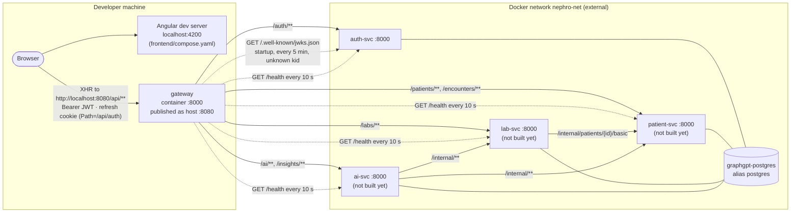
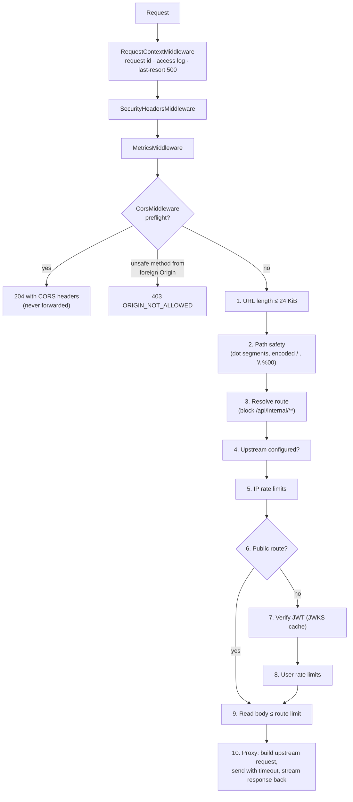
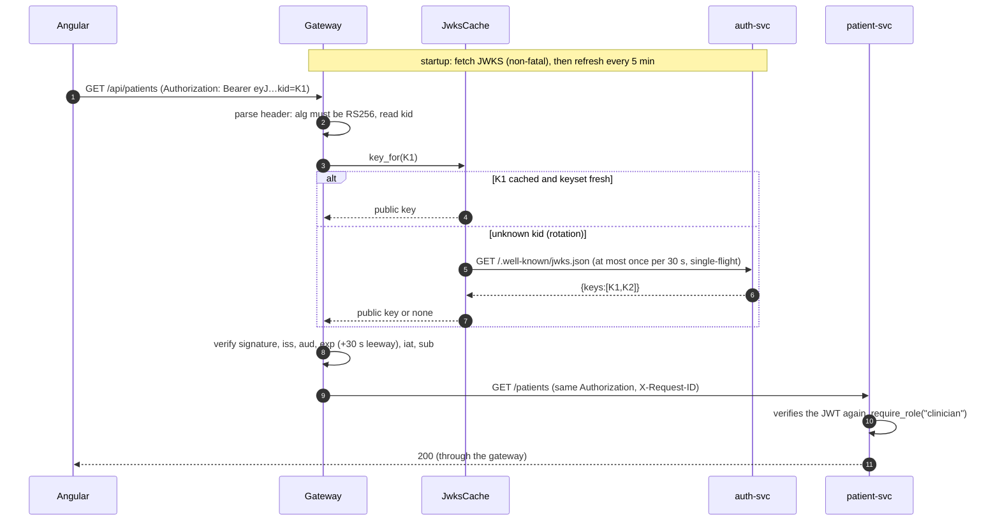
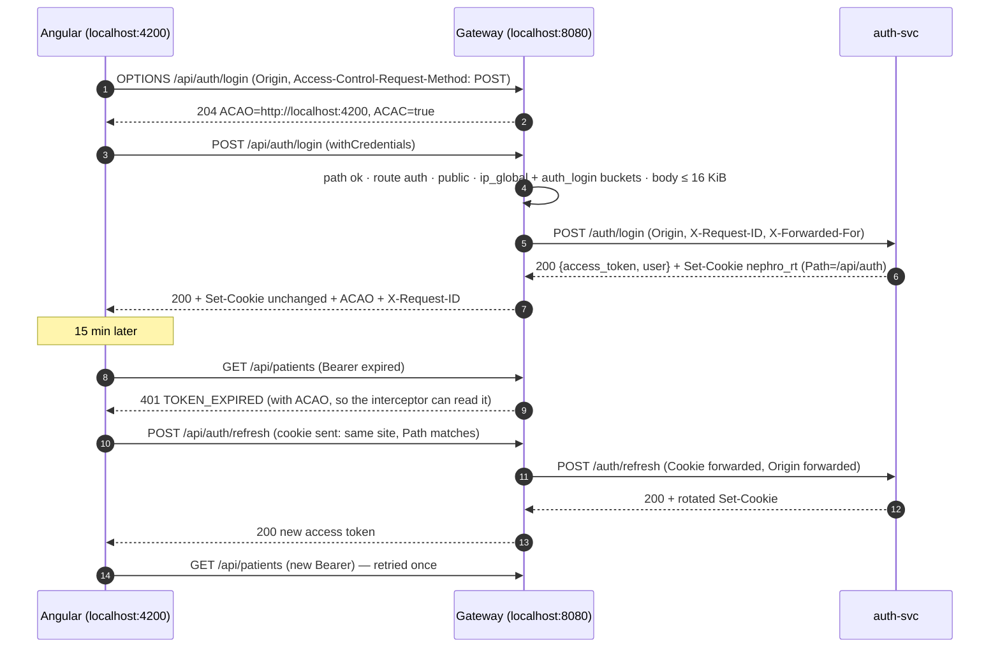

# gateway — High-Level and Low-Level Design

**Project:** General Nephrology EMR (NephroCare) · repo `TyrionEMR`
**Component:** `gateway` — the custom API gateway, the only component with a published port
**Parent design:** `HLD-v2.md`. This document expands §3, §7.3, §8, §9 (edge part), §12, §13, §17 and ADR-012 for one component. Where HLD-v2 and this document differ, the difference is listed in §14 with its reason.
**Sibling designs it must agree with:** `auth-svc-HLD-LLD.md` (implemented), `patient-svc-HLD-LLD.md`, `lab-svc-HLD-LLD.md`.
**Repo conventions it follows:** the implemented `auth-svc/` folder: self-contained service at the repo root, own `app/core`, `setup/`, `scripts/`, `Dockerfile`, `Makefile`, `docker-compose.yml`, tests and docs, **no `libs/common`** (auth-svc README deviation D3).
**Data:** the gateway stores nothing. It holds public keys and rate-limit counters in memory only.
**Status:** ready to implement. Completes HLD-v2 build step 2 ("auth-svc + gateway end to end") and closes auth-svc's two open items: the JWKS cache (auth-svc D9) and the smoke test through `:8080`.

---

## Table of Contents

**Part A — High-Level Design**

1. [Purpose and scope](#1-purpose-and-scope)
2. [Requirements](#2-requirements)
3. [Context and topology](#3-context-and-topology)
4. [Responsibilities and boundaries](#4-responsibilities-and-boundaries)
5. [The request pipeline](#5-the-request-pipeline)
6. [Routing model](#6-routing-model)
7. [Authentication model](#7-authentication-model)
8. [Edge security](#8-edge-security)
9. [Traffic management](#9-traffic-management)
10. [Observability](#10-observability)
11. [Failure modes and availability](#11-failure-modes-and-availability)
12. [Scalability and sizing](#12-scalability-and-sizing)
13. [Design decisions (gateway ADRs)](#13-design-decisions-gateway-adrs)
14. [Refinements to HLD-v2 and to sibling designs](#14-refinements-to-hld-v2-and-to-sibling-designs)

**Part B — Low-Level Design**

15. [Tech stack and dependencies](#15-tech-stack-and-dependencies)
16. [Folder structure](#16-folder-structure)
17. [Configuration](#17-configuration)
18. [Route table and rate-limit policies](#18-route-table-and-rate-limit-policies)
19. [Path safety and route resolution](#19-path-safety-and-route-resolution)
20. [Authentication gate and JWKS cache](#20-authentication-gate-and-jwks-cache)
21. [Rate limiter](#21-rate-limiter)
22. [Header policy](#22-header-policy)
23. [Proxy service](#23-proxy-service)
24. [CORS middleware](#24-cors-middleware)
25. [Pipeline, middleware stack and app factory](#25-pipeline-middleware-stack-and-app-factory)
26. [Error catalog](#26-error-catalog)
27. [Gateway-owned endpoints](#27-gateway-owned-endpoints)
28. [Contracts with services and with Angular](#28-contracts-with-services-and-with-angular)
29. [Containerization and runtime](#29-containerization-and-runtime)
30. [Observability detail](#30-observability-detail)
31. [Testing](#31-testing)
32. [Runbooks](#32-runbooks)
33. [Implementation checklist](#33-implementation-checklist)
34. [Open questions](#34-open-questions)

---

# Part A — High-Level Design

## 1. Purpose and scope

The gateway is the **single entry point** of the platform. The Angular app talks only to it (`environment.apiBaseUrl`, repo `CLAUDE.md` §1). Every backend service sits on the private Docker network `nephro-net` with no published port.

It is **thin on purpose** (HLD-v2 ADR-012). It handles the concerns that are identical for every request and must be enforced in one place:

- route `/api/<prefix>/…` to the owning service,
- authenticate the caller (verify the RS256 access token locally against cached public keys),
- refuse anything that must never be reachable from outside (`/internal/**`, path traversal, service `/docs`, `/health`, JWKS),
- apply CORS, rate limits, body and URL limits, timeouts,
- give every request an `X-Request-ID`, a JSON access log line and metrics,
- turn transport failures into the uniform error envelope.

### In scope
- Reverse proxying for auth-svc, patient-svc, lab-svc and ai-svc.
- JWKS cache with rotation support (the reference implementation the other services copy).
- In-memory token-bucket rate limiting (single gateway replica).
- Dev-only aggregated API docs at `/docs` (§27.4).
- The end-to-end smoke test through `:8080` (`setup/smoke-test.sh`).

### Out of scope (deliberate)
| Not here | Where it lives | Why |
|---|---|---|
| Authorization (role, per-patient access) | Each service (`require_role("clinician")`) | Services own their rules; a gateway that authorizes becomes a second place to change every rule (HLD-v2 §7.3) |
| Response aggregation, BFF endpoints | Angular parallel calls, ai-svc `insights/` | Aggregation belongs in a BFF if ever needed (HLD-v2 §8 "Does NOT do") |
| Business logic, validation of request bodies | Services | Same |
| TLS termination | A reverse proxy or load balancer in front, in a real deployment | Local development is HTTP on `localhost` |
| Response caching, compression | Not done | Clinical data, small payloads, BREACH risk (ADR-G12) |
| WebSockets | Not supported | No feature needs them; the AI progress uses polling (HLD-v2 ADR-017) |

---

## 2. Requirements

### 2.1 Functional

| # | Requirement | Source |
|---|---|---|
| G-F1 | Route `/api/auth/*` → auth-svc, `/api/patients/*` and `/api/encounters*` → patient-svc, `/api/labs/*` → lab-svc, `/api/ai/*` and `/api/insights/*` → ai-svc, stripping only the `/api` prefix | HLD-v2 §8 |
| G-F2 | Reject requests without a valid access token, except the allow-listed public auth endpoints | HLD-v2 §7.3, §8 |
| G-F3 | Verify tokens locally with a cached JWKS: RS256 only, `iss=nephro-auth`, `aud=nephro-api`, `exp/iat/sub` required, 30 s leeway; refetch on unknown `kid` at most once per 30 s; keep old keys when a fetch fails | HLD-v2 §7.2, auth LLD §22.1 |
| G-F4 | `/internal/**` is unreachable from outside | HLD-v2 §7.3 rule 4, §8 |
| G-F5 | Forward `Cookie` and pass every `Set-Cookie` unchanged for auth routes; never cache `/api/auth/*` | auth LLD §22.1 |
| G-F6 | CORS: one allow-listed origin (`http://localhost:4200` in dev), credentials allowed | HLD-v2 §8 |
| G-F7 | Rate limits: strict per IP on login and signup, moderate on refresh, moderate per user globally, a separate generous bucket for AI summary polling | HLD-v2 §8, auth LLD §22.1 |
| G-F8 | Generate `X-Request-ID` if absent, propagate it upstream, return it to the client | HLD-v2 §8 |
| G-F9 | Per-route timeouts: 5 s default, 10 s for `/api/insights/**`; timeout → `504`, connection failure → `502`, both in the error envelope | HLD-v2 §8 |
| G-F10 | Strip hop-by-hop headers, limit body size | HLD-v2 §8 |
| G-F11 | Access log (method, route template, status, latency, request id, user id) and `/metrics` | HLD-v2 §8, §12 |
| G-F12 | `/health` (self) and `/ready` (JWKS loaded, auth-svc reachable) | HLD-v2 §8 |
| G-F13 | Work while only some services exist (today only auth-svc is built) | Build order, repo state |

### 2.2 Non-functional

| Area | Target |
|---|---|
| Added latency (p95, warm, same host) | ≤ 5 ms over the upstream's own latency. RS256 verification costs about 0.1 ms; the rest is one extra local HTTP hop |
| Throughput | ≥ 500 requests/s on one worker for small JSON responses. Clinic load is under 50 requests/s |
| Memory | ≤ 256 MiB container limit. Rate-limit table capped at 100,000 keys |
| Availability | Stateless; restart takes under 2 s; starts and serves even when auth-svc is down (keys arrive when auth-svc does) |
| Security | No published service ports except the gateway; no PHI, tokens, cookies or query strings in logs |
| Operability | Same JSON log format, error envelope and metric names as auth-svc, so one dashboard reads all components |
| Testability | Full pipeline testable in-process with fake upstreams (`httpx.MockTransport`) and a fake JWKS; no Docker needed for unit or API tests |

---

## 3. Context and topology



| Element | Address | Published on host |
|---|---|---|
| gateway | `http://gateway:8000` inside `nephro-net` | **`localhost:8080`** (`GATEWAY_PORT`) |
| auth-svc | `http://auth-svc:8000` | no (host-run dev: `localhost:8001`) |
| patient-svc | `http://patient-svc:8000` | no (host-run dev: `localhost:8002`) |
| lab-svc | `http://lab-svc:8000` | no (host-run dev: `localhost:8003`) |
| ai-svc | `http://ai-svc:8000` | no (host-run dev: `localhost:8004`) |
| Postgres | `postgres:5432` (alias on `nephro-net`) | `localhost:5433` (repo deviation D2) |

Service-to-service calls (lab → patient, ai → patient/lab) go **directly** over `nephro-net`, never through the gateway (HLD-v2 §9). The gateway is north-south only.

---

## 4. Responsibilities and boundaries

| The gateway does | The gateway does not |
|---|---|
| Match the first path segment after `/api` against a fixed route table | Look at request bodies |
| Verify access tokens (authenticity and expiry) | Check roles or patient access |
| Forward the original `Authorization` header unchanged | Add identity headers (`X-User-Id` etc.). Services re-verify the JWT (HLD-v2 §8 "Contract with services") |
| Answer CORS preflights itself | Forward `OPTIONS` to services |
| Count requests per IP and per user | Know about AI quotas (ai-svc owns the daily quota) |
| Translate connect errors and timeouts into `502`/`504` envelopes | Rewrite upstream JSON error envelopes (they pass through unchanged) |
| Rewrite upstream `Location` headers into `/api/...` | Follow redirects |
| Probe upstream `/health` for `/ready` and metrics | Stop routing to an upstream it thinks is down (no circuit breaker, ADR-G9) |
| Keep public keys and counters in memory | Store anything on disk or in a database |

---

## 5. The request pipeline

Every `/api/**` request passes through the same ordered steps. Cheap rejections come first, the network call last.



| Step | Rejects with | Why it is at this position |
|---|---|---|
| CORS preflight | `204` (handled) or `403` | Browsers send preflights without credentials; they must never reach auth or rate limits |
| 1 URL length | `414 URI_TOO_LONG` | Before any parsing |
| 2 Path safety | `400 INVALID_PATH` | Traversal must be refused before routing looks at segments |
| 3 Resolve | `404 NOT_FOUND` | Unknown prefixes and `/internal/**` look identical: nothing to confirm |
| 4 Configured | `503 UPSTREAM_NOT_DEPLOYED` | Phased build: patient, lab, ai URLs are empty until those services exist |
| 5 IP limits | `429 RATE_LIMITED` | Throttles login guessing and token floods before any crypto work |
| 7 JWT | `401 UNAUTHENTICATED` / `401 TOKEN_EXPIRED` | Before reading a body from an unauthenticated caller |
| 8 User limits | `429 RATE_LIMITED` | Needs the verified `sub` |
| 9 Body | `413 PAYLOAD_TOO_LARGE` | Only authenticated (or public auth) requests get their body read |
| 10 Proxy | `502` / `503` / `504` | The only step with network I/O |

The whole pipeline runs inside one route handler with a `try/except` that turns any exception into an envelope, so every response, including unexpected failures, still passes back through `CorsMiddleware` and carries CORS headers. Without that, a gateway `500` would look like a CORS failure in the browser and the Angular error interceptor would see status `0` instead of the envelope.

---

## 6. Routing model

**Rule:** the gateway strips `/api` and nothing else. `/api/labs/patients/{id}/trends` becomes `/labs/patients/{id}/trends` on lab-svc.

| First segment after `/api` | Upstream | Upstream path | Timeout | Cookies | Body limit |
|---|---|---|---|---|---|
| `auth` | auth-svc | `/auth/…` | 5 s | forwarded, `Set-Cookie` passed | 16 KiB |
| `patients` | patient-svc | `/patients/…` | 5 s | dropped | 1 MiB |
| `encounters` | patient-svc | `/encounters…` | 5 s | dropped | 1 MiB |
| `labs` | lab-svc | `/labs/…` | 5 s | dropped | 1 MiB |
| `ai` | ai-svc | `/ai/…` | 5 s | dropped | 1 MiB |
| `insights` | ai-svc | `/insights/…` | 10 s | dropped | 1 MiB |
| anything else, including `internal` | none | — | — | — | `404` |

Consequences of "strip `/api` only":

- Every upstream path starts with an allow-listed service prefix. A service's own `/docs`, `/openapi.json`, `/health`, `/ready`, `/metrics`, `/.well-known/jwks.json` and `/internal/**` live at the service root and **cannot be addressed** through the gateway, because the gateway never produces a path that does not start with one of the six prefixes. Path-safety (§8.1) stops `..` from escaping the prefix.
- Matching is by **whole segment**, not string prefix: `/api/encountersX` is `404`, not patient-svc.
- The route table is code (`app/routing/table.py`), reviewed like any contract. Only upstream base URLs and timeouts come from the environment.

**Public routes** (no JWT at the gateway; exact method and path):

| Method | Path |
|---|---|
| POST | `/api/auth/login` |
| POST | `/api/auth/signup` |
| POST | `/api/auth/refresh` |
| POST | `/api/auth/logout` |

`GET /api/auth/me` and every other route need a valid token. Gateway-owned endpoints (`/health`, `/ready`, `/metrics`, `/docs`) are outside `/api` and handled by their own routes (§27).

---

## 7. Authentication model



| Decision | Detail |
|---|---|
| Verification rules | Identical to `auth-svc/app/core/security.py`: RS256 only (rejects `none` and HS256 key confusion), key chosen by `kid`, `iss`, `aud`, `exp`, `iat`, `sub` required, 30 s leeway. The function is copied, not imported (no shared library, D3), and the gateway's tests repeat auth-svc's token test cases so the two copies cannot drift unnoticed |
| What the gateway checks | Authenticity and expiry. **Not** the `role` claim: services authorize (ADR-G6) |
| What it forwards | The original `Authorization` header, byte for byte. Services re-verify (defense in depth, HLD-v2 §7.3). The audit trail in services therefore always sees the real user |
| Keyset updates | A successful fetch **replaces** the keyset, so a key auth-svc stops publishing stops verifying. A failed fetch keeps the previous keyset |
| Staleness cap | If no fetch has succeeded for `JWKS_MAX_STALE_S` (24 h), the keyset is treated as empty: every protected request gets `401` and `/ready` fails. A retired key cannot verify forever just because auth-svc is unreachable |
| Unknown-kid refetch | At most once per 30 s, single-flight. A flood of tokens with random `kid` values cannot turn the gateway into an amplifier against auth-svc |
| Key validation | Only `kty=RSA`, `use=sig` (or absent), `alg=RS256` (or absent), modulus ≥ 2048 bits; `kid` must equal the RFC 7638 thumbprint of the key (auth-svc ADR-A7). A key that fails any check is ignored and logged |
| Expired token response | `401 TOKEN_EXPIRED` (silent refresh in Angular); any other failure `401 UNAUTHENTICATED`. Same codes as auth-svc §18 |

Why the gateway verifies at all, given that services verify again: it stops unauthenticated traffic at the edge (cheap rejection, no load on services), it gives the access log a `user_id` for every request, and it is what makes per-user rate limits possible.

---

## 8. Edge security

### 8.1 Path safety: refuse, do not normalize

The gateway validates the **raw** request path (`scope["raw_path"]`, still percent-encoded) and rejects instead of cleaning it up. Normalizing (`/api/labs/../internal` → `/api/internal`) is where gateways historically get bypassed, because the gateway and the upstream normalize differently.

| Rejected | Example | Why |
|---|---|---|
| Dot segments | `/api/labs/../internal/labs/status` | Traversal out of the service prefix |
| Encoded dot, slash, backslash, NUL, percent | `%2e%2e`, `%2f`, `%5c`, `%00`, `%252e` (double encoding) | Encoded traversal; double decoding differences |
| Backslash or empty segment | `/api\labs`, `/api//patients` | Parser differences between servers |
| Characters outside RFC 3986 `pchar` after decoding | `/api/labs/<script>`, `/api/patients/a b` | No route has free text in its path; search text goes in the query string |

Browsers already remove dot segments before sending, so this only affects hand-crafted requests (`curl --path-as-is`). All cases above are unit-tested (§31.1).

### 8.2 Internal routes

`/api/internal/**` and every path whose first segment after `/api` is not one of the six prefixes return `404 NOT_FOUND`. `404`, not `403`, so the gateway confirms nothing about what exists behind it. Together with §6 and §8.1 this gives three independent layers: no route produces an `/internal` upstream path, traversal is refused, and services still require a valid JWT on internal routes (patient LLD §17.2).

### 8.3 Header policy

- **Request headers are allow-listed** (ADR-G5). Only `Accept`, `Accept-Language`, `Authorization`, `Cache-Control`, `Content-Type`, `If-Match`, `If-None-Match`, `If-Modified-Since`, `Idempotency-Key`, `Origin` and `User-Agent` are forwarded. Anything a client invents (`X-User-Id`, `X-Real-IP`, `X-Forwarded-*`, `Forwarded`) is dropped.
- The gateway **sets** `X-Request-ID`, `X-Forwarded-For` (the client IP only, never the client-supplied chain), `X-Forwarded-Proto`, `X-Forwarded-Host` and `Accept-Encoding: identity`.
- `Origin` is forwarded because auth-svc's `require_trusted_origin` checks it on `/auth/refresh` and `/auth/logout`.
- **Response headers**: hop-by-hop headers (`Connection`, `Keep-Alive`, `Transfer-Encoding`, `TE`, `Trailer`, `Upgrade`, `Proxy-*` and any header named in `Connection`), `Server`, `X-Powered-By` and the upstream `X-Request-ID` are removed. `Location` and `Content-Location` are rewritten (§23.4).

### 8.4 Cookie scoping

| Direction | auth routes | All other routes |
|---|---|---|
| Request `Cookie` | forwarded unchanged | **dropped** |
| Response `Set-Cookie` | every header passed unchanged (never merged) | **dropped** |

The refresh cookie's `Path=/api/auth` already stops browsers from sending it elsewhere; the gateway enforces the same boundary on the server side, so a future service bug cannot set or read cookies. `Set-Cookie` is never rewritten: its `Path=/api/auth` is already the browser-visible path because it is defined in gateway terms (auth LLD §19.7).

### 8.5 CORS

| Setting | Value |
|---|---|
| Allowed origins | `CORS_ALLOWED_ORIGINS` (dev: `http://localhost:4200`). Exact match, no wildcards |
| Credentials | `Access-Control-Allow-Credentials: true` (refresh cookie) |
| Allowed methods | `GET, POST, PUT, PATCH, DELETE` |
| Allowed request headers | `Authorization, Content-Type, X-Request-ID, If-None-Match, If-Match, Cache-Control, Idempotency-Key` |
| Exposed response headers | `X-Request-ID, Retry-After, ETag, Location, Content-Disposition` |
| Preflight cache | `Access-Control-Max-Age: 600` |
| `Vary: Origin` | On every response |
| Foreign origin, preflight | `403 ORIGIN_NOT_ALLOWED`, no CORS headers |
| Foreign origin, unsafe method (`POST/PUT/PATCH/DELETE`) | `403 ORIGIN_NOT_ALLOWED` before anything else runs |
| Foreign origin, `GET` | Processed, but no `Access-Control-Allow-Origin`, so the browser hides the response |
| No `Origin` header (curl, server-to-server) | Processed normally |

The unsafe-method check is defense in depth: Bearer-token APIs are not CSRF-prone, but it costs nothing and mirrors auth-svc's Origin check (auth R4).

`localhost:4200` → `localhost:8080` is **cross-origin but same-site** (ports are ignored for "site"), so the `SameSite=Strict` refresh cookie is still sent, provided Angular sets `withCredentials: true` on `/api/auth/*` calls (§28.3).

### 8.6 Size limits

| Limit | Default | Response |
|---|---|---|
| URL (path + query) | 24 KiB | `414 URI_TOO_LONG` |
| Request body, auth routes | 16 KiB | `413 PAYLOAD_TOO_LARGE` |
| Request body, other routes | 1 MiB | `413 PAYLOAD_TOO_LARGE` |
| Request line + headers (Uvicorn h11) | 32 KiB (`--h11-max-incomplete-event-size`) | connection error from Uvicorn |

24 KiB is chosen for one real case: the Needs-attention filter sends up to 500 patient UUIDs in `GET /patients?ids=…` (patient LLD §11.2), about 18.5 KB. Uvicorn's default h11 limit is 16 KiB, which would reject it, so the gateway raises it, and **patient-svc must raise it too** (§14 R8).

### 8.7 Security headers on every response

`X-Content-Type-Options: nosniff`, `X-Frame-Options: DENY`, `Referrer-Policy: no-referrer`, `Cross-Origin-Resource-Policy: same-site`, and `Cache-Control: no-store` **when the upstream did not set one** (clinical data must not sit in shared caches; lab-svc's catalog `max-age` and `ETag`s still work). `Strict-Transport-Security` only when `HSTS_ENABLED=true` (behind TLS).

### 8.8 Request smuggling and protocol hygiene

The gateway never forwards raw bytes. Uvicorn (h11) parses the request, the body is read with a limit, and httpx writes a fresh request with an exact `Content-Length`. `Transfer-Encoding` from the client is never forwarded. `TRACE`, `CONNECT` and `HEAD` are not routed (`405`). WebSocket upgrades are refused.

---

## 9. Traffic management

### 9.1 Rate limits (token bucket)

| Policy | Applies to | Key | Rate | Burst |
|---|---|---|---|---|
| `ip_global` | every `/api/**` request | client IP | 1200/min | 200 |
| `auth_login` | `POST /api/auth/login`, `POST /api/auth/signup` | client IP | 10/min | 5 |
| `auth_refresh` | `POST /api/auth/refresh` | client IP | 60/min | 20 |
| `ai_generate` | `POST /api/ai/patients/{id}/summary` | user (`sub`) | 10/min | 3 |
| `ai_poll` | `GET /api/ai/summaries/{id}` | user | 300/min | 60 |
| `user_default` | every other authenticated request | user | 300/min | 100 |

- `ai_poll` replaces `user_default` for polling, so the 1 s progress polling (HLD-v2 §10.3) never eats the user's general budget, as HLD-v2 §8 requires.
- `429` carries `Retry-After` (seconds, rounded up) and the envelope `RATE_LIMITED` with `details: [{"policy": "auth_login"}]`.
- ai-svc's per-user daily AI quota (`429 AI_QUOTA_EXCEEDED`) is separate and passes through unchanged.
- The limiter is **in-memory and per process**. The gateway therefore runs **one Uvicorn worker** (ADR-G8). Scaling to several replicas means swapping the `RateLimiter` implementation for a Redis one behind the same interface.
- **Docker Desktop caveat:** on Windows and macOS, published-port traffic reaches the container from one internal address, so every browser on the machine shares one IP bucket. The IP policies are sized so that one developer never hits them; on Linux the real client IP is preserved.

### 9.2 Timeouts

| Phase | Setting |
|---|---|
| Connect to upstream | 1 s |
| Time to response headers | route timeout (5 s, or 10 s for insights), enforced with `asyncio.timeout` |
| Idle time between body chunks | route timeout (httpx read timeout) |
| Waiting for a pooled connection | 1 s → `503 GATEWAY_BUSY` |
| JWKS fetch | 2 s |
| Health probe | 1 s |

`POST /api/ai/patients/{id}/summary` fits in 5 s because it always returns `202` immediately (HLD-v2 ADR-017). Streaming responses (`text/event-stream`, the future SSE upgrade) get no time-to-headers deadline beyond the route timeout and no total deadline.

### 9.3 Retries

One retry, after 50–100 ms, **only** for `GET` and **only** when the connection could not be established (`ConnectError`, `ConnectTimeout`). In that case the request never reached the upstream, so retrying cannot duplicate work. No retry on read timeouts or on any `POST/PUT/PATCH/DELETE` (ADR-G9).

### 9.4 Bulkheads

One `httpx.AsyncClient` per upstream, each with its own pool (100 connections, 20 kept alive). A slow ai-svc can exhaust only ai-svc's pool; patient and lab traffic keeps flowing.

---

## 10. Observability

| Signal | What |
|---|---|
| Access log | One JSON line per request: `method`, `route` (template, ids replaced by `{id}`), `status`, `latency_ms`, `upstream`, `upstream_status`, `upstream_ms`, `user_id`, `client_ip`, `request_id`, `rate_limited`. Never the query string (patient search text), never headers, cookies or bodies |
| Event logs | `gateway.jwks.refreshed`, `gateway.jwks.refresh_failed`, `gateway.jwks.key_rejected`, `gateway.upstream.health_changed`, `gateway.upstream.error`, `gateway.auth.rejected` (reason only) |
| Metrics | Same `http_request_duration_seconds` as services, plus gateway metrics (§30.2) |
| Tracing | `X-Request-ID` links gateway, service and audit rows. OpenTelemetry is future work (HLD-v2 §20) |

Log format, redaction rules and the `request_id` contextvar are copied from `auth-svc/app/core/logging.py` and `context.py`, so log lines from both components have the same shape.

---

## 11. Failure modes and availability

| Failure | Effect | Handling |
|---|---|---|
| auth-svc down at gateway start | No keys yet | Gateway starts anyway, retries the JWKS fetch with backoff (2 s → 30 s). Protected routes `401` until keys arrive; `/ready` `503` |
| auth-svc down later | No logins or refreshes; existing access tokens keep working (keys cached) | `/api/auth/*` → `502 UPSTREAM_UNAVAILABLE`. After 24 h without a successful fetch, keys expire (§7) |
| patient/lab/ai not built yet | — | `503 UPSTREAM_NOT_DEPLOYED` for their prefixes; the rest works |
| Upstream down | — | `502 UPSTREAM_UNAVAILABLE` within about 1 s (connect timeout), one retry for `GET` |
| Upstream slow | — | `504 UPSTREAM_TIMEOUT` at the route timeout |
| Upstream pool exhausted | — | `503 GATEWAY_BUSY` after 1 s; other upstreams unaffected |
| Upstream returns a non-JSON error (Uvicorn plain-text 500, HTML) | Would break the envelope guarantee | Wrapped into an envelope with the same status (§23.3) |
| Upstream redirects (FastAPI trailing-slash `307`) | `Location` would point at `http://patient-svc:8000/…` | Rewritten to `/api/…` (§23.4); services should also set `redirect_slashes=False` (§14 R14) |
| Client disconnects mid-stream | Upstream connection could leak | The streaming generator closes the upstream response in `finally` |
| Bug inside the pipeline | — | Caught in the handler → `500 INTERNAL_ERROR` envelope with CORS headers; logged with exception type only |
| Bug in a middleware | — | `RequestContextMiddleware` last-resort `500` envelope with `X-Request-ID` (no CORS headers; acceptable for a bug path) |
| Gateway restart | In-flight requests fail; rate-limit counters reset | Uvicorn graceful shutdown (10 s); counters resetting is harmless |

---

## 12. Scalability and sizing

- **Stateless except counters.** Public keys are re-fetchable; rate-limit counters are disposable.
- **One worker is the right size now.** The work is I/O wait plus about 0.1 ms of RS256 verification. One asyncio event loop handles thousands of concurrent in-flight requests. One worker also keeps the in-memory rate limit exact.
- **Scale-out path, in order:**
  1. More gateway replicas behind an L4/L7 load balancer, with `RateLimiter` swapped to Redis (`INCR`/Lua token bucket) and `TRUST_PROXY_HOPS=1` so the client IP is taken from the load balancer's `X-Forwarded-For`.
  2. TLS at the load balancer, HSTS on.
  3. If raw throughput ever matters more than the custom logic, move routing, TLS and rate limiting to Envoy or Nginx and keep only the JWKS check as an external-auth hook. The route table and contracts in this document stay the same.
- **Connections to upstreams:** at most 100 per upstream per replica. Upstreams are async FastAPI services; this is well inside their capacity.

---

## 13. Design decisions (gateway ADRs)

These sit under HLD-v2 ADR-012 ("thin custom gateway").

### ADR-G1: Custom Python gateway instead of Nginx, Kong, Traefik or Envoy
**Context:** the stack decision is "their own custom API gateway".
**Decision:** FastAPI + httpx, same Python 3.12 base image and tooling as the services.
**Why:** the JWT rules are the same code as auth-svc's (copied, tested with the same cases); everything is testable in pytest without Docker; every behavior can be explained line by line in an interview.
**Trade-off:** lower raw throughput than Nginx or Envoy, irrelevant at clinic scale. The scale-out path in §12 keeps the contract if that ever changes.

### ADR-G2: One explicit pipeline in a single handler, a few ASGI middlewares
**Decision:** cross-cutting concerns that apply to **every** response (request id and access log, security headers, metrics, CORS) are pure-ASGI middlewares. The ordered, early-exit steps (path safety → route → limits → auth → body → proxy) are one `GatewayPipeline.handle()` method.
**Why:** the order is visible in one place, each step is a plain function with a unit test, and middlewares cannot be accidentally reordered by an `add_middleware` call.

### ADR-G3: Buffer requests (bounded), stream responses
**Why:** request bodies are small and must be size-checked; buffering also gives httpx an exact `Content-Length` (no smuggling). Responses are streamed so large result pages and a future SSE stream do not sit in gateway memory.

### ADR-G4: One HTTP client per upstream
**Why:** bulkhead isolation (§9.4) and per-upstream metrics. `trust_env=False` so a host `HTTP(S)_PROXY` variable can never route internal traffic through a proxy.

### ADR-G5: Allow-list request headers
**Why:** a block-list misses the next spoofable header someone invents. Allow-listing means the upstream sees only headers the gateway understands.

### ADR-G6: The gateway authenticates; services authorize
**Why:** HLD-v2 §7.3 defense in depth. The gateway rejects garbage early; services keep the authority over who may do what. The gateway adds no identity headers, so no service can be tempted to trust them.

### ADR-G7: JWKS cache semantics
**Decision:** replace on success, keep on failure, 24 h staleness cap, unknown-kid refetch rate-limited and single-flight, thumbprint check.
**Why:** rotation works without restarts (auth LLD §26.2), auth-svc outages do not log everyone out, retired keys do not live forever, and the cache cannot be used to flood auth-svc.

### ADR-G8: In-memory token bucket, one worker
**Why:** exact limits with zero infrastructure. The `RateLimiter` protocol makes Redis a drop-in when a second replica is added.

### ADR-G9: No retries except connect failures on GET; no circuit breaker
**Why:** retrying after a read timeout can duplicate a write or double the load on a struggling service. A connect failure guarantees the request was never received. A breaker adds state and tuning for little gain: a down upstream already fails in about 1 s (connect timeout), and ai-svc has its own breaker around the LLM where it matters (HLD-v2 §10.8).

### ADR-G10: Refuse unsafe paths instead of normalizing them
**Why:** §8.1. Different normalization in two parsers is a classic bypass.

### ADR-G11: Readiness depends on JWKS and auth-svc only
**Why:** if lab-svc is down, patient screens should still work. A gateway that reports not-ready because one upstream is down would take the whole API out of rotation.

### ADR-G12: No response compression at the gateway
**Why:** responses that mix secrets (access tokens) with attacker-influenced content are BREACH candidates when compressed; payloads here are small JSON. A front proxy can compress static assets later.

### ADR-G13: Upstream JSON passes through; non-JSON errors are wrapped
**Why:** services already produce the envelope with their own codes (`VERSION_CONFLICT`, `ENCOUNTER_FINAL`…). The gateway guarantees the shape only where a service could not (framework-level plain-text errors).

### ADR-G14: Aggregated API docs at the gateway, dev only
**Why:** one Swagger UI at `localhost:8080/docs` shows every service's OpenAPI with requests going through the real gateway path, useful for the submission's API documentation and manual testing. Off by default so it never ships enabled.

---

## 14. Refinements to HLD-v2 and to sibling designs

| # | Refinement | Reason | Affects |
|---|---|---|---|
| R1 | Gateway lives in `gateway/` at the repo root, self-contained like `auth-svc/` (no `libs/common`; core helpers copied) | Repo deviation D3 applies to every component | HLD-v2 §17.1 |
| R2 | `/api/internal/**` and unknown prefixes return `404`, not `403`; raw-path traversal is rejected with `400 INVALID_PATH` | Confirm nothing; close the traversal bypass | HLD-v2 §8 |
| R3 | `Cookie` forwarded and `Set-Cookie` accepted only on auth routes | Server-side cookie scoping | HLD-v2 §8, auth LLD §22.1 |
| R4 | Upstream `Location`/`Content-Location` rewritten to `/api/…` | Services emit service-relative paths (`201 Location`, trailing-slash redirects) | HLD-v2 §8 |
| R5 | Connect timeout 1 s; pool exhaustion → `503 GATEWAY_BUSY` | Not specified | HLD-v2 §8 |
| R6 | New gateway codes: `INVALID_PATH`, `URI_TOO_LONG`, `UPSTREAM_NOT_DEPLOYED`, `GATEWAY_BUSY` | Gateway-specific failures | HLD-v2 §11.5, §12 |
| R7 | One Uvicorn worker; in-memory limiter | Exact limits without Redis | HLD-v2 §13.2 |
| R8 | Uvicorn h11 header limit raised to 32 KiB on the gateway **and on patient-svc** | `GET /patients?ids=` with 500 UUIDs ≈ 18.5 KB exceeds the 16 KiB default | patient LLD §11.2, §24.1 |
| R9 | Frontend dev `apiBaseUrl` must be `http://localhost:8080/api` (repo currently has `:8000`); `withCredentials: true` on `/api/auth/*` | Gateway port is `GATEWAY_PORT=8080` in the root `.env.example` | `frontend/src/environments/environment.development.ts` |
| R10 | Standardize every service on network `nephro-net` with Postgres alias `postgres` (repo reality) | patient LLD uses `nephro-pgnet`/`nephro-pg`; lab LLD uses the container name | patient LLD §8, lab LLD §B14 |
| R11 | `/metrics` protected by `METRICS_TOKEN` when set | The gateway port is public; metrics reveal routes and volumes | HLD-v2 §8 |
| R12 | Unsafe methods from a foreign `Origin` rejected globally | Defense in depth, mirrors auth R4 | HLD-v2 §7.4 |
| R13 | Gateway runs with `--no-proxy-headers` and sets `X-Forwarded-For` itself; services keep `--proxy-headers` and trust it | Clients must not be able to spoof their IP into rate limits or logs | auth LLD §23.2 |
| R14 | Services should construct `FastAPI(..., redirect_slashes=False)` | Avoid `307` round trips; gateway rewrite is the safety net | all services |
| R15 | Gateway-level body limit 16 KiB on auth routes | auth payloads are tiny; password capped at 128 chars | auth LLD §8.1 |

---

# Part B — Low-Level Design

## 15. Tech stack and dependencies

| Concern | Choice | Notes |
|---|---|---|
| Runtime | Python 3.12 | Same base image as auth-svc |
| Web | FastAPI + Uvicorn (`uvicorn[standard]`) | FastAPI for the gateway-owned routes and the catch-all; pure-ASGI middlewares |
| HTTP client | httpx (`AsyncClient`, streaming) | One client per upstream |
| Settings | pydantic-settings | Same `_split` CSV helper as auth-svc |
| JWT | PyJWT[crypto] | RS256 verify only (no signing key exists here) |
| Metrics | prometheus-client | Same histogram name as services |
| Tests | pytest, pytest-asyncio, httpx (`ASGITransport`, `MockTransport`) | No Docker needed |
| Lint | ruff, mypy | Same config as auth-svc |

`pyproject.toml`:

```toml
[build-system]
requires = ["setuptools>=68"]
build-backend = "setuptools.build_meta"

[project]
name = "gateway"
version = "1.0.0"
requires-python = ">=3.12"
dependencies = [
  "fastapi>=0.115",
  "uvicorn[standard]>=0.30",
  "httpx>=0.27",
  "pydantic>=2.7",
  "pydantic-settings>=2.3",
  "pyjwt[crypto]>=2.8",
  "prometheus-client>=0.20",
]

[project.optional-dependencies]
dev = ["pytest>=8", "pytest-asyncio>=0.23", "ruff", "mypy", "python-dotenv>=1.0"]

[tool.setuptools.packages.find]
include = ["app*"]

[tool.pytest.ini_options]
asyncio_mode = "auto"
asyncio_default_fixture_loop_scope = "session"
asyncio_default_test_loop_scope = "session"
testpaths = ["tests"]
markers = ["smoke: needs the real auth-svc on nephro-net"]

[tool.ruff]
line-length = 120
target-version = "py312"

[tool.ruff.lint]
select = ["E", "F", "I", "UP", "B", "ASYNC"]

[tool.mypy]
python_version = "3.12"
ignore_missing_imports = true
```

No database driver, no Alembic, no argon2: the gateway has no storage.

---

## 16. Folder structure

### 16.1 Tree

```
gateway/
  .dockerignore
  .env.example                    every setting with a safe placeholder (§17)
  .gitignore
  Dockerfile                      build context = gateway/ (self-contained)
  Makefile                        venv, install, run, test, lint, routes, build, up, down, logs, smoke
  README.md                       layout, first run, smoke test, deviations, open items
  docker-compose.yml              runs the gateway alone on nephro-net, publishes ${GATEWAY_PORT:-8080}
  pyproject.toml
  docs/
    gateway-HLD-LLD.md            this document
  scripts/
    entrypoint.sh                 exec uvicorn (no DB wait, no migrations)
  setup/
    network.sh                    create nephro-net if missing (idempotent)
    smoke-test.sh                 end-to-end check through :8080 against the real auth-svc
  app/
    __init__.py
    main.py                       create_app(), build_state(), lifespan (clients, JWKS task, prober task)
    core/
      __init__.py
      config.py                   Settings (pydantic-settings), upstream_urls()
      context.py                  request_id contextvar, get_request_id(), client_ip()
      errors.py                   AppError, envelope(), error_response(), handlers, GatewayError classes
      logging.py                  JSON logging + redaction (copied from auth-svc)
      metrics.py                  Prometheus metrics, MetricsMiddleware, mount_metrics()
      middleware.py               RequestContextMiddleware (request id, access log, last-resort 500)
      cors.py                     CorsMiddleware (preflight, ACAO on every response, unsafe-origin check)
      security_headers.py         SecurityHeadersMiddleware
      security.py                 verify_access_token(), bearer_token(), unverified_kid(), Claims
      common_setup.py             install_common_middleware(app, settings)
    routing/
      __init__.py
      table.py                    Route, build_routes(settings), PUBLIC_ROUTES
      policies.py                 Policy, ip_policies(), user_policies()
      paths.py                    safe_segments(), route_template()  (pure)
      resolver.py                 RouteMatch, resolve()               (pure)
    services/
      __init__.py
      jwks_cache.py               JwksCache, parse_jwks(), thumbprint_kid()
      rate_limiter.py             RateLimiter protocol, InMemoryRateLimiter
      upstreams.py                UpstreamRegistry (one httpx.AsyncClient per upstream)
      health_prober.py            HealthProber (background /health probes)
      headers.py                  upstream_request_headers(), filter_response_headers(), rewrite_location()
      proxy.py                    ProxyService.forward(), streaming relay, error mapping
      auth_gate.py                AuthGate.authenticate(): bearer → kid → JWKS key → verify
      pipeline.py                 GatewayPipeline.handle(): the ordered steps of §5
    api/
      __init__.py
      deps.py                     get_settings_dep(), get_pipeline()
      routes/
        __init__.py
        gateway.py                catch-all /api and /api/{rest:path}
        health.py                 /health, /ready
        docs.py                   /docs, /docs/{upstream}/openapi.json (DOCS_ENABLED only)
    domain/
      __init__.py
      clock.py                    Clock protocol, SystemClock, FakeClock (wall + monotonic)
      token_bucket.py             Bucket, Decision, take()  (pure)
    cli/
      __init__.py
      print_routes.py             prints the route table and public routes (README, interviews)
  tests/
    __init__.py
    conftest.py                   test RSA key, fake JWKS, fake upstreams (MockTransport), app factory
    unit/
      __init__.py
      test_paths.py               traversal, encodings, templates
      test_resolver.py            segment matching, internal blocked, public routes
      test_policies.py            which buckets apply to which requests
      test_token_bucket.py        burst, refill, retry-after, fake clock
      test_security.py            same cases as auth-svc test_token_service (alg none, HS256, iss, aud, exp, kid)
      test_jwks_cache.py          replace vs keep, max stale, single-flight, unknown-kid rate limit, thumbprint
      test_headers.py             allow-list, hop-by-hop, cookie scoping, Location rewrite, XFF
      test_cors.py                preflight decisions, Vary, foreign origin
      test_error_envelope.py      shape, request_id, upstream non-JSON wrapping
    api/
      __init__.py
      test_routing.py             each prefix reaches the right upstream with the right path and query
      test_auth_gate.py           public vs protected, 401 codes, Authorization forwarded unchanged
      test_internal_blocked.py    /api/internal/**, traversal variants, service /docs unreachable
      test_cookies_passthrough.py multiple Set-Cookie preserved on auth; dropped elsewhere
      test_cors_api.py            preflight 204, error responses carry ACAO
      test_rate_limit.py          login 6th attempt 429 + Retry-After; poll bucket separate
      test_timeouts.py            504, 502, 503 busy, GET retry on connect error, no retry on POST
      test_body_limit.py          413 by Content-Length and by streamed size
      test_request_id.py          generated, propagated, echoed, invalid incoming replaced
      test_streaming.py           large body streamed; upstream closed on client disconnect
      test_no_phi_in_logs.py      query strings, tokens, cookies never logged
      test_health.py              /health, /ready states, /metrics token
```

### 16.2 Mapping to auth-svc

| auth-svc | gateway | Same, adapted or new |
|---|---|---|
| `Dockerfile`, `.dockerignore`, `.gitignore` | same files | adapted (no migrations, no keys) |
| `Makefile` | same | adapted (no DB targets; adds `smoke`, `routes`) |
| `docker-compose.yml` (external `nephro-net`, no ports) | same | adapted (**publishes** `8080:8000`) |
| `scripts/entrypoint.sh` | same | adapted (no DB wait, no Alembic) |
| `setup/init-auth-db.sh`, `generate-keys.sh` | `setup/network.sh`, `smoke-test.sh` | new (the gateway has no DB or keys) |
| `migrations/`, `alembic.ini` | — | not needed |
| `app/main.py` (`create_app`, `build_state`, lifespan) | same pattern | adapted |
| `app/core/config.py, context.py, errors.py, logging.py, metrics.py, middleware.py, common_setup.py` | same files | `logging.py` copied verbatim; others adapted |
| `app/core/security.py` | same file | `verify_access_token` copied verbatim; no `require_role` (services authorize) |
| — | `app/core/cors.py`, `security_headers.py` | new (auth-svc delegates CORS to the gateway) |
| `app/api/routes/{auth,wellknown,health}.py` | `app/api/routes/{gateway,health,docs}.py` | new routes, same layout |
| `app/services/*` (AuthService, TokenService, KeyStore…) | `app/services/*` (pipeline, proxy, JWKS cache…) | new |
| `app/repositories/`, `app/models/`, `app/db/` | — | not needed (no storage) |
| — | `app/routing/` | new: pure routing logic, kept apart so it has no I/O |
| `app/domain/` (pure: password policy, clock) | `app/domain/` (pure: clock, token bucket) | same idea |
| `app/jobs/cleanup.py` | background tasks in `services/jwks_cache.py`, `health_prober.py` | same idea |
| `app/cli/` | `app/cli/print_routes.py` | same idea |
| `tests/unit`, `tests/api`, `conftest.py` | same | same idea; API tests use fake upstreams instead of a real DB |
| `docs/` | `docs/` | same |

### 16.3 Layering rules

```
api/routes  →  services/pipeline  →  services/{proxy, jwks_cache, rate_limiter, headers}  →  httpx
                       ↓
                 routing/  (pure)      domain/ (pure)      core/ (infra)
```

- `routing/` and `domain/` import nothing from FastAPI, Starlette or httpx. A unit test (`test_paths.py::test_pure_modules_have_no_io_imports`) enforces it.
- Routes never touch httpx; the pipeline never builds HTTP responses by hand except through `core/errors.py`.
- Everything stateful (`JwksCache`, `InMemoryRateLimiter`, `UpstreamRegistry`, `HealthProber`) is created in `build_state()` and stored on `app.state`, so tests can replace any piece.

---

## 17. Configuration

All settings are environment variables (12-factor). Defaults suit local development.

| Variable | Default | Purpose |
|---|---|---|
| `SERVICE_NAME` | `gateway` | Logs and metrics label |
| `LOG_LEVEL` | `INFO` | |
| `AUTH_SVC_URL` | `http://auth-svc:8000` | Upstream base URL |
| `PATIENT_SVC_URL` | empty | Empty = not deployed → `503 UPSTREAM_NOT_DEPLOYED` |
| `LAB_SVC_URL` | empty | Same |
| `AI_SVC_URL` | empty | Same |
| `JWKS_URL` | `${AUTH_SVC_URL}/.well-known/jwks.json` | Public keys |
| `JWT_ISSUER` / `JWT_AUDIENCE` | `nephro-auth` / `nephro-api` | Token checks |
| `JWKS_TTL_S` | `300` | Scheduled refresh interval |
| `JWKS_MIN_REFETCH_S` | `30` | Minimum gap between unknown-kid refetches |
| `JWKS_MAX_STALE_S` | `86400` | Keys unusable after this long without a successful fetch |
| `JWKS_FETCH_TIMEOUT_S` | `2` | |
| `JWKS_REQUIRE_THUMBPRINT_KID` | `true` | Enforce auth ADR-A7 |
| `CORS_ALLOWED_ORIGINS` | `http://localhost:4200` | CSV, exact match |
| `CORS_MAX_AGE_S` | `600` | Preflight cache |
| `UPSTREAM_CONNECT_TIMEOUT_S` | `1.0` | |
| `UPSTREAM_DEFAULT_TIMEOUT_S` | `5.0` | Route timeout unless overridden |
| `INSIGHTS_TIMEOUT_S` | `10.0` | `/api/insights/**` |
| `UPSTREAM_POOL_TIMEOUT_S` | `1.0` | Wait for a pooled connection |
| `UPSTREAM_MAX_CONNECTIONS` | `100` | Per upstream |
| `UPSTREAM_MAX_KEEPALIVE` | `20` | Per upstream |
| `MAX_BODY_BYTES` | `1048576` | 1 MiB |
| `MAX_AUTH_BODY_BYTES` | `16384` | 16 KiB |
| `MAX_URL_BYTES` | `24576` | 24 KiB |
| `RATE_LIMIT_ENABLED` | `true` | Tests and load tests can turn it off |
| `RL_IP_GLOBAL_PER_MIN` / `_BURST` | `1200` / `200` | |
| `RL_AUTH_LOGIN_PER_MIN` / `_BURST` | `10` / `5` | |
| `RL_AUTH_REFRESH_PER_MIN` / `_BURST` | `60` / `20` | |
| `RL_USER_DEFAULT_PER_MIN` / `_BURST` | `300` / `100` | |
| `RL_AI_GENERATE_PER_MIN` / `_BURST` | `10` / `3` | |
| `RL_AI_POLL_PER_MIN` / `_BURST` | `300` / `60` | |
| `RL_MAX_KEYS` | `100000` | LRU cap on buckets |
| `TRUST_PROXY_HOPS` | `0` | `0` = use the socket peer as client IP; `1` behind one load balancer |
| `HEALTH_PROBE_INTERVAL_S` | `10` | |
| `READY_REQUIRES` | `auth` | CSV of upstreams that must be healthy for `/ready` |
| `METRICS_TOKEN` | empty | When set, `/metrics` needs `Authorization: Bearer <token>` |
| `DOCS_ENABLED` | `false` | Dev-only `/docs` |
| `HSTS_ENABLED` | `false` | Only behind TLS |
| `UVICORN_WORKERS` | `1` | Keep at 1 while the limiter is in memory |
| `H11_MAX_INCOMPLETE_EVENT_SIZE` | `32768` | Request line + headers limit |

```python
# app/core/config.py
from __future__ import annotations

from functools import lru_cache
from typing import Annotated

from pydantic import field_validator, model_validator
from pydantic_settings import BaseSettings, NoDecode, SettingsConfigDict

UPSTREAM_NAMES = ("auth", "patient", "lab", "ai")


def _split(value: object) -> object:
    if isinstance(value, str):
        return [p.strip() for p in value.split(",") if p.strip()]
    return value


class Settings(BaseSettings):
    model_config = SettingsConfigDict(env_file=".env", extra="ignore", case_sensitive=False)

    service_name: str = "gateway"
    log_level: str = "INFO"

    auth_svc_url: str = "http://auth-svc:8000"
    patient_svc_url: str = ""
    lab_svc_url: str = ""
    ai_svc_url: str = ""

    jwks_url: str = ""
    jwt_issuer: str = "nephro-auth"
    jwt_audience: str = "nephro-api"
    jwks_ttl_s: float = 300
    jwks_min_refetch_s: float = 30
    jwks_max_stale_s: float = 86400
    jwks_fetch_timeout_s: float = 2
    jwks_require_thumbprint_kid: bool = True

    cors_allowed_origins: Annotated[list[str], NoDecode] = ["http://localhost:4200"]
    cors_max_age_s: int = 600

    upstream_connect_timeout_s: float = 1.0
    upstream_default_timeout_s: float = 5.0
    insights_timeout_s: float = 10.0
    upstream_pool_timeout_s: float = 1.0
    upstream_max_connections: int = 100
    upstream_max_keepalive: int = 20

    max_body_bytes: int = 1_048_576
    max_auth_body_bytes: int = 16_384
    max_url_bytes: int = 24_576

    rate_limit_enabled: bool = True
    rl_ip_global_per_min: int = 1200
    rl_ip_global_burst: int = 200
    rl_auth_login_per_min: int = 10
    rl_auth_login_burst: int = 5
    rl_auth_refresh_per_min: int = 60
    rl_auth_refresh_burst: int = 20
    rl_user_default_per_min: int = 300
    rl_user_default_burst: int = 100
    rl_ai_generate_per_min: int = 10
    rl_ai_generate_burst: int = 3
    rl_ai_poll_per_min: int = 300
    rl_ai_poll_burst: int = 60
    rl_max_keys: int = 100_000

    trust_proxy_hops: int = 0
    health_probe_interval_s: float = 10
    ready_requires: Annotated[list[str], NoDecode] = ["auth"]
    metrics_token: str = ""
    docs_enabled: bool = False
    hsts_enabled: bool = False
    uvicorn_workers: int = 1

    @field_validator("cors_allowed_origins", "ready_requires", mode="before")
    @classmethod
    def _csv(cls, v: object) -> object:
        return _split(v)

    @model_validator(mode="after")
    def _derive(self) -> "Settings":
        if not self.jwks_url:
            self.jwks_url = self.auth_svc_url.rstrip("/") + "/.well-known/jwks.json"
        if "*" in self.cors_allowed_origins:
            raise ValueError("CORS_ALLOWED_ORIGINS must list exact origins; '*' cannot be used with credentials")
        return self

    def upstream_urls(self) -> dict[str, str]:
        return {"auth": self.auth_svc_url, "patient": self.patient_svc_url,
                "lab": self.lab_svc_url, "ai": self.ai_svc_url}


@lru_cache
def get_settings() -> Settings:
    return Settings()
```

`.env.example`:

```
# gateway settings (gateway LLD §17). Placeholders only. Copy to .env (gitignored).
SERVICE_NAME=gateway
LOG_LEVEL=INFO

# Upstreams on nephro-net. Empty = not deployed yet (prefix answers 503 UPSTREAM_NOT_DEPLOYED).
# Host-run dev (make run): AUTH_SVC_URL=http://localhost:8001, PATIENT_SVC_URL=http://localhost:8002, ...
AUTH_SVC_URL=http://auth-svc:8000
PATIENT_SVC_URL=
LAB_SVC_URL=
AI_SVC_URL=

JWT_ISSUER=nephro-auth
JWT_AUDIENCE=nephro-api
JWKS_TTL_S=300
JWKS_MIN_REFETCH_S=30
JWKS_MAX_STALE_S=86400

CORS_ALLOWED_ORIGINS=http://localhost:4200
GATEWAY_PORT=8080

MAX_BODY_BYTES=1048576
MAX_AUTH_BODY_BYTES=16384
RATE_LIMIT_ENABLED=true
TRUST_PROXY_HOPS=0
READY_REQUIRES=auth
METRICS_TOKEN=
DOCS_ENABLED=true
UVICORN_WORKERS=1
```

---

## 18. Route table and rate-limit policies

### 18.1 Route table

```python
# app/routing/table.py
from __future__ import annotations

from dataclasses import dataclass

from app.core.config import Settings

API_PREFIX = "/api"


@dataclass(frozen=True)
class Route:
    prefix: str                 # first segment after /api
    upstream: str               # key in UpstreamRegistry: auth | patient | lab | ai
    timeout_s: float
    max_body_bytes: int
    forward_cookies: bool = False
    pass_set_cookie: bool = False


def build_routes(s: Settings) -> dict[str, Route]:
    d, body = s.upstream_default_timeout_s, s.max_body_bytes
    return {
        "auth":       Route("auth", "auth", d, s.max_auth_body_bytes, forward_cookies=True, pass_set_cookie=True),
        "patients":   Route("patients", "patient", d, body),
        "encounters": Route("encounters", "patient", d, body),
        "labs":       Route("labs", "lab", d, body),
        "ai":         Route("ai", "ai", d, body),
        "insights":   Route("insights", "ai", s.insights_timeout_s, body),
    }


# Exact (method, path). No trailing-slash variants: Angular never sends them.
PUBLIC_ROUTES: frozenset[tuple[str, str]] = frozenset({
    ("POST", "/api/auth/login"),
    ("POST", "/api/auth/signup"),
    ("POST", "/api/auth/refresh"),
    ("POST", "/api/auth/logout"),
})
```

### 18.2 Policies

```python
# app/routing/policies.py
from __future__ import annotations

from dataclasses import dataclass
from typing import Literal

from app.core.config import Settings


@dataclass(frozen=True)
class Policy:
    name: str
    key: Literal["ip", "user"]
    per_min: int
    burst: int


def ip_policies(method: str, template: str, s: Settings) -> list[Policy]:
    out = [Policy("ip_global", "ip", s.rl_ip_global_per_min, s.rl_ip_global_burst)]
    if method == "POST" and template in ("/api/auth/login", "/api/auth/signup"):
        out.append(Policy("auth_login", "ip", s.rl_auth_login_per_min, s.rl_auth_login_burst))
    elif method == "POST" and template == "/api/auth/refresh":
        out.append(Policy("auth_refresh", "ip", s.rl_auth_refresh_per_min, s.rl_auth_refresh_burst))
    return out


def user_policies(method: str, template: str, s: Settings) -> list[Policy]:
    if method == "POST" and template == "/api/ai/patients/{id}/summary":
        return [Policy("ai_generate", "user", s.rl_ai_generate_per_min, s.rl_ai_generate_burst)]
    if method == "GET" and template == "/api/ai/summaries/{id}":
        return [Policy("ai_poll", "user", s.rl_ai_poll_per_min, s.rl_ai_poll_burst)]   # replaces user_default
    return [Policy("user_default", "user", s.rl_user_default_per_min, s.rl_user_default_burst)]
```

`template` is the route template from §19.2 (`/api/ai/patients/{id}/summary`), so policies match on the shape of the path, never on raw ids.

`python -m app.cli.print_routes` prints both tables; the README embeds its output.

---

## 19. Path safety and route resolution

### 19.1 Path safety

```python
# app/routing/paths.py  (pure: no framework imports)
from __future__ import annotations

import re
from urllib.parse import unquote

# encoded dot, slash, backslash, NUL, and percent itself (catches double encoding like %252e)
_FORBIDDEN_ENCODED = re.compile(r"%(2e|2f|5c|00|25)", re.IGNORECASE)
# RFC 3986 pchar after decoding (unreserved / sub-delims / ":" / "@")
_SAFE_SEGMENT = re.compile(r"^[A-Za-z0-9._~!$&'()*+,;=:@-]+$")
_UUID = re.compile(r"^[0-9a-fA-F]{8}-[0-9a-fA-F]{4}-[0-9a-fA-F]{4}-[0-9a-fA-F]{4}-[0-9a-fA-F]{12}$")
_NUMERIC = re.compile(r"^\d+$")


class UnsafePath(ValueError):
    """Raised for any path the gateway refuses to route (mapped to 400 INVALID_PATH)."""


def safe_segments(raw_path: str) -> list[str]:
    """Validate the raw (still percent-encoded) path and return its decoded segments.

    Refuses instead of normalizing (ADR-G10). One trailing slash is tolerated; the caller keeps the
    raw path for forwarding, so the upstream sees exactly what the client sent.
    """
    if _FORBIDDEN_ENCODED.search(raw_path):
        raise UnsafePath("encoded dot, slash, backslash, NUL or percent")
    if "\\" in raw_path or "//" in raw_path:
        raise UnsafePath("backslash or empty segment")
    path = unquote(raw_path)
    if not path.startswith("/"):
        raise UnsafePath("relative path")
    segments = path.split("/")[1:]
    if segments and segments[-1] == "":
        segments = segments[:-1]
    for seg in segments:
        if seg in (".", "..") or not _SAFE_SEGMENT.match(seg):
            raise UnsafePath("disallowed segment")
    return segments


def route_template(segments: list[str]) -> str:
    """'/api/labs/patients/{id}/results'. Used for logs, metric labels and policy matching.
    UUIDs and numbers become {id}, so labels have bounded cardinality and no identifiers."""
    return "/" + "/".join("{id}" if (_UUID.match(s) or _NUMERIC.match(s)) else s for s in segments)
```

Verified cases (also the `test_paths.py` table):

| Raw path | Result |
|---|---|
| `/api/patients`, `/api/patients/`, `/api/encounters`, `/api/auth/login` | accepted |
| `/api/labs/patients/0b7c…5a69/results` | accepted; template `/api/labs/patients/{id}/results` |
| `/api/labs/../internal/labs/status` | `INVALID_PATH` (dot segment) |
| `/api/labs/%2e%2e/internal`, `%2E%2E`, `%252e%252e` | `INVALID_PATH` (encoded) |
| `/api//patients`, `/api\labs` | `INVALID_PATH` |
| `/api/labs/a%2fb`, `/api/x%00`, `/api/labs/%5c..` | `INVALID_PATH` |
| `/api/labs/<script>`, `/api/patients/abc%20def` | `INVALID_PATH` (outside pchar) |

### 19.2 Resolution

```python
# app/routing/resolver.py  (pure)
from __future__ import annotations

from dataclasses import dataclass

from app.routing.paths import route_template
from app.routing.table import API_PREFIX, PUBLIC_ROUTES, Route


@dataclass(frozen=True)
class RouteMatch:
    route: Route
    template: str          # '/api/labs/patients/{id}/results'
    upstream_path: str     # raw path minus '/api', e.g. '/labs/patients/0b7c…/results'
    public: bool


def resolve(method: str, raw_path: str, segments: list[str], routes: dict[str, Route]) -> RouteMatch | None:
    """None means 404. '/api/internal/**' resolves to None like any unknown prefix (§8.2)."""
    if len(segments) < 2 or segments[0] != API_PREFIX.strip("/"):
        return None
    route = routes.get(segments[1])          # whole-segment match: 'encountersX' is not 'encounters'
    if route is None:
        return None
    template = route_template(segments)
    return RouteMatch(
        route=route,
        template=template,
        upstream_path=raw_path[len(API_PREFIX):],
        public=(method, template) in PUBLIC_ROUTES,
    )
```

`/api` alone and `/api/` resolve to `None` (`404`). `upstream_path` keeps the client's raw encoding and any trailing slash; the query string is forwarded separately and unchanged.

---

## 20. Authentication gate and JWKS cache

### 20.1 Token verification (copied from auth-svc)

```python
# app/core/security.py
"""Access-token verification. verify_access_token() is a verbatim copy of
auth-svc/app/core/security.py so both components apply identical rules (no shared library, D3).
tests/unit/test_security.py repeats auth-svc's token cases to catch drift."""
from __future__ import annotations

import time
from collections.abc import Mapping
from dataclasses import dataclass
from typing import Any

import jwt
from starlette.requests import Request

from app.core.errors import TokenExpired, Unauthenticated

ALGORITHM = "RS256"
LEEWAY_S = 30
REQUIRED_CLAIMS = ["exp", "iat", "sub", "iss", "aud"]


@dataclass(frozen=True)
class Claims:
    sub: str
    role: str
    raw: Mapping[str, Any]


def verify_access_token(token: str, keys: Mapping[str, Any], *, issuer: str, audience: str,
                        now: float | None = None) -> Claims:
    now = time.time() if now is None else now
    try:
        header = jwt.get_unverified_header(token)
    except jwt.PyJWTError as exc:
        raise Unauthenticated() from exc
    if header.get("alg") != ALGORITHM:
        raise Unauthenticated()
    kid = header.get("kid")
    key = keys.get(kid) if isinstance(kid, str) else None
    if key is None:
        raise Unauthenticated()
    try:
        payload = jwt.decode(
            token, key, algorithms=[ALGORITHM], audience=audience, issuer=issuer, leeway=LEEWAY_S,
            options={"require": REQUIRED_CLAIMS, "verify_exp": False, "verify_nbf": False, "verify_iat": False},
        )
    except jwt.PyJWTError as exc:
        raise Unauthenticated() from exc
    try:
        exp, iat = float(payload["exp"]), float(payload["iat"])
        nbf = float(payload.get("nbf", iat))
    except (TypeError, ValueError) as exc:
        raise Unauthenticated() from exc
    if exp + LEEWAY_S <= now:
        raise TokenExpired()
    if nbf - LEEWAY_S > now or iat - LEEWAY_S > now:
        raise Unauthenticated()
    return Claims(sub=str(payload["sub"]), role=str(payload.get("role", "")), raw=payload)


def bearer_token(request: Request) -> str:
    scheme, _, token = request.headers.get("authorization", "").partition(" ")
    if scheme.lower() != "bearer" or not token.strip():
        raise Unauthenticated()
    return token.strip()


def unverified_kid(token: str) -> str:
    """Read kid from the header without trusting it (used only to pick a key)."""
    try:
        header = jwt.get_unverified_header(token)
    except jwt.PyJWTError as exc:
        raise Unauthenticated() from exc
    kid = header.get("kid")
    if header.get("alg") != ALGORITHM or not isinstance(kid, str) or not 1 <= len(kid) <= 128:
        raise Unauthenticated()
    return kid
```

### 20.2 JWKS cache

```python
# app/services/jwks_cache.py
from __future__ import annotations

import asyncio
import base64
import hashlib
import json
import logging
from collections.abc import Awaitable, Callable
from typing import Any

from cryptography.hazmat.primitives.asymmetric.rsa import RSAPublicKey, RSAPublicNumbers

from app.core.config import Settings
from app.core.metrics import JWKS_KEYS, JWKS_REFRESH
from app.domain.clock import Clock

log = logging.getLogger("gateway.jwks")
Fetch = Callable[[], Awaitable[Any]]


def _b64u_uint(n: int) -> str:
    raw = n.to_bytes((n.bit_length() + 7) // 8, "big")
    return base64.urlsafe_b64encode(raw).rstrip(b"=").decode()


def _b64u_to_int(s: str) -> int:
    return int.from_bytes(base64.urlsafe_b64decode(s + "=" * (-len(s) % 4)), "big")


def thumbprint_kid(pub: RSAPublicKey) -> str:
    """RFC 7638 thumbprint, identical to auth-svc KeyStore (ADR-A7)."""
    nums = pub.public_numbers()
    canonical = json.dumps({"e": _b64u_uint(nums.e), "kty": "RSA", "n": _b64u_uint(nums.n)}, separators=(",", ":"))
    return base64.urlsafe_b64encode(hashlib.sha256(canonical.encode()).digest()).rstrip(b"=").decode()


def parse_jwks(doc: Any, *, require_thumbprint: bool) -> dict[str, RSAPublicKey]:
    if not isinstance(doc, dict) or not isinstance(doc.get("keys"), list):
        raise ValueError("not a JWKS document")
    keys: dict[str, RSAPublicKey] = {}
    for jwk in doc["keys"]:
        if not isinstance(jwk, dict) or jwk.get("kty") != "RSA":
            continue
        if jwk.get("use", "sig") != "sig" or jwk.get("alg", "RS256") != "RS256":
            continue
        kid = jwk.get("kid")
        try:
            pub = RSAPublicNumbers(_b64u_to_int(jwk["e"]), _b64u_to_int(jwk["n"])).public_key()
        except (KeyError, TypeError, ValueError):
            log.warning("gateway.jwks.key_rejected", extra={"reason": "malformed"})
            continue
        if pub.key_size < 2048:
            log.warning("gateway.jwks.key_rejected", extra={"reason": "too_small"})
            continue
        if not isinstance(kid, str) or (require_thumbprint and kid != thumbprint_kid(pub)):
            log.warning("gateway.jwks.key_rejected", extra={"reason": "kid_mismatch"})
            continue
        keys[kid] = pub
    return keys


class JwksCache:
    def __init__(self, fetch: Fetch, settings: Settings, clock: Clock) -> None:
        self._fetch, self._s, self._clock = fetch, settings, clock
        self._keys: dict[str, RSAPublicKey] = {}
        self._last_success: float | None = None
        self._last_attempt = float("-inf")
        self._lock = asyncio.Lock()

    # ---- state -------------------------------------------------------------------------------
    @property
    def fresh(self) -> bool:
        return (self._last_success is not None
                and self._clock.mono() - self._last_success <= self._s.jwks_max_stale_s)

    @property
    def key_count(self) -> int:
        return len(self._keys) if self.fresh else 0

    def age_s(self) -> float | None:
        return None if self._last_success is None else self._clock.mono() - self._last_success

    # ---- lookups -----------------------------------------------------------------------------
    async def key_for(self, kid: str) -> RSAPublicKey | None:
        if self.fresh and kid in self._keys:
            return self._keys[kid]
        # unknown kid (rotation) or stale keyset: refetch, but never more often than JWKS_MIN_REFETCH_S
        await self.refresh("unknown_kid", min_interval_s=self._s.jwks_min_refetch_s)
        return self._keys.get(kid) if self.fresh else None

    # ---- refresh -----------------------------------------------------------------------------
    async def refresh(self, reason: str, *, min_interval_s: float = 0.0) -> bool:
        async with self._lock:                                   # single-flight
            if self._clock.mono() - self._last_attempt < min_interval_s:
                return False                                     # someone just tried; use what we have
            self._last_attempt = self._clock.mono()
            try:
                keys = parse_jwks(await self._fetch(), require_thumbprint=self._s.jwks_require_thumbprint_kid)
                if not keys:
                    raise ValueError("JWKS contained no usable key")
            except Exception as exc:                             # keep the previous keyset (ADR-G7)
                JWKS_REFRESH.labels(outcome="error").inc()
                log.warning("gateway.jwks.refresh_failed", extra={"reason": reason, "error_type": type(exc).__name__})
                return False
            self._keys = keys                                    # replace, never merge
            self._last_success = self._clock.mono()
            JWKS_REFRESH.labels(outcome="ok").inc()
            JWKS_KEYS.set(len(keys))
            log.info("gateway.jwks.refreshed", extra={"reason": reason, "keys": len(keys), "kids": sorted(keys)})
            return True

    async def run_forever(self) -> None:
        backoff = 2.0
        while True:
            ok = await self.refresh("scheduled")
            if ok:
                backoff = 2.0
                await asyncio.sleep(self._s.jwks_ttl_s)
            else:
                await asyncio.sleep(backoff)
                backoff = min(backoff * 2, 30.0)
```

The production `fetch` is a closure over a dedicated `httpx.AsyncClient(timeout=JWKS_FETCH_TIMEOUT_S, trust_env=False)`:

```python
async def fetch_jwks() -> Any:
    resp = await jwks_client.get(settings.jwks_url, headers={"Accept": "application/json"})
    resp.raise_for_status()
    return resp.json()
```

Behaviors and their tests (`test_jwks_cache.py`, with a fake fetch and `FakeClock`):

| Situation | Result |
|---|---|
| First fetch fails, second succeeds | `key_for` returns `None` until success, then the key |
| Keyset `{K1}` then auth-svc publishes `{K1,K2}`, token with `K2` arrives | One refetch, `K2` verifies |
| 100 concurrent tokens with unknown `kid` | Exactly one fetch (lock + min interval) |
| Random `kid` every request | At most one fetch per 30 s |
| Fetch fails after a success | Old keys still verify |
| No success for 24 h + 1 s | `key_for` returns `None`; `fresh` false; `/ready` 503 |
| Rotation step 6 (auth stops publishing `K1`) | Next scheduled refresh removes `K1`; `K1` tokens `401` (they have expired by then anyway) |
| Key with `kid` ≠ thumbprint, 1024-bit key, `alg=HS256` | Ignored, `gateway.jwks.key_rejected` logged |

### 20.3 Authentication gate (inside the pipeline)

```python
async def authenticate(self, request: Request) -> Claims:
    token = bearer_token(request)                       # 401 UNAUTHENTICATED
    kid = unverified_kid(token)                         # 401 UNAUTHENTICATED
    key = await self._jwks.key_for(kid)
    if key is None:
        AUTH_FAILURES.labels(reason="unknown_kid").inc()
        raise Unauthenticated()
    claims = verify_access_token(token, {kid: key}, issuer=self._s.jwt_issuer,
                                 audience=self._s.jwt_audience, now=self._clock.wall())
    request.state.user_id = claims.sub                  # picked up by the access log
    return claims
```

Failures are counted by reason (`missing`, `malformed`, `unknown_kid`, `expired`, `invalid`) and logged as `gateway.auth.rejected` with the reason only.

---

## 21. Rate limiter

### 21.1 Pure token bucket

```python
# app/domain/token_bucket.py  (pure)
from __future__ import annotations

import math
from dataclasses import dataclass


@dataclass(frozen=True)
class Bucket:
    tokens: float
    updated: float          # monotonic seconds


@dataclass(frozen=True)
class Decision:
    allowed: bool
    remaining: int
    retry_after_s: int


def take(bucket: Bucket | None, now: float, capacity: int, refill_per_s: float) -> tuple[Bucket, Decision]:
    if bucket is None:
        bucket = Bucket(tokens=float(capacity), updated=now)
    tokens = min(float(capacity), bucket.tokens + max(0.0, now - bucket.updated) * refill_per_s)
    if tokens >= 1.0:
        tokens -= 1.0
        return Bucket(tokens, now), Decision(True, int(tokens), 0)
    wait = (1.0 - tokens) / refill_per_s
    return Bucket(tokens, now), Decision(False, 0, max(1, math.ceil(wait)))
```

Checked with the `auth_login` policy (burst 5, 10/min): five immediate attempts pass, the sixth gets `retry_after_s = 6`; after 6 s one more passes, the next is refused again. That matches auth-svc's lockout rhythm: the gateway slows guessing, auth-svc locks the account after 5 wrong passwords.

### 21.2 In-memory limiter

```python
# app/services/rate_limiter.py
from __future__ import annotations

from collections import OrderedDict
from typing import Protocol

from app.core.metrics import RATE_LIMITED
from app.domain.clock import Clock
from app.domain.token_bucket import Bucket, Decision, take
from app.routing.policies import Policy


class RateLimiter(Protocol):
    def check(self, policy: Policy, key: str) -> Decision: ...


class InMemoryRateLimiter:
    """Exact for one process (UVICORN_WORKERS=1). No awaits inside check(), so it is atomic on the
    event loop without a lock. LRU-capped so a flood of distinct keys cannot exhaust memory."""

    def __init__(self, clock: Clock, max_keys: int) -> None:
        self._clock, self._max = clock, max_keys
        self._buckets: OrderedDict[str, Bucket] = OrderedDict()

    def check(self, policy: Policy, key: str) -> Decision:
        k = f"{policy.name}:{key}"
        bucket, decision = take(self._buckets.pop(k, None), self._clock.mono(),
                                policy.burst, policy.per_min / 60.0)
        self._buckets[k] = bucket                     # (re)insert at the end: most recently used
        if len(self._buckets) > self._max:
            self._buckets.popitem(last=False)
        if not decision.allowed:
            RATE_LIMITED.labels(policy=policy.name).inc()
        return decision


class DisabledRateLimiter:
    def check(self, policy: Policy, key: str) -> Decision:
        return Decision(True, policy.burst, 0)
```

A Redis implementation later keeps the same `check()` signature (a Lua script doing the same arithmetic atomically).

---

## 22. Header policy

```python
# app/services/headers.py
from __future__ import annotations

from collections.abc import Iterable
from urllib.parse import urlsplit

from starlette.datastructures import Headers

from app.routing.table import API_PREFIX

FORWARD_REQUEST_HEADERS = frozenset({
    "accept", "accept-language", "authorization", "cache-control", "content-type",
    "if-match", "if-none-match", "if-modified-since", "idempotency-key", "origin", "user-agent",
})
HOP_BY_HOP = frozenset({
    "connection", "keep-alive", "proxy-authenticate", "proxy-authorization",
    "te", "trailer", "transfer-encoding", "upgrade",
})
DROP_RESPONSE = HOP_BY_HOP | {"server", "x-powered-by", "x-request-id", "date"}


def upstream_request_headers(incoming: Headers, *, client_ip: str, request_id: str, scheme: str,
                             forward_cookies: bool) -> list[tuple[str, str]]:
    out = [(k, v) for k, v in incoming.items() if k in FORWARD_REQUEST_HEADERS]
    if forward_cookies and "cookie" in incoming:
        out.append(("cookie", incoming["cookie"]))
    out += [
        ("x-request-id", request_id),
        ("x-forwarded-for", client_ip),                  # the client IP only, never the client's chain
        ("x-forwarded-proto", scheme),
        ("x-forwarded-host", incoming.get("host", "")),
        ("accept-encoding", "identity"),                 # stream bytes unchanged (ADR-G12)
    ]
    return out


def rewrite_location(value: str, upstream_base: str) -> str:
    """'http://patient-svc:8000/patients/' and '/patients/123' become '/api/…'.
    Foreign absolute URLs are left untouched."""
    parts = urlsplit(value)
    if parts.scheme or parts.netloc:
        base = urlsplit(upstream_base)
        if (parts.scheme, parts.netloc) != (base.scheme, base.netloc):
            return value
        value = parts.path + (f"?{parts.query}" if parts.query else "")
    if value.startswith("/") and not value.startswith(API_PREFIX + "/"):
        return API_PREFIX + value
    return value


def filter_response_headers(items: Iterable[tuple[str, str]], *, pass_set_cookie: bool,
                            upstream_base: str) -> list[tuple[bytes, bytes]]:
    """Returns raw header pairs. A list, not a dict: repeated Set-Cookie headers must survive."""
    items = list(items)
    named_in_connection = {
        t.strip().lower() for k, v in items if k.lower() == "connection" for t in v.split(",")
    }
    out: list[tuple[bytes, bytes]] = []
    for k, v in items:
        lk = k.lower()
        if lk in DROP_RESPONSE or lk in named_in_connection:
            continue
        if lk == "set-cookie" and not pass_set_cookie:
            continue
        if lk in ("location", "content-location"):
            v = rewrite_location(v, upstream_base)
        out.append((lk.encode("latin-1"), v.encode("latin-1")))
    return out
```

`Date` is dropped because Uvicorn adds its own. `Content-Length` and `Content-Type` are kept: the body bytes are relayed unchanged.

Location rewrite cases (verified):

| Upstream `Location` | Sent to browser |
|---|---|
| `http://patient-svc:8000/patients/` (trailing-slash redirect) | `/api/patients/` |
| `http://patient-svc:8000/patients?q=1` | `/api/patients?q=1` |
| `/patients/123` (`201 Created`) | `/api/patients/123` |
| `/labs/patients/x/results?report_id=1` | `/api/labs/patients/x/results?report_id=1` |
| `/api/patients/1` | unchanged |
| `https://evil.example/x` | unchanged (foreign) |

**On the wire** (`GET /api/patients?q=kul` from Angular):

```
Browser → gateway                                gateway → patient-svc
GET /api/patients?q=kul HTTP/1.1                 GET /patients?q=kul HTTP/1.1
Host: localhost:8080                             Host: patient-svc:8000
Origin: http://localhost:4200                    origin: http://localhost:4200
Authorization: Bearer eyJ…                       authorization: Bearer eyJ…
Accept: application/json                         accept: application/json
X-Request-ID: req-1a2b3c4d5e6f                   x-request-id: req-1a2b3c4d5e6f
X-User-Id: someone-else            (dropped)     x-forwarded-for: 172.18.0.1
X-Forwarded-For: 1.2.3.4           (dropped)     x-forwarded-proto: http
Cookie: nephro_rt=…  (not sent: Path)            x-forwarded-host: localhost:8080
                                                 accept-encoding: identity
```

---

## 23. Proxy service

### 23.1 Upstream registry

```python
# app/services/upstreams.py
from __future__ import annotations

from collections.abc import Mapping

import httpx

from app.core.config import Settings


class UpstreamRegistry:
    def __init__(self, s: Settings, transports: Mapping[str, httpx.AsyncBaseTransport] | None = None) -> None:
        self._bases = {name: url.rstrip("/") for name, url in s.upstream_urls().items() if url}
        self._clients: dict[str, httpx.AsyncClient] = {
            name: httpx.AsyncClient(
                base_url=base,
                transport=(transports or {}).get(name),
                timeout=httpx.Timeout(connect=s.upstream_connect_timeout_s, read=s.upstream_default_timeout_s,
                                      write=5.0, pool=s.upstream_pool_timeout_s),
                limits=httpx.Limits(max_connections=s.upstream_max_connections,
                                    max_keepalive_connections=s.upstream_max_keepalive, keepalive_expiry=30),
                follow_redirects=False,
                trust_env=False,                 # never route internal traffic through a host proxy
            )
            for name, base in self._bases.items()
        }

    def configured(self, name: str) -> bool:
        return name in self._clients

    def client(self, name: str) -> httpx.AsyncClient:
        return self._clients[name]

    def base_url(self, name: str) -> str:
        return self._bases[name]

    def names(self) -> list[str]:
        return list(self._clients)

    async def aclose(self) -> None:
        for c in self._clients.values():
            await c.aclose()
```

### 23.2 Forwarding

```python
# app/services/proxy.py
from __future__ import annotations

import asyncio
import logging
import random
import time

import httpx
from starlette.requests import Request
from starlette.responses import Response, StreamingResponse

from app.core.context import get_request_id
from app.core.errors import (GatewayBusy, UpstreamTimeout, UpstreamUnavailable, error_response,
                             status_code_name)
from app.core.metrics import UPSTREAM_DURATION, UPSTREAM_ERRORS
from app.routing.resolver import RouteMatch
from app.services.headers import filter_response_headers, upstream_request_headers
from app.services.upstreams import UpstreamRegistry

log = logging.getLogger("gateway.proxy")
_RETRYABLE = (httpx.ConnectError, httpx.ConnectTimeout)    # the request never reached the upstream


class ProxyService:
    def __init__(self, registry: UpstreamRegistry) -> None:
        self._reg = registry

    async def forward(self, request: Request, match: RouteMatch, body: bytes, client_ip: str) -> Response:
        name = match.route.upstream
        client = self._reg.client(name)
        upstream_req = client.build_request(
            request.method,
            httpx.URL(path=match.upstream_path, query=request.scope.get("query_string", b"")),
            headers=upstream_request_headers(request.headers, client_ip=client_ip, request_id=get_request_id(),
                                             scheme=request.url.scheme,
                                             forward_cookies=match.route.forward_cookies),
            content=body,
            # per-route idle read timeout; connect and pool limits come from the client defaults
            timeout=httpx.Timeout(connect=client.timeout.connect, read=match.route.timeout_s,
                                  write=5.0, pool=client.timeout.pool),
        )

        attempts = 2 if request.method == "GET" else 1
        started = time.perf_counter()
        for attempt in range(1, attempts + 1):
            try:
                async with asyncio.timeout(match.route.timeout_s):           # time to response headers
                    upstream = await client.send(upstream_req, stream=True)
                break
            except _RETRYABLE:
                if attempt < attempts:
                    await asyncio.sleep(0.05 + random.random() * 0.05)
                    continue
                UPSTREAM_ERRORS.labels(upstream=name, kind="connect").inc()
                raise UpstreamUnavailable(upstream=name) from None
            except httpx.PoolTimeout:
                UPSTREAM_ERRORS.labels(upstream=name, kind="pool").inc()
                raise GatewayBusy(upstream=name) from None
            except (TimeoutError, httpx.TimeoutException):
                UPSTREAM_ERRORS.labels(upstream=name, kind="timeout").inc()
                raise UpstreamTimeout(upstream=name) from None
            except httpx.TransportError:
                UPSTREAM_ERRORS.labels(upstream=name, kind="transport").inc()
                raise UpstreamUnavailable(upstream=name) from None

        elapsed = time.perf_counter() - started
        UPSTREAM_DURATION.labels(upstream=name).observe(elapsed)
        request.state.upstream_status = upstream.status_code
        request.state.upstream_ms = round(elapsed * 1000, 1)
        return await self._relay(upstream, match)
```

The request is built once and re-sent on the single `GET` retry; its body is plain bytes, so it can be sent twice.

### 23.3 Relaying the response

```python
    async def _relay(self, upstream: httpx.Response, match: RouteMatch) -> Response:
        name = match.route.upstream
        headers = filter_response_headers(upstream.headers.multi_items(),
                                          pass_set_cookie=match.route.pass_set_cookie,
                                          upstream_base=self._reg.base_url(name))
        ctype = upstream.headers.get("content-type", "")

        # ADR-G13: services' JSON (including their error envelopes) passes through untouched;
        # a non-JSON error (framework plain text, HTML) is wrapped so the envelope guarantee holds.
        if upstream.status_code >= 400 and not ctype.startswith("application/json"):
            await upstream.aread()
            await upstream.aclose()
            log.warning("gateway.upstream.non_json_error", extra={"upstream": name, "status": upstream.status_code})
            return error_response(upstream.status_code, status_code_name(upstream.status_code),
                                  "The service returned an unexpected response.", [{"upstream": name}])

        if upstream.status_code in (204, 304):
            await upstream.aclose()
            resp = Response(status_code=upstream.status_code)
            resp.raw_headers = [h for h in headers if h[0] != b"content-length"]
            return resp

        resp = StreamingResponse(_body(upstream), status_code=upstream.status_code)
        resp.raw_headers = headers           # replaces Starlette's defaults; keeps repeated Set-Cookie
        return resp


async def _body(upstream: httpx.Response):
    """Stream bytes unchanged. finally: the upstream connection is released even when the client
    disconnects mid-stream (Starlette cancels the generator)."""
    try:
        async for chunk in upstream.aiter_raw():
            yield chunk
    finally:
        await upstream.aclose()
```

Why `raw_headers` is assigned directly: `Response(headers=dict)` would merge two `Set-Cookie` headers into one, which browsers do not parse. auth-svc's `refresh` sends one `Set-Cookie`, but error paths can send a clearing cookie alongside others; the list form is always correct.

### 23.4 Status and error mapping

| Upstream outcome | Client sees |
|---|---|
| Any status with a JSON body | Same status, same body (the service's own envelope or resource) |
| `4xx`/`5xx` with a non-JSON body | Same status, gateway envelope, code from the status map (`NOT_FOUND`, `INTERNAL_ERROR`…), `details: [{"upstream": "lab"}]` |
| `204`, `304` | Same, no body (`ETag` revalidation on lab `latest` works) |
| `3xx` | Same status, `Location` rewritten (§22) |
| Connect error / connect timeout (after one `GET` retry) | `502 UPSTREAM_UNAVAILABLE` |
| No response headers within route timeout | `504 UPSTREAM_TIMEOUT` |
| No pooled connection within 1 s | `503 GATEWAY_BUSY` |
| Other transport error (reset mid-request) | `502 UPSTREAM_UNAVAILABLE` |
| Error after headers were sent (mid-stream) | Connection closed; logged as `gateway.upstream.error` with `kind=stream` (no envelope is possible once a status was sent) |

---

## 24. CORS middleware

```python
# app/core/cors.py
from __future__ import annotations

import json

from starlette.datastructures import Headers
from starlette.types import ASGIApp, Message, Receive, Scope, Send

from app.core.context import get_request_id

ALLOWED_METHODS = "GET, POST, PUT, PATCH, DELETE"
ALLOWED_HEADERS = "Authorization, Content-Type, X-Request-ID, If-None-Match, If-Match, Cache-Control, Idempotency-Key"
EXPOSED_HEADERS = "X-Request-ID, Retry-After, ETag, Location, Content-Disposition"
UNSAFE = frozenset({"POST", "PUT", "PATCH", "DELETE"})


class CorsMiddleware:
    def __init__(self, app: ASGIApp, allowed_origins: list[str], max_age_s: int) -> None:
        self.app, self.allowed, self.max_age = app, frozenset(allowed_origins), str(max_age_s)

    async def __call__(self, scope: Scope, receive: Receive, send: Send) -> None:
        if scope["type"] != "http":
            await self.app(scope, receive, send)
            return
        headers = Headers(scope=scope)
        origin = headers.get("origin")
        method = scope["method"]
        allowed = origin is not None and origin in self.allowed

        if method == "OPTIONS" and origin is not None and "access-control-request-method" in headers:
            if not allowed or headers["access-control-request-method"].upper() not in ALLOWED_METHODS:
                await self._reject(send)
                return
            await send({"type": "http.response.start", "status": 204, "headers": [
                (b"access-control-allow-origin", origin.encode()),
                (b"access-control-allow-credentials", b"true"),
                (b"access-control-allow-methods", ALLOWED_METHODS.encode()),
                (b"access-control-allow-headers", ALLOWED_HEADERS.encode()),
                (b"access-control-max-age", self.max_age.encode()),
                (b"vary", b"Origin"),
            ]})
            await send({"type": "http.response.body", "body": b""})
            return

        if origin is not None and not allowed and method in UNSAFE:
            await self._reject(send)
            return

        async def send_wrapper(message: Message) -> None:
            if message["type"] == "http.response.start":
                extra = [(b"vary", b"Origin")]
                if allowed:
                    extra += [(b"access-control-allow-origin", origin.encode()),   # type: ignore[union-attr]
                              (b"access-control-allow-credentials", b"true"),
                              (b"access-control-expose-headers", EXPOSED_HEADERS.encode())]
                message = {**message, "headers": [*message.get("headers", []), *extra]}
            await send(message)

        await self.app(scope, receive, send_wrapper)

    async def _reject(self, send: Send) -> None:
        body = json.dumps({"error": {"code": "ORIGIN_NOT_ALLOWED", "message": "Request blocked.",
                                     "details": [], "request_id": get_request_id()}}).encode()
        await send({"type": "http.response.start", "status": 403, "headers": [
            (b"content-type", b"application/json"), (b"content-length", str(len(body)).encode()),
            (b"vary", b"Origin")]})
        await send({"type": "http.response.body", "body": body})
```

A plain `OPTIONS` without preflight headers reaches the pipeline, which answers `204` with `Allow:` and never forwards it.

---

## 25. Pipeline, middleware stack and app factory

### 25.1 Pipeline

```python
# app/services/pipeline.py
from __future__ import annotations

from starlette.requests import Request
from starlette.responses import Response

from app.core.config import Settings
from app.core.context import client_ip
from app.core.errors import (BadRequest, InvalidPath, NotFound, PayloadTooLarge, RateLimited,
                             UpstreamNotDeployed, UriTooLong)
from app.core.security import Claims
from app.routing.paths import UnsafePath, safe_segments
from app.routing.policies import ip_policies, user_policies
from app.routing.resolver import resolve
from app.routing.table import Route
from app.services.proxy import ProxyService
from app.services.rate_limiter import RateLimiter
from app.services.upstreams import UpstreamRegistry


class GatewayPipeline:
    def __init__(self, s: Settings, routes: dict[str, Route], registry: UpstreamRegistry,
                 limiter: RateLimiter, auth, proxy: ProxyService) -> None:
        self._s, self._routes, self._reg = s, routes, registry
        self._limiter, self._auth, self._proxy = limiter, auth, proxy

    async def handle(self, request: Request) -> Response:
        scope = request.scope
        raw_path = scope.get("raw_path", b"").decode("latin-1") or scope["path"]
        if len(raw_path) + len(scope.get("query_string", b"")) > self._s.max_url_bytes:   # 1
            raise UriTooLong()
        if request.method == "OPTIONS":                                                    # non-preflight
            return Response(status_code=204, headers={"Allow": "GET, POST, PUT, PATCH, DELETE, OPTIONS"})
        try:
            segments = safe_segments(raw_path)                                             # 2
        except UnsafePath:
            raise InvalidPath() from None
        match = resolve(request.method, raw_path, segments, self._routes)                  # 3
        if match is None:
            raise NotFound()
        request.state.route = match.template
        request.state.upstream = match.route.upstream
        if not self._reg.configured(match.route.upstream):                                 # 4
            raise UpstreamNotDeployed(upstream=match.route.upstream)

        ip = client_ip(scope, self._s.trust_proxy_hops)
        for policy in ip_policies(request.method, match.template, self._s):                # 5
            self._enforce(policy, ip)

        claims: Claims | None = None
        if not match.public:                                                               # 6, 7
            claims = await self._auth.authenticate(request)
            for policy in user_policies(request.method, match.template, self._s):          # 8
                self._enforce(policy, claims.sub)

        body = await _read_body(request, match.route.max_body_bytes)                       # 9
        return await self._proxy.forward(request, match, body, ip)                         # 10

    def _enforce(self, policy, key: str) -> None:
        decision = self._limiter.check(policy, key)
        if not decision.allowed:
            raise RateLimited(policy=policy.name, retry_after=decision.retry_after_s)


async def _read_body(request: Request, limit: int) -> bytes:
    if request.method in ("GET", "DELETE") and "content-length" not in request.headers \
            and "transfer-encoding" not in request.headers:
        return b""
    declared = request.headers.get("content-length")
    if declared is not None:
        if not declared.isdigit():
            raise BadRequest("Invalid Content-Length.")
        if int(declared) > limit:
            raise PayloadTooLarge(limit=limit)
    buf = bytearray()
    async for chunk in request.stream():
        buf += chunk
        if len(buf) > limit:
            raise PayloadTooLarge(limit=limit)
    return bytes(buf)
```

`client_ip()` (in `core/context.py`):

```python
def client_ip(scope, trust_hops: int) -> str:
    peer = scope["client"][0] if scope.get("client") else "unknown"
    if trust_hops <= 0:
        return peer                                   # default: the socket peer, not spoofable
    chain = [p.strip() for p in Headers(scope=scope).get("x-forwarded-for", "").split(",") if p.strip()]
    chain.append(peer)
    return chain[-(trust_hops + 1)] if len(chain) > trust_hops else chain[0]
```

### 25.2 The catch-all route

```python
# app/api/routes/gateway.py
from __future__ import annotations

import logging

from fastapi import APIRouter, Request
from fastapi.responses import Response

from app.core.errors import AppError, error_response

router = APIRouter()
log = logging.getLogger("gateway.pipeline")
METHODS = ["GET", "POST", "PUT", "PATCH", "DELETE", "OPTIONS"]


@router.api_route("/api", methods=METHODS, include_in_schema=False)
@router.api_route("/api/{rest:path}", methods=METHODS, include_in_schema=False)
async def gateway(request: Request) -> Response:
    try:
        return await request.app.state.pipeline.handle(request)
    except AppError as exc:
        return error_response(exc.status_code, exc.code, exc.message, exc.details, exc.headers)
    except Exception:
        # Never let an exception escape: the response must still pass through CorsMiddleware,
        # or the browser reports a CORS failure instead of the envelope (§5).
        log.exception("gateway.unhandled")
        return error_response(500, "INTERNAL_ERROR", "Something went wrong.")
```

`TRACE`, `CONNECT` and `HEAD` are not in `METHODS`, so Starlette answers `405`, which the shared HTTP exception handler turns into the `METHOD_NOT_ALLOWED` envelope.

### 25.3 Middleware stack

Outermost first:

| # | Middleware | Why at this position |
|---|---|---|
| 1 | `RequestContextMiddleware` | Sets the request id before anything can respond; logs every response, including CORS rejections; last-resort `500` |
| 2 | `SecurityHeadersMiddleware` | Applies to every response, including `403`/`204` from CORS |
| 3 | `MetricsMiddleware` | Counts CORS rejections and preflights too |
| 4 | `CorsMiddleware` | Wraps all application responses, so gateway errors carry CORS headers |
| — | FastAPI routes | `/api/**` pipeline, `/health`, `/ready`, `/metrics`, `/docs` |

```python
# app/core/common_setup.py
from fastapi import FastAPI

from app.core.config import Settings
from app.core.cors import CorsMiddleware
from app.core.errors import install_exception_handlers
from app.core.metrics import MetricsMiddleware
from app.core.middleware import RequestContextMiddleware
from app.core.security_headers import SecurityHeadersMiddleware


def install_common_middleware(app: FastAPI, s: Settings) -> None:
    install_exception_handlers(app)
    # add_middleware prepends: the LAST one added is the OUTERMOST.
    app.add_middleware(CorsMiddleware, allowed_origins=s.cors_allowed_origins, max_age_s=s.cors_max_age_s)
    app.add_middleware(MetricsMiddleware)
    app.add_middleware(SecurityHeadersMiddleware, hsts=s.hsts_enabled)
    app.add_middleware(RequestContextMiddleware)
```

`RequestContextMiddleware` is auth-svc's, with one change: the route label comes from `scope["state"]["route"]` (set by the pipeline) instead of the matched FastAPI route, because every `/api/**` request matches the same catch-all. It also logs `upstream`, `upstream_status`, `upstream_ms` from the same state dict. `MetricsMiddleware` reads the label the same way.

```python
# app/core/security_headers.py
from starlette.types import ASGIApp, Message, Receive, Scope, Send

_BASE = [(b"x-content-type-options", b"nosniff"), (b"x-frame-options", b"DENY"),
         (b"referrer-policy", b"no-referrer"), (b"cross-origin-resource-policy", b"same-site")]


class SecurityHeadersMiddleware:
    def __init__(self, app: ASGIApp, hsts: bool = False) -> None:
        self.app = app
        self.extra = _BASE + ([(b"strict-transport-security", b"max-age=31536000")] if hsts else [])

    async def __call__(self, scope: Scope, receive: Receive, send: Send) -> None:
        if scope["type"] != "http":
            await self.app(scope, receive, send)
            return

        async def send_wrapper(message: Message) -> None:
            if message["type"] == "http.response.start":
                headers = list(message.get("headers", []))
                names = {k.lower() for k, _ in headers}
                if b"cache-control" not in names:
                    headers.append((b"cache-control", b"no-store"))
                headers += [h for h in self.extra if h[0] not in names]
                message = {**message, "headers": headers}
            await send(message)

        await self.app(scope, receive, send_wrapper)
```

### 25.4 App factory

```python
# app/main.py
"""App factory and lifespan. Mirrors auth-svc: build_state() is separate so tests can inject
fake upstream transports, a fake JWKS fetch and a fake clock."""
from __future__ import annotations

import asyncio
from collections.abc import Awaitable, Callable, Mapping
from contextlib import asynccontextmanager
from typing import Any

import httpx
from fastapi import FastAPI

from app.api.routes import docs as routes_docs
from app.api.routes import gateway as routes_gateway
from app.api.routes import health as routes_health
from app.core.common_setup import install_common_middleware
from app.core.config import Settings, get_settings
from app.core.logging import configure_logging
from app.core.metrics import mount_metrics
from app.domain.clock import Clock, SystemClock
from app.routing.table import build_routes
from app.services.auth_gate import AuthGate
from app.services.health_prober import HealthProber
from app.services.jwks_cache import JwksCache
from app.services.pipeline import GatewayPipeline
from app.services.proxy import ProxyService
from app.services.rate_limiter import DisabledRateLimiter, InMemoryRateLimiter
from app.services.upstreams import UpstreamRegistry

JwksFetch = Callable[[], Awaitable[Any]]


def build_state(app: FastAPI, s: Settings, clock: Clock,
                transports: Mapping[str, httpx.AsyncBaseTransport] | None = None,
                jwks_fetch: JwksFetch | None = None) -> None:
    app.state.settings = s
    app.state.clock = clock
    app.state.upstreams = UpstreamRegistry(s, transports)
    app.state.jwks_client = httpx.AsyncClient(timeout=s.jwks_fetch_timeout_s, trust_env=False,
                                              transport=(transports or {}).get("jwks"))

    async def _fetch() -> Any:
        resp = await app.state.jwks_client.get(s.jwks_url, headers={"Accept": "application/json"})
        resp.raise_for_status()
        return resp.json()

    app.state.jwks = JwksCache(jwks_fetch or _fetch, s, clock)
    limiter = InMemoryRateLimiter(clock, s.rl_max_keys) if s.rate_limit_enabled else DisabledRateLimiter()
    app.state.prober = HealthProber(app.state.upstreams, s)
    app.state.pipeline = GatewayPipeline(
        s, build_routes(s), app.state.upstreams, limiter,
        AuthGate(app.state.jwks, s, clock), ProxyService(app.state.upstreams))


def create_app(settings: Settings | None = None, *, clock: Clock | None = None,
               transports: Mapping[str, httpx.AsyncBaseTransport] | None = None,
               jwks_fetch: JwksFetch | None = None) -> FastAPI:
    s = settings or get_settings()        # all settings have defaults, so import never fails
    clk = clock or SystemClock()

    @asynccontextmanager
    async def lifespan(app: FastAPI):
        configure_logging(s.service_name, s.log_level)
        build_state(app, s, clk, transports, jwks_fetch)
        tasks = [asyncio.create_task(app.state.jwks.run_forever()),
                 asyncio.create_task(app.state.prober.run_forever())]
        try:
            yield
        finally:
            for t in tasks:
                t.cancel()
            await app.state.upstreams.aclose()
            await app.state.jwks_client.aclose()

    # FastAPI's own docs are off: /docs is the gateway's aggregated page (§27.4), dev only.
    app = FastAPI(title="gateway", version="1.0.0", lifespan=lifespan,
                  docs_url=None, redoc_url=None, openapi_url=None)
    install_common_middleware(app, s)
    app.include_router(routes_health.router)
    if s.docs_enabled:
        app.include_router(routes_docs.router)
    app.include_router(routes_gateway.router)
    mount_metrics(app, s.metrics_token)
    return app


app = create_app()
```

`AuthGate` (`app/services/auth_gate.py`) holds the `authenticate()` method from §20.3.

`domain/clock.py`:

```python
import time
from typing import Protocol


class Clock(Protocol):
    def wall(self) -> float: ...      # epoch seconds (token exp/iat)
    def mono(self) -> float: ...      # monotonic seconds (buckets, JWKS age)


class SystemClock:
    def wall(self) -> float:
        return time.time()

    def mono(self) -> float:
        return time.monotonic()


class FakeClock:
    def __init__(self, wall: float = 1_762_884_131.0) -> None:
        self._wall, self._mono = wall, 1000.0

    def wall(self) -> float:
        return self._wall

    def mono(self) -> float:
        return self._mono

    def advance(self, seconds: float) -> None:
        self._wall += seconds
        self._mono += seconds
```

---

## 26. Error catalog

Every error uses the HLD-v2 §12 envelope, produced by the same `envelope()` helper as auth-svc:

```json
{"error": {"code": "UPSTREAM_TIMEOUT", "message": "The service took too long to respond.",
           "details": [{"upstream": "ai"}], "request_id": "req-7f3a2c1b9d0e"}}
```

| HTTP | Code | When | Message | Extra |
|---|---|---|---|---|
| 400 | `INVALID_PATH` | §19.1 rejects the path | Invalid request path. | |
| 400 | `BAD_REQUEST` | Non-numeric `Content-Length` | Invalid Content-Length. | |
| 401 | `UNAUTHENTICATED` | Missing, malformed or invalid token; unknown `kid`; keys stale | Please sign in. | |
| 401 | `TOKEN_EXPIRED` | `exp` passed (+30 s) | Your access token has expired. | Angular refreshes silently |
| 403 | `ORIGIN_NOT_ALLOWED` | Foreign origin: preflight or unsafe method | Request blocked. | |
| 403 | `FORBIDDEN` | `/metrics` with a wrong token | You do not have permission to do this. | |
| 404 | `NOT_FOUND` | Unknown prefix, `/api/internal/**`, `/api` | Not found. | |
| 405 | `METHOD_NOT_ALLOWED` | `HEAD`, `TRACE`, `CONNECT`… | Method not allowed. | |
| 413 | `PAYLOAD_TOO_LARGE` | Body above the route limit | Request body is too large. | `details: [{"limit_bytes": 1048576}]` |
| 414 | `URI_TOO_LONG` | Path + query above 24 KiB | Request URL is too long. | |
| 429 | `RATE_LIMITED` | Any policy exhausted | Too many requests. Try again in N seconds. | `Retry-After`, `details: [{"policy": "auth_login"}]` |
| 500 | `INTERNAL_ERROR` | Bug in the gateway | Something went wrong. | |
| 502 | `UPSTREAM_UNAVAILABLE` | Cannot connect (after one GET retry); transport error | The service is unavailable. Try again shortly. | `details: [{"upstream": "lab"}]` |
| 503 | `UPSTREAM_NOT_DEPLOYED` | Upstream URL empty (phased build) | This part of the system is not available yet. | `details: [{"upstream": "ai"}]` |
| 503 | `GATEWAY_BUSY` | Upstream connection pool exhausted | The system is busy. Try again shortly. | `details: [{"upstream": "ai"}]` |
| 503 | `NOT_READY` | `/ready` failing | Service unavailable. | `details` lists failed checks |
| 504 | `UPSTREAM_TIMEOUT` | No response headers in time | The service took too long to respond. | `details: [{"upstream": "ai"}]` |

```python
# app/core/errors.py (gateway classes; AppError, envelope, error_response and the handlers are
# copied from auth-svc unchanged)
class GatewayError(AppError):
    pass


class InvalidPath(GatewayError):
    status_code, code, message = 400, "INVALID_PATH", "Invalid request path."

class BadRequest(GatewayError):
    status_code, code, message = 400, "BAD_REQUEST", "Bad request."

class Unauthenticated(GatewayError):
    status_code, code, message = 401, "UNAUTHENTICATED", "Please sign in."

class TokenExpired(GatewayError):
    status_code, code, message = 401, "TOKEN_EXPIRED", "Your access token has expired."

class Forbidden(GatewayError):
    status_code, code, message = 403, "FORBIDDEN", "You do not have permission to do this."

class NotFound(GatewayError):
    status_code, code, message = 404, "NOT_FOUND", "Not found."

class UriTooLong(GatewayError):
    status_code, code, message = 414, "URI_TOO_LONG", "Request URL is too long."

class PayloadTooLarge(GatewayError):
    status_code, code, message = 413, "PAYLOAD_TOO_LARGE", "Request body is too large."
    def __init__(self, limit: int) -> None:
        super().__init__(details=[{"limit_bytes": limit}])

class RateLimited(GatewayError):
    status_code, code = 429, "RATE_LIMITED"
    def __init__(self, policy: str, retry_after: int) -> None:
        super().__init__(f"Too many requests. Try again in {retry_after} seconds.",
                         details=[{"policy": policy}], headers={"Retry-After": str(retry_after)})

class _UpstreamError(GatewayError):
    def __init__(self, upstream: str) -> None:
        super().__init__(details=[{"upstream": upstream}])

class UpstreamUnavailable(_UpstreamError):
    status_code, code, message = 502, "UPSTREAM_UNAVAILABLE", "The service is unavailable. Try again shortly."

class UpstreamNotDeployed(_UpstreamError):
    status_code, code, message = 503, "UPSTREAM_NOT_DEPLOYED", "This part of the system is not available yet."

class GatewayBusy(_UpstreamError):
    status_code, code, message = 503, "GATEWAY_BUSY", "The system is busy. Try again shortly."

class UpstreamTimeout(_UpstreamError):
    status_code, code, message = 504, "UPSTREAM_TIMEOUT", "The service took too long to respond."

class NotReady(GatewayError):
    status_code, code, message = 503, "NOT_READY", "Service unavailable."


def status_code_name(status: int) -> str:
    return _HTTP_CODES.get(status, "HTTP_ERROR")      # the auth-svc status→code map, plus 414
```

---

## 27. Gateway-owned endpoints

These are outside `/api` and never forwarded.

### 27.1 `GET /health`

`200 {"status": "ok"}` while the process runs. Used by the Docker `HEALTHCHECK`. No dependencies checked.

### 27.2 `GET /ready`

```json
{"status": "ready",
 "jwks": {"keys": 1, "age_s": 42.1},
 "upstreams": {"auth": "up", "patient": "not_configured", "lab": "not_configured", "ai": "not_configured"}}
```

`200` when the keyset is fresh and has at least one key, and every upstream in `READY_REQUIRES` (default `auth`) is `up` according to the prober. Otherwise `503 NOT_READY` with `details` such as `[{"check": "jwks", "status": "failed"}, {"check": "upstream:auth", "status": "down"}]`.

The prober (`services/health_prober.py`) calls `GET {base}/health` on each configured upstream every 10 s with a 1 s timeout, keeps `up | down | unknown`, logs `gateway.upstream.health_changed` on transitions and sets `gateway_upstream_up{upstream}`. Routing never consults it (ADR-G9): a probe can be up to 10 s stale, and the real request is the better health check.

### 27.3 `GET /metrics`

Prometheus text. When `METRICS_TOKEN` is set, requests without `Authorization: Bearer <token>` get `403 FORBIDDEN`. In local development the token is empty and the endpoint is open. The gateway's own `/health`, `/ready` and `/metrics` are excluded from the HTTP histogram.

### 27.4 `GET /docs` (dev only)

When `DOCS_ENABLED=true`:

| Route | Returns |
|---|---|
| `GET /docs` | Swagger UI with a dropdown of every configured upstream |
| `GET /docs/{upstream}/openapi.json` | That upstream's `/openapi.json`, fetched over `nephro-net` (2 s timeout, cached 60 s), with `servers` set to `[{"url": "/api"}]` |

Because the server URL is `/api`, every "Try it out" call goes through the real gateway path: CORS (same origin here), JWT check, rate limits. Click **Authorize** and paste the `access_token` from a login. auth-svc's OpenAPI documents `/auth/login`, which Swagger then calls as `/api/auth/login`. A fetch failure returns `502 UPSTREAM_UNAVAILABLE` for that upstream only.

---

## 28. Contracts with services and with Angular

### 28.1 What every service receives

| Header | Value | Service rule |
|---|---|---|
| `Authorization` | Exactly as the client sent it | Verify it again; never trust anything else for identity |
| `X-Request-ID` | `req-…` (validated or generated) | Log it, echo it, forward it on internal calls, write it to audit rows |
| `X-Forwarded-For` | The client IP only | Run Uvicorn with `--proxy-headers --forwarded-allow-ips="*"` (auth-svc already does), safe only because no service port is published |
| `X-Forwarded-Proto`, `X-Forwarded-Host` | `http`, `localhost:8080` | Informational |
| `Origin` | As sent | auth-svc checks it on cookie endpoints |
| `Cookie` | auth-svc only | Others never rely on cookies |
| `Accept-Encoding` | `identity` | Do not compress |

### 28.2 What every service must provide

| Requirement | Why |
|---|---|
| Serve its routes under its own prefix (`/auth`, `/patients`, `/encounters`, `/labs`, `/ai`, `/insights`) | The gateway only strips `/api` |
| Return JSON error envelopes | Passed through unchanged |
| `GET /health` (no auth) | Prober and `/ready` |
| Service-relative `Location` headers | The gateway prefixes `/api` |
| `FastAPI(..., redirect_slashes=False)` | Avoid trailing-slash redirects (R14) |
| Uvicorn `--h11-max-incomplete-event-size 32768` on patient-svc | `ids=` filter (R8) |
| Respond within the route timeout (5 s; 10 s insights) | Otherwise `504` |
| Publish no host port | The gateway is the only entry (HLD-v2 §17.2) |

### 28.3 Angular

| Item | Change or rule |
|---|---|
| `environment.development.ts` | `apiBaseUrl: 'http://localhost:8080/api'` (currently `:8000`, which is not the gateway) |
| `environment.ts` (production) | `apiBaseUrl: '/api'`: in a real deployment the SPA and gateway share an origin behind one proxy, so CORS is not needed there |
| Auth calls | `withCredentials: true` on every `/api/auth/*` request (cross-origin cookie); not needed elsewhere (Bearer only) |
| `X-Request-ID` | Optional: the `ErrorInterceptor` reads it from responses (it is in `Access-Control-Expose-Headers`) and shows it in error toasts for support |
| 401 handling | `UNAUTHENTICATED` or `TOKEN_EXPIRED` from **any** route (gateway or service) → single-flight `POST /api/auth/refresh`, retry once (auth LLD §22.3). `/api/auth/refresh` is public at the gateway, so the refresh can never loop on its own `401` |
| 429 handling | Read `Retry-After`; show "Too many attempts, try again in N seconds" on sign-in |
| 503 `UPSTREAM_NOT_DEPLOYED` | While `useMocks` is false and a service is not built yet, the panel shows its error state (per-panel isolation, HLD-v2 §15.2) |
| Alternative to CORS in dev | Angular dev-server proxy (`/api` → gateway). It needs the `web` container to reach the gateway (`host.docker.internal:8080` or join `nephro-net`). CORS is the default because it needs no frontend container changes; the proxy is a one-file switch if preferred |

### 28.4 Login and silent refresh through the gateway



---

## 29. Containerization and runtime

### 29.1 Dockerfile

```dockerfile
# Build context = gateway/ (self-contained: no shared library)
FROM python:3.12-slim AS build
ENV PIP_NO_CACHE_DIR=1 PIP_DISABLE_PIP_VERSION_CHECK=1
WORKDIR /src
COPY pyproject.toml ./
COPY app ./app
RUN pip wheel --wheel-dir /wheels .

FROM python:3.12-slim
ENV PYTHONDONTWRITEBYTECODE=1 PYTHONUNBUFFERED=1
RUN useradd --uid 10001 --system --no-create-home --shell /usr/sbin/nologin app
WORKDIR /app
COPY --from=build /wheels /wheels
RUN pip install --no-cache-dir /wheels/* && rm -rf /wheels
COPY app ./app
COPY scripts/entrypoint.sh ./entrypoint.sh
RUN chmod 0555 entrypoint.sh
USER 10001
EXPOSE 8000
HEALTHCHECK --interval=10s --timeout=3s --retries=6 \
  CMD python -c "import urllib.request; urllib.request.urlopen('http://127.0.0.1:8000/health', timeout=2)"
ENTRYPOINT ["./entrypoint.sh"]
```

### 29.2 Entrypoint

```sh
#!/bin/sh
# No database, no migrations: start Uvicorn directly.
set -eu
# --no-proxy-headers: the gateway is the edge. The client IP is the socket peer, never a client-sent
#   X-Forwarded-For (R13). Behind a load balancer, set TRUST_PROXY_HOPS instead.
# --h11-max-incomplete-event-size: room for GET /patients?ids=<500 UUIDs> (R8).
# --workers 1: the in-memory rate limiter is exact only in one process (ADR-G8).
exec uvicorn app.main:app --host 0.0.0.0 --port 8000 \
  --workers "${UVICORN_WORKERS:-1}" --no-proxy-headers --no-server-header \
  --h11-max-incomplete-event-size "${H11_MAX_INCOMPLETE_EVENT_SIZE:-32768}" \
  --timeout-graceful-shutdown 10
```

### 29.3 docker-compose.yml

```yaml
# Runs the gateway ALONE on nephro-net, for development. auth-svc runs from its own folder
# (auth-svc/docker-compose.yml) on the same external network. The gateway is the ONLY
# component that publishes a host port.
services:
  gateway:
    build:
      context: .
    image: nephro/gateway
    env_file: .env
    environment:
      AUTH_SVC_URL: http://auth-svc:8000
      PATIENT_SVC_URL: ${PATIENT_SVC_URL:-}
      LAB_SVC_URL: ${LAB_SVC_URL:-}
      AI_SVC_URL: ${AI_SVC_URL:-}
      CORS_ALLOWED_ORIGINS: ${CORS_ALLOWED_ORIGINS:-http://localhost:4200}
      DOCS_ENABLED: "true"
    ports:
      - "${GATEWAY_PORT:-8080}:8000"
    networks: [nephro-net]
    mem_limit: 256m
    read_only: true
    tmpfs: [/tmp]
    restart: unless-stopped
    # No depends_on: auth-svc lives in another compose project. The gateway starts without it and
    # picks up the JWKS when auth-svc becomes reachable (§11).

networks:
  nephro-net:
    external: true
```

When more services exist, a root `docker-compose.yml` can pull every service in with Compose's `include:` (one file per service folder), so each folder stays self-contained.

### 29.4 Makefile

```make
SHELL := bash
PY := .venv/Scripts/python
ifeq ($(wildcard .venv/bin/python),.venv/bin/python)
PY := .venv/bin/python
endif
-include .env
export

.PHONY: venv install network run test test-unit test-api lint fmt routes build up down logs smoke

venv:
	python -m venv .venv
install: venv
	$(PY) -m pip install -q -e ".[dev]"

network:
	bash setup/network.sh

# Host run: auth-svc must also run on the host (cd ../auth-svc && make run → :8001)
run:
	AUTH_SVC_URL=$${AUTH_SVC_URL_HOST:-http://localhost:8001} DOCS_ENABLED=true \
	$(PY) -m uvicorn app.main:app --reload --port 8080 --no-proxy-headers --h11-max-incomplete-event-size 32768

test:
	$(PY) -m pytest -q -m "not smoke"
test-unit:
	$(PY) -m pytest -q tests/unit
test-api:
	$(PY) -m pytest -q tests/api

lint:
	$(PY) -m ruff check app tests && $(PY) -m mypy app
fmt:
	$(PY) -m ruff format app tests && $(PY) -m ruff check --fix app tests

routes:
	$(PY) -m app.cli.print_routes

build:
	docker build -t nephro/gateway .
up:
	docker compose up --build -d
down:
	docker compose down
logs:
	docker compose logs -f gateway

smoke:
	bash setup/smoke-test.sh
```

### 29.5 setup/network.sh

```bash
#!/usr/bin/env bash
# Creates the shared network if missing. Idempotent. Attaching Postgres is auth-svc's README step.
set -euo pipefail
docker network inspect nephro-net >/dev/null 2>&1 || docker network create nephro-net
echo "nephro-net ready"
```

### 29.6 setup/smoke-test.sh

```bash
#!/usr/bin/env bash
# End-to-end check through the gateway against the REAL auth-svc (closes auth-svc's open item).
# Usage: GW=http://localhost:8080 bash setup/smoke-test.sh
set -euo pipefail
GW="${GW:-http://localhost:8080}"
ORIGIN="${ORIGIN:-http://localhost:4200}"
EMAIL="${EMAIL:-dr.rao@nephrocare.demo}"
PASSWORD="${PASSWORD:-Nephro#2026}"
PY="${PY:-python}"
JAR="$(mktemp)"; trap 'rm -f "$JAR"' EXIT
pass=0; fail=0

check() {  # check <name> <expected-status> <curl args...>
  local name="$1" want="$2"; shift 2
  local got; got="$(curl -s -o /tmp/smoke_body -w '%{http_code}' "$@")"
  if [[ "$got" == "$want" ]]; then echo "PASS  $name ($got)"; pass=$((pass+1))
  else echo "FAIL  $name: want $want, got $got"; cat /tmp/smoke_body; echo; fail=$((fail+1)); fi
}

check "health"                       200 "$GW/health"
check "ready (JWKS + auth-svc)"      200 "$GW/ready"
check "preflight from Angular"       204 -X OPTIONS "$GW/api/auth/login" \
      -H "Origin: $ORIGIN" -H "Access-Control-Request-Method: POST"
check "preflight from foreign site"  403 -X OPTIONS "$GW/api/auth/login" \
      -H "Origin: https://evil.example" -H "Access-Control-Request-Method: POST"
check "login"                        200 -c "$JAR" -X POST "$GW/api/auth/login" \
      -H "Origin: $ORIGIN" -H "Content-Type: application/json" \
      -d "{\"email\":\"$EMAIL\",\"password\":\"$PASSWORD\"}"
TOKEN="$($PY -c 'import json;print(json.load(open("/tmp/smoke_body"))["access_token"])')"
grep -q nephro_rt "$JAR" && echo "PASS  refresh cookie received" || { echo "FAIL  no refresh cookie"; fail=$((fail+1)); }

check "me with token"                200 "$GW/api/auth/me" -H "Authorization: Bearer $TOKEN"
check "me without token (gateway)"   401 "$GW/api/auth/me"
check "garbage token"                401 "$GW/api/auth/me" -H "Authorization: Bearer abc.def.ghi"
check "refresh with cookie"          200 -b "$JAR" -c "$JAR" -X POST "$GW/api/auth/refresh" -H "Origin: $ORIGIN"
check "internal blocked"             404 "$GW/api/internal/labs/status" -H "Authorization: Bearer $TOKEN"
check "traversal refused"            400 --path-as-is "$GW/api/auth/../.well-known/jwks.json"
check "encoded traversal refused"    400 "$GW/api/auth/%2e%2e/docs"
check "unknown prefix"               404 "$GW/api/nothing" -H "Authorization: Bearer $TOKEN"
check "not-yet-built service"        503 "$GW/api/patients" -H "Authorization: Bearer $TOKEN"
check "logout"                       204 -b "$JAR" -X POST "$GW/api/auth/logout" -H "Origin: $ORIGIN"
check "refresh after logout"         401 -b "$JAR" -X POST "$GW/api/auth/refresh" -H "Origin: $ORIGIN"

echo "---- $pass passed, $fail failed"
[[ $fail -eq 0 ]]
```

The "not-yet-built service" line expects `503` until `PATIENT_SVC_URL` is set; flip it to `200` once patient-svc runs.

---

## 30. Observability detail

### 30.1 Access log line

```json
{"ts":"2026-11-12T06:12:44.120Z","level":"INFO","service":"gateway","logger":"nephro.access",
 "event":"http.request","request_id":"req-1a2b3c4d5e6f","method":"GET",
 "route":"/api/labs/patients/{id}/trends","status":200,"latency_ms":23.4,
 "upstream":"lab","upstream_status":200,"upstream_ms":21.9,
 "user_id":"1b7c6d3e-8a0f-4c55-9a7e-1f2d3c4b5a69","client_ip":"172.18.0.1","rate_limited":false}
```

Never logged: query strings (patient search text such as `q=ravi`), header values, cookies, tokens, bodies, upstream exception messages (type only). `logging.py` is auth-svc's, including its redaction safety net for keys like `authorization`, `cookie`, `token`.

### 30.2 Metrics

| Metric | Type | Labels |
|---|---|---|
| `http_request_duration_seconds` | histogram | `route` (template), `method`, `status` |
| `gateway_upstream_duration_seconds` | histogram | `upstream` |
| `gateway_upstream_errors_total` | counter | `upstream`, `kind` (`connect`, `timeout`, `pool`, `transport`, `stream`, `non_json`) |
| `gateway_upstream_up` | gauge | `upstream` |
| `gateway_auth_failures_total` | counter | `reason` |
| `gateway_rate_limited_total` | counter | `policy` |
| `gateway_jwks_refresh_total` | counter | `outcome` |
| `gateway_jwks_keys` | gauge | |
| `gateway_inflight_requests` | gauge | |

Alert suggestions for a real deployment: `gateway_jwks_refresh_total{outcome="error"}` rising for 10 min; any `upstream_errors` rate above 1% for 5 min; p95 of `http_request_duration_seconds` minus upstream duration above 20 ms; `gateway_auth_failures_total{reason="unknown_kid"}` spikes (rotation problem or forged tokens).

---

## 31. Testing

All unit and API tests run in-process: the app is driven through `httpx.ASGITransport`, upstreams are `httpx.MockTransport` handlers, the JWKS fetch is a coroutine returning a dict, and time is a `FakeClock`. No Docker, no network, no database.

### 31.1 Unit tests

| File | Cases |
|---|---|
| `test_paths.py` | Every row of the §19.1 table; templates for UUID (upper and lower case) and numeric ids; `routing/` and `domain/` import nothing from fastapi, starlette, httpx |
| `test_resolver.py` | Each prefix → upstream; `encountersX` → None; `/api`, `/api/` → None; `/api/internal/...` → None; public set matches only exact method + path; `upstream_path` keeps raw encoding and trailing slash |
| `test_policies.py` | Login → `ip_global` + `auth_login`; refresh → `auth_refresh`; poll → `ai_poll` only; generate → `ai_generate`; everything else → `user_default` |
| `test_token_bucket.py` | Burst then refuse; refill; `retry_after_s` rounding; capacity cap after long idle |
| `test_security.py` | Valid token; expired → `TOKEN_EXPIRED`; within leeway OK; `alg=none`; HS256 signed with the public key; wrong `iss`; wrong `aud`; missing `sub`; unknown `kid`; future `iat` beyond leeway (same list as auth-svc `test_token_service.py`) |
| `test_jwks_cache.py` | Every row of the §20.2 behaviors table |
| `test_headers.py` | Spoofed `X-User-Id`, `X-Forwarded-For`, `Forwarded` dropped; `Cookie` only when `forward_cookies`; hop-by-hop and `Connection`-named headers dropped; repeated `Set-Cookie` kept as separate pairs; `Set-Cookie` dropped when not passed; every row of the Location table |
| `test_cors.py` | Allowed preflight; foreign preflight 403; disallowed requested method 403; foreign `POST` 403; foreign `GET` passes without ACAO; `Vary: Origin` always |
| `test_error_envelope.py` | Shape and `request_id` for each gateway error class; `Retry-After` on `RateLimited` |

### 31.2 API tests

`tests/conftest.py` (core of it):

```python
import base64

import httpx
import jwt
import pytest
from cryptography.hazmat.primitives.asymmetric import rsa

from app.core.config import Settings
from app.domain.clock import FakeClock
from app.main import build_state, create_app
from app.services.jwks_cache import thumbprint_kid


def _b64u(n: int) -> str:
    return base64.urlsafe_b64encode(n.to_bytes((n.bit_length() + 7) // 8, "big")).rstrip(b"=").decode()


@pytest.fixture(scope="session")
def rsa_key():
    return rsa.generate_private_key(public_exponent=65537, key_size=2048)


@pytest.fixture
def jwks_doc(rsa_key):
    nums = rsa_key.public_key().public_numbers()
    return {"keys": [{"kty": "RSA", "use": "sig", "alg": "RS256", "kid": thumbprint_kid(rsa_key.public_key()),
                      "n": _b64u(nums.n), "e": _b64u(nums.e)}]}


@pytest.fixture
def clock():
    return FakeClock()


@pytest.fixture
def make_token(rsa_key, clock):
    def _make(sub="1b7c6d3e-8a0f-4c55-9a7e-1f2d3c4b5a69", ttl=900, **over):
        now = int(clock.wall())
        claims = {"iss": "nephro-auth", "aud": "nephro-api", "sub": sub, "role": "clinician",
                  "iat": now, "nbf": now, "exp": now + ttl, "jti": "t"} | over
        return jwt.encode(claims, rsa_key, algorithm="RS256",
                          headers={"kid": thumbprint_kid(rsa_key.public_key())})
    return _make


class Upstream:
    """Records requests; responds with whatever the test configured."""
    def __init__(self, name):
        self.name, self.calls = name, []
        self.respond = lambda req: httpx.Response(200, json={"upstream": name, "path": req.url.path})

    def handler(self, request: httpx.Request) -> httpx.Response:
        self.calls.append(request)
        return self.respond(request)


@pytest.fixture
def upstreams():
    return {n: Upstream(n) for n in ("auth", "patient", "lab", "ai")}


@pytest.fixture
async def make_client(upstreams, jwks_doc, clock):
    clients = []

    async def factory(**overrides):
        s = Settings(_env_file=None, patient_svc_url="http://patient-svc:8000",
                     lab_svc_url="http://lab-svc:8000", ai_svc_url="http://ai-svc:8000", **overrides)
        transports = {n: httpx.MockTransport(u.handler) for n, u in upstreams.items()}

        async def fetch():
            return jwks_doc

        app = create_app(s, clock=clock, transports=transports, jwks_fetch=fetch)
        build_state(app, s, clock, transports, fetch)       # tests skip the lifespan tasks
        await app.state.jwks.refresh("test")
        c = httpx.AsyncClient(transport=httpx.ASGITransport(app=app, raise_app_exceptions=False,
                                                            client=("203.0.113.7", 50000)),
                              base_url="http://localhost:8080")
        clients.append(c)
        return c, app

    yield factory
    for c in clients:
        await c.aclose()
```

| File | Cases |
|---|---|
| `test_routing.py` | `/api/labs/patients/{id}/trends?tests=CREAT,EGFR&from=…` reaches lab-svc as `/labs/patients/{id}/trends` with the identical query; `/api/encounters?status=draft` reaches patient-svc; `/api/insights/dashboard` uses the 10 s route; `201 Location: /patients/x` comes back as `/api/patients/x`; `307` from `http://patient-svc:8000/patients/` comes back rewritten |
| `test_auth_gate.py` | Public login without token reaches auth-svc; `/api/auth/me` without token → `401` and auth-svc **not called**; expired → `TOKEN_EXPIRED`; valid token → upstream receives the same `Authorization` bytes; upstream receives no `X-User-Id` even when the client sent one |
| `test_internal_blocked.py` | `/api/internal/labs/status`, `/api/labs/../internal/x` (raw), `%2e%2e`, `%252e`, `/api/auth/../docs`, `/api/auth/../.well-known/jwks.json` → `404`/`400`, upstream never called |
| `test_cookies_passthrough.py` | auth upstream returns two `Set-Cookie` headers → client receives two; patient upstream returns `Set-Cookie` → client receives none; `Cookie` reaches auth upstream only |
| `test_cors_api.py` | Preflight `204` not forwarded; `401` from the gateway carries ACAO for the allowed origin; foreign `POST` → `403` and upstream not called |
| `test_rate_limit.py` | Six logins from one IP → sixth `429` with `Retry-After: 6`; after `clock.advance(6)` one more passes; 300 polls do not consume `user_default`; `RATE_LIMIT_ENABLED=false` disables |
| `test_timeouts.py` | Handler raising `httpx.ConnectError` on `GET` → retried once then `502`; on `POST` → not retried; `httpx.ReadTimeout` → `504`; `httpx.PoolTimeout` → `503 GATEWAY_BUSY`; slow handler beyond route timeout → `504`; empty upstream URL → `503 UPSTREAM_NOT_DEPLOYED` |
| `test_body_limit.py` | 16 KiB + 1 on login → `413` (by `Content-Length` and by chunked stream); 1 MiB + 1 on labs → `413`; exact limit passes |
| `test_request_id.py` | Absent → generated, sent upstream, returned; valid incoming kept; invalid incoming (`<script>`) replaced |
| `test_streaming.py` | 5 MB upstream body arrives intact; non-JSON `500` from upstream wrapped in envelope; JSON `409` passes unchanged |
| `test_no_phi_in_logs.py` | Captured logs after `GET /api/patients?q=Ramesh+Kulkarni` contain no `Ramesh`, no token, no cookie value; route label is the template |
| `test_health.py` | `/ready` 200 with keys and auth `up`; 503 before the first JWKS fetch; 503 after `clock.advance(86401)` without refresh; `/metrics` 403 with wrong token when `METRICS_TOKEN` set |

### 31.3 Smoke test (real services)

`make smoke` (§29.6) against the running containers. It is the acceptance test for build step 2 and is listed in the auth-svc README's open items.

### 31.4 Load sanity (optional)

`hey -z 30s -c 50 -H "Authorization: Bearer $TOKEN" http://localhost:8080/api/auth/me` with `RATE_LIMIT_ENABLED=false`, comparing p95 against the same command sent to auth-svc directly from a container on `nephro-net`. The difference is the gateway overhead (target ≤ 5 ms).

---

## 32. Runbooks

### 32.1 First run (auth-svc already set up)

```bash
cd gateway
cp .env.example .env
make install network
(cd ../auth-svc && make up)          # auth-svc on nephro-net
make up                              # gateway, published on :8080
make smoke                           # all PASS
```

Then set `apiBaseUrl: 'http://localhost:8080/api'` in `frontend/src/environments/environment.development.ts` and turn `useMocks` off for the auth feature.

### 32.2 Host-run mode (fast reload, no containers)

```bash
(cd ../auth-svc && make run)         # :8001
make run                             # gateway on :8080, AUTH_SVC_URL=http://localhost:8001
GW=http://localhost:8080 make smoke
```

### 32.3 Adding a service (patient-svc, lab-svc, ai-svc)

1. Start it on `nephro-net` with container name `patient-svc` (no host port).
2. Set `PATIENT_SVC_URL=http://patient-svc:8000` in `gateway/.env`, `make up`.
3. `/ready` shows `"patient": "up"`; `/api/patients` now answers through it.

No route-table change is needed: all six prefixes are already defined. A **new** prefix needs one line in `build_routes()` and a test in `test_routing.py`.

### 32.4 Signing-key rotation (auth LLD §26.2) from the gateway's side

| auth-svc step | Gateway behavior |
|---|---|
| Publish `k2` alongside `k1` | Picked up at the next scheduled refresh (≤ 5 min) |
| Switch signer to `k2` | Already known if step 3's wait was respected; if not, the first `k2` token triggers an unknown-kid refetch (≤ 30 s gap) |
| Stop publishing `k1` | Next refresh drops `k1`; by then every `k1` token has expired |

Check with `curl localhost:8080/ready` (`jwks.keys`) and the `gateway.jwks.refreshed` log line (lists `kids`).

### 32.5 Everyone gets 401

1. `curl localhost:8080/ready`: `jwks.keys` 0 or `age_s` large → auth-svc unreachable from the gateway. `docker run --rm --network nephro-net curlimages/curl -s http://auth-svc:8000/.well-known/jwks.json`.
2. Keys present but still 401: compare `JWT_ISSUER`/`JWT_AUDIENCE` in both `.env` files; look for `gateway.auth.rejected` reasons in logs (`expired` points to clock skew between host and containers).

### 32.6 Reading 502, 503 and 504

| Code | Meaning | First check |
|---|---|---|
| `502 UPSTREAM_UNAVAILABLE` | Could not connect | Is the container running and on `nephro-net` under the expected name? |
| `503 UPSTREAM_NOT_DEPLOYED` | URL empty in gateway config | Set `<SVC>_SVC_URL` |
| `503 GATEWAY_BUSY` | Pool exhausted | Upstream slow; `gateway_upstream_duration_seconds` |
| `504 UPSTREAM_TIMEOUT` | Too slow | Upstream logs with the same `request_id` |

### 32.7 Tuning rate limits

Change `RL_*` variables and restart (counters reset; harmless). On Docker Desktop all browsers on one machine share one IP bucket (§9.1); raise `RL_IP_GLOBAL_*` if a shared demo machine hits it.

---

## 33. Implementation checklist

| # | Step | Done when |
|---|---|---|
| 1 | Folder skeleton per §16.1; copy `logging.py`, `context.py`, `errors.py` base, `middleware.py`, `metrics.py` base, `verify_access_token` from auth-svc | `ruff` and `mypy` clean |
| 2 | `routing/` (paths, table, policies, resolver) + unit tests | `make test-unit` green for routing |
| 3 | `domain/` (clock, token bucket), `InMemoryRateLimiter` + tests | Bucket tests green |
| 4 | `JwksCache` + `parse_jwks` + tests | §20.2 table green |
| 5 | Header policy + Location rewrite + tests | Header tests green |
| 6 | `UpstreamRegistry`, `ProxyService` (streaming, error mapping) | `test_routing`, `test_timeouts`, `test_streaming` green |
| 7 | `GatewayPipeline`, `AuthGate`, catch-all route | `test_auth_gate`, `test_internal_blocked`, `test_body_limit` green |
| 8 | `CorsMiddleware`, `SecurityHeadersMiddleware`, middleware order | `test_cors_api` green; gateway `401` carries ACAO |
| 9 | `/health`, `/ready`, prober, `/metrics` token, dev `/docs` | `test_health` green |
| 10 | Dockerfile, entrypoint, compose, Makefile, `setup/` scripts | `make up` → container healthy |
| 11 | Smoke test against real auth-svc | `make smoke` all PASS; tick auth-svc README open item |
| 12 | Frontend: `apiBaseUrl` → `:8080`, `withCredentials` on auth calls | Sign-in works from `localhost:4200` with mocks off |
| 13 | README (layout, first run, deviations from this LLD if any, status) | Committed |
| 14 | Cross-service follow-ups: R8 (patient h11 limit), R10 (network names in patient/lab docs), R14 (`redirect_slashes=False`) | Noted in those services' READMEs |

---

## 34. Open questions

| # | Question | Default if unanswered |
|---|---|---|
| Q1 | CORS (default) or the Angular dev-server proxy for local development? | CORS; proxy documented as an alternative (§28.3) |
| Q2 | Should `/docs` aggregation ship in the submission build? | Dev only (`DOCS_ENABLED=true` in compose, `false` in `.env.example` defaults for production) |
| Q3 | Keep `/api/v1` reserved (HLD-v2 §12) as an alias now? | No alias; add a second prefix map when a breaking change actually needs it |
| Q4 | Rate-limit values for a shared demo machine (Docker Desktop shares one IP) | Current defaults; raise `RL_IP_GLOBAL_*` if hit |
| Q5 | Should the gateway reject tokens whose `role` is not `clinician`? | No: services authorize (ADR-G6). Revisit only if a second role appears |
